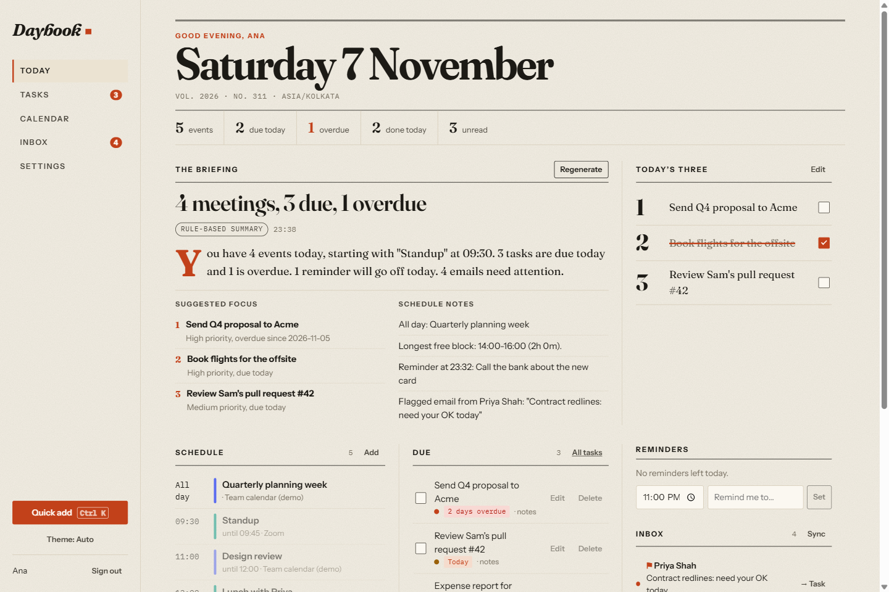
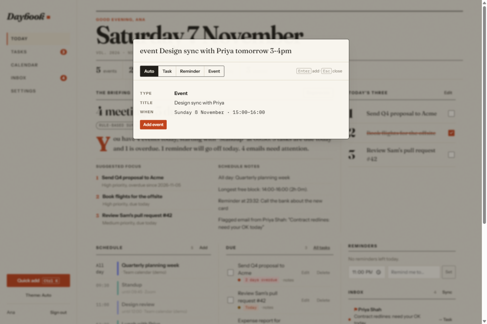
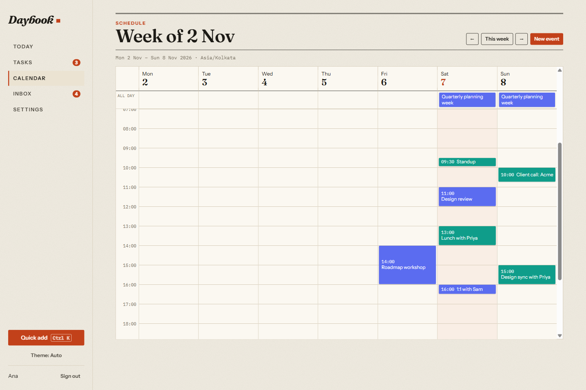
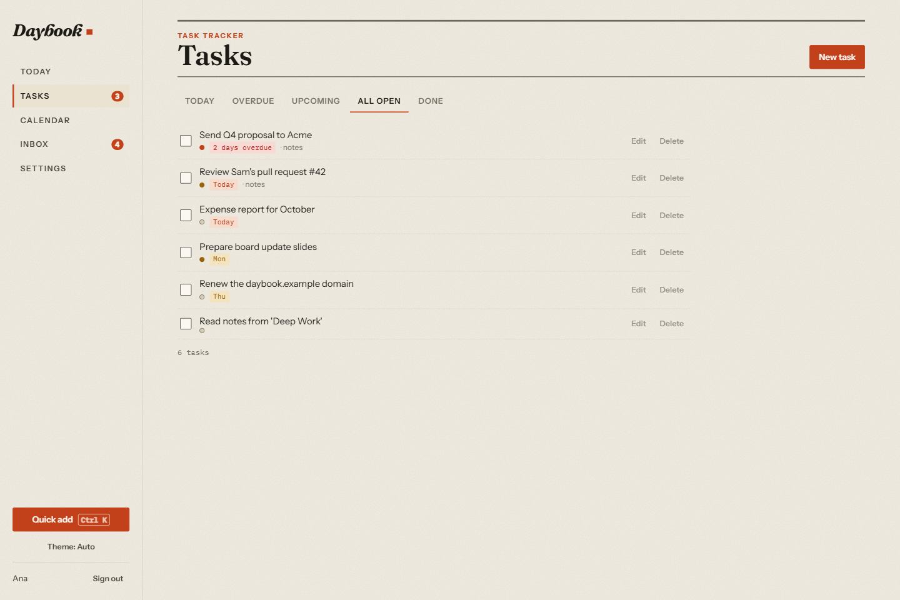
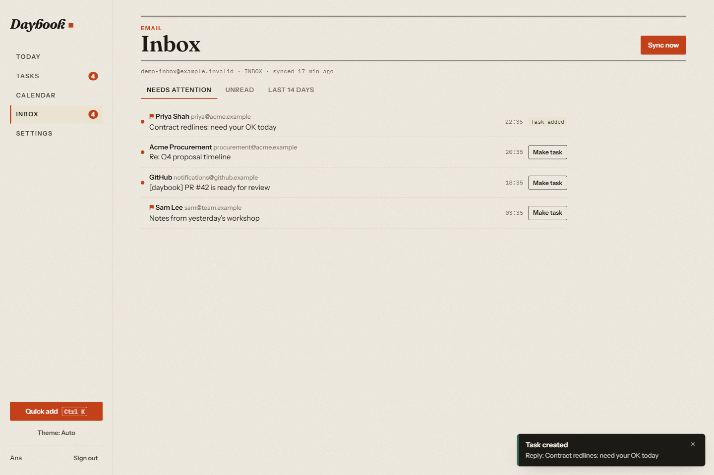
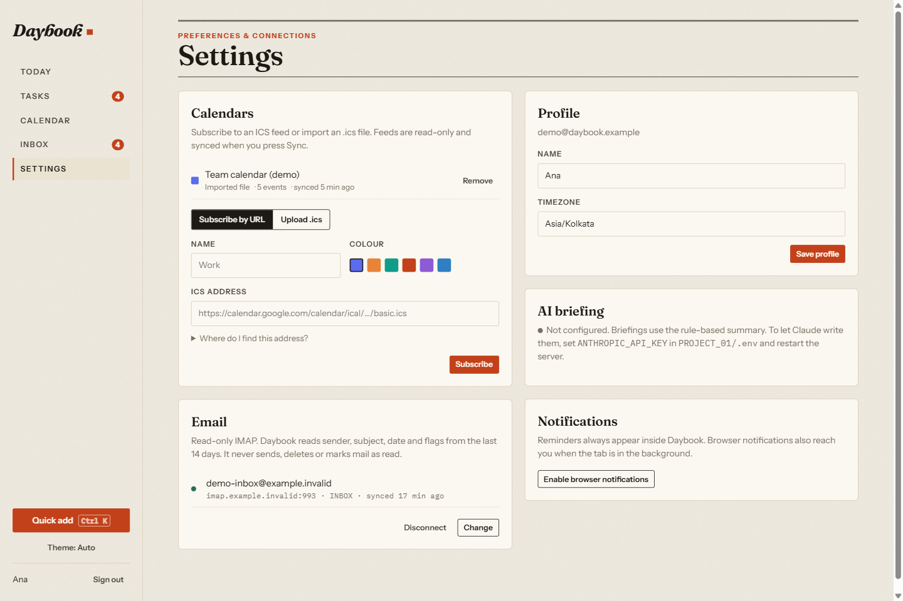
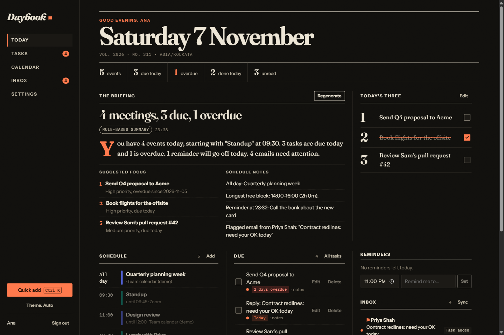
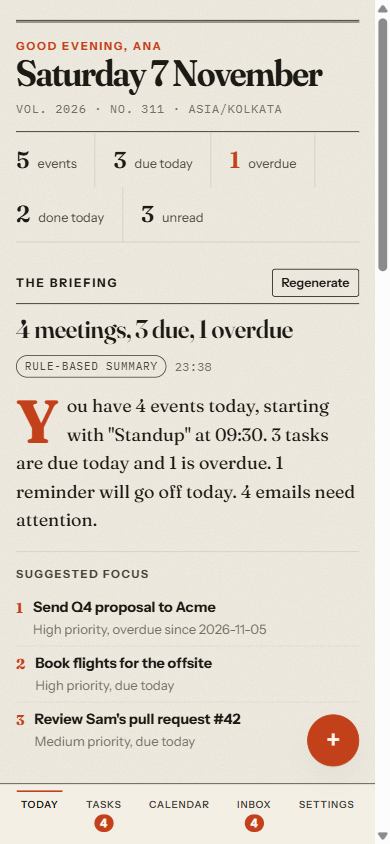
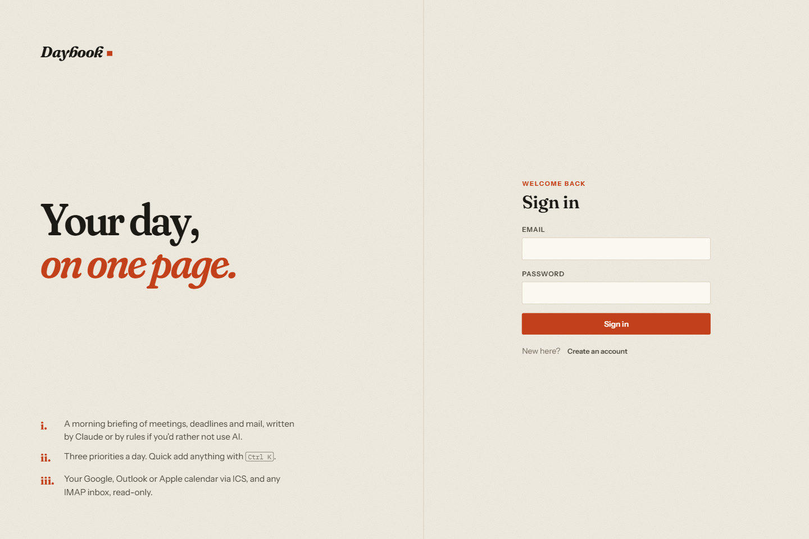

# Project 01: Personal Dashboard ("Daybook")

**Category:** 1. Personal Productivity & Life Management · **Status:** Completed (v1.0)

Daybook puts your calendar, tasks, reminders, email and daily priorities on one page, laid
out like a morning newspaper. A daily briefing (written by Claude when an API key is
configured, otherwise by a clearly labelled rule engine) tells you what matters first.



## 1. Overview

A self-hosted web app with a FastAPI backend and a React frontend. Each user signs in to a
private dashboard that combines:

- **Calendar** events from any ICS feed (Google, Outlook, iCloud) or `.ics` file, plus events
  created in the app
- **Tasks** with priorities and due dates
- **Reminders** that raise in-app and browser notifications
- **Email** that needs attention, read over IMAP (read-only)
- **Three daily priorities**, optionally linked to tasks
- **A daily briefing** that summarises the day and suggests what to focus on

## 2. Problem statement

The answer to "what matters today?" is usually spread across four tools: calendar, to-do list,
reminders and inbox. Switching between them wastes time, and things slip: an overdue task
buried in a list, a flagged email from a client, a meeting that collides with a deadline.
Daybook pulls these into one view and turns them into a short, prioritised plan.
See the full [PRD](docs/PRD.md).

## 3. Features

| Area | What you can do |
|---|---|
| Daily briefing | Generate a headline, summary, schedule notes (overlaps, back-to-back meetings, longest free block), up to 3 suggested priorities and heads-ups. Labelled **Written by Claude · model** or **Rule-based summary** |
| Schedule view | Today's agenda with a live "now" line; a week calendar with overlap layout and click-to-create; read-only events from subscribed calendars |
| Task tracker | Create, edit, complete and delete tasks; Today / Overdue / Upcoming / All / Done views computed in *your* timezone |
| Quick actions | **Ctrl/⌘ + K** command bar with natural-language quick add (`remind me to call mom tomorrow 6pm`, `event Design review thu 2-3pm`, `Send invoice friday !high`) and a live preview; one-click briefing and email sync |
| Reminders | In-app sticky toasts and browser notifications when due; snooze 10 min / 1 h; done |
| Daily priorities | "Today's three": set by hand or adopted from the briefing's suggestions; ticking one off completes its linked task |
| External calendars | Subscribe to an ICS URL (`webcal://` supported) or upload `.ics`; recurring events (RRULE/EXDATE), all-day and timezone-aware events expanded; manual re-sync with error reporting |
| Email | Connect an IMAP mailbox with an app password (verified, then encrypted); sync the last 14 days of headers; unread / flagged list; turn an email into a task |
| Accounts | Register / sign in / sign out; every record is private to its owner |
| UI | Light "morning" and dark "night" editions; responsive down to phones (bottom tab bar); keyboard and screen-reader friendly controls; loading, empty, error and confirmation states |

## 4. Technology stack

| Layer | Technology |
|---|---|
| Backend | Python 3.11+ (tested on 3.13), FastAPI, Pydantic v2, SQLAlchemy 2, Alembic, Uvicorn |
| Database | SQLite (one file in `data/`); migrations with Alembic |
| Integrations | `icalendar` + `recurring-ical-events` (ICS), stdlib `imaplib` (IMAP), `cryptography` Fernet (secrets at rest), `anthropic` SDK (Claude) |
| Frontend | React 19, TypeScript, Vite, TanStack Query, React Router, chrono-node |
| Design | Hand-written CSS design tokens; Fraunces, Instrument Sans and IBM Plex Mono, bundled locally (no font CDN) |
| Tests | pytest + FastAPI TestClient (74 tests), Vitest + Testing Library (30 tests) |

## 5. Architecture

```text
Browser (React SPA) ──/api, cookie session──▶ FastAPI ──SQLAlchemy──▶ SQLite
                                                 ├──▶ ICS feeds (https, 15 s, 5 MB cap)
                                                 ├──▶ IMAP server (TLS, read-only)
                                                 └──▶ Claude API (optional briefing)
```

- In development, Vite (port **5101**) proxies `/api` to Uvicorn (port **8001**). In
  production the backend also serves the built SPA, so the whole app runs as one process.
- All timestamps are stored in UTC. "Today" is computed in the user's IANA timezone.
- Security: scrypt password hashes; HttpOnly SameSite=Lax session cookie storing only its SHA-256
  hash on the server; CSRF header check on every write; login rate limiting; IMAP passwords and private
  ICS URLs encrypted with Fernet; ownership checks return 404 for other users' records.
- The briefing sends Claude only titles, times, sender names and subjects (never email bodies),
  asks for JSON matching a schema (`output_config.format`, effort `low`), validates it with
  Pydantic, drops task ids the model invented, and falls back to the rule engine with a
  visible note on any API error, refusal, truncation or malformed answer. The server-side refusal
  fallback (`fallbacks: "default"`) is enabled.

Details, data model and design decisions: [docs/ARCHITECTURE.md](docs/ARCHITECTURE.md).

## 6. Folder structure

```text
PROJECT_01/
├── .env.example
├── README.md
├── data/                      # SQLite database + generated secret key (git-ignored)
├── docs/
│   ├── PRD.md
│   ├── ARCHITECTURE.md
│   └── screenshots/
├── backend/
│   ├── app/
│   │   ├── main.py            # app factory, CSRF middleware, SPA serving
│   │   ├── config.py · db.py · models.py · schemas.py · security.py · deps.py · timeutil.py
│   │   ├── routers/           # auth, tasks, reminders, events, calendars, email,
│   │   │                      # priorities, dashboard, briefing, meta
│   │   └── services/          # ics.py, imap.py, briefing.py, today.py
│   ├── alembic/               # migrations (0001_initial_schema)
│   ├── scripts/seed_demo.py   # optional demo account
│   ├── tests/                 # pytest suite
│   ├── requirements.txt · requirements-dev.txt · pytest.ini · alembic.ini
└── frontend/
    ├── src/
    │   ├── api/               # fetch client, types, TanStack Query hooks
    │   ├── components/        # Layout, CommandBar, ReminderWatcher, forms, dialogs, toasts
    │   ├── features/          # Today, Tasks, Calendar, Inbox, Settings, Auth pages
    │   ├── lib/               # dates (timezone maths), quickAdd (NL parser)
    │   └── styles/            # tokens.css, app.css
    ├── index.html · package.json · vite.config.ts · tsconfig.json
```

## 7. Installation

Requirements: **Python 3.11+**, **Node.js 20+**.

```bash
cd PROJECT_01/backend
python -m venv .venv
# Windows: .venv\Scripts\activate    macOS/Linux: source .venv/bin/activate
pip install -r requirements-dev.txt

cd ../frontend
npm install
```

## 8. Environment configuration

```bash
cp PROJECT_01/.env.example PROJECT_01/.env   # then edit
```

| Variable | Default | Purpose |
|---|---|---|
| `DATABASE_URL` | `sqlite:///…/PROJECT_01/data/dashboard.db` | Database location |
| `APP_SECRET_KEY` | auto-generated into `data/secret.key` | Encrypts stored IMAP passwords and ICS URLs |
| `COOKIE_SECURE` | `false` | Set `true` behind HTTPS |
| `SESSION_DAYS` | `14` | Session lifetime |
| `ANTHROPIC_API_KEY` | *(empty)* | Enables the Claude-written briefing |
| `ANTHROPIC_MODEL` | `claude-opus-5-5` | Model used for the briefing |
| `LOG_LEVEL` | `INFO` | Server log level |

Every variable is optional for a local run.

## 9. Database setup

Nothing to do by hand: the server applies Alembic migrations on startup and creates
`data/dashboard.db`. To migrate manually:

```bash
cd PROJECT_01/backend
alembic upgrade head
```

Optional demo data (a separate account with sample tasks, events, a generated team calendar and
sample emails, all labelled as demo; credentials are documented at the top of the script):

```bash
cd PROJECT_01/backend
python -m scripts.seed_demo --tz Europe/London
```

## 10. API documentation

Interactive OpenAPI docs: **http://localhost:8001/docs** while the server runs.

| Area | Endpoints |
|---|---|
| Meta | `GET /api/health`, `GET /api/meta` |
| Auth | `POST /api/auth/register`, `POST /api/auth/login`, `POST /api/auth/logout`, `GET/PATCH /api/auth/me` |
| Tasks | `GET /api/tasks?view=today\|overdue\|upcoming\|all\|done`, `POST /api/tasks`, `PATCH/DELETE /api/tasks/{id}` |
| Reminders | `GET /api/reminders`, `GET /api/reminders/due`, `POST /api/reminders`, `PATCH/DELETE /api/reminders/{id}`, `POST /api/reminders/{id}/snooze`, `POST /api/reminders/{id}/dismiss` |
| Events | `GET /api/events?start&end`, `POST /api/events`, `PATCH/DELETE /api/events/{id}` |
| Calendars | `GET/POST /api/calendars`, `POST /api/calendars/upload`, `POST /api/calendars/{id}/sync`, `DELETE /api/calendars/{id}` |
| Email | `GET/PUT/DELETE /api/email/account`, `POST /api/email/sync`, `GET /api/email/messages?filter=`, `POST /api/email/messages/{id}/task` |
| Priorities | `GET /api/priorities?day`, `PUT /api/priorities`, `PATCH /api/priorities/{id}` |
| Dashboard | `GET /api/dashboard/today` |
| Briefing | `GET /api/briefing/today`, `POST /api/briefing` |

Writes require the header `X-Requested-With: dashboard` (CSRF protection). Errors have the shape
`{"detail": "message"}`.

## 11. How to run locally

**Development** (hot reload, two terminals):

```bash
cd PROJECT_01/backend
uvicorn app.main:create_app --factory --reload --port 8001
```

```bash
cd PROJECT_01/frontend
npm run dev          # http://localhost:5101
```

**Production-style** (one process serving API and UI):

```bash
cd PROJECT_01/frontend
npm run build
```

```bash
cd PROJECT_01/backend
uvicorn app.main:create_app --factory --host 127.0.0.1 --port 8001   # http://localhost:8001
```

Then open the app, create an account, and connect a calendar and mailbox under **Settings**.

## 12. Testing

```bash
cd PROJECT_01/backend
pytest               # 74 passed
```

```bash
cd PROJECT_01/frontend
npm test             # 30 passed
npm run typecheck
```

What the tests cover:

- **Backend:** auth (cookie flags, rate limit, CSRF, timing-safe unknown emails), per-user
  isolation on every resource, timezone-aware task views, reminders (due, snooze, dismiss),
  event overlap queries, ICS parsing (RRULE + EXDATE, all-day, TZID, floating times,
  cancelled events, size and status limits), calendar subscribe/upload/sync/delete with
  encrypted URLs, IMAP header parsing and read-only sync against a fake server, email-to-task,
  priorities, the dashboard aggregate, briefing (rule engine, AI request shape with a fake
  client, and fallback on invalid JSON, refusal, truncation or connection error), migrations
  matching the models, and SPA serving with path-traversal protection.
- **Frontend:** the natural-language parser, timezone and date maths (including DST), the API
  client, sign-up/sign-in/sign-out view transitions, the Today page (AI vs rule labels, adopting
  suggestions, completing tasks), the command bar and the reminder watcher.

**Manual end-to-end run (2026-11-07):** the production build was driven in a real browser
(Playwright). Checked: sign-in, briefing generation, adopting suggestions, completing a priority
(which completed its task), Ctrl+K event creation showing up on the week view, email to task, the
sync error path, light/dark/mobile layouts, and subscribing to and re-syncing a **real public
Google Calendar ICS feed** (46 events). Bugs found in that run were fixed and covered by new tests.

## 13. Screenshots

All screenshots are captures of the running app using the seeded **demo** account.

| | |
|---|---|
|  Today: briefing, three priorities, agenda |  Ctrl+K quick add with live preview |
|  Week view (local + subscribed events) |  Task tracker |
|  Inbox: email → task |  Calendars, email, AI and notifications |
|  Night edition (dark mode) |  Mobile layout |
|  Sign in | |

## 14. Known limitations

- **Claude briefing not verified live.** No API key was available when this was built, so the AI
  path has been tested only with a fake client, against the request shape documented for
  `anthropic` 2.6. Set `ANTHROPIC_API_KEY` to use it. Each briefing is one billed API call
  (regeneration is limited to once per 30 s).
- **IMAP not verified against a real mailbox.** It is covered by tests against a fake IMAP server,
  and the connection-error path was checked in the browser. Most providers require an app password.
- **Sync is on demand.** There is no background scheduler; calendars and email refresh when you
  press Sync.
- **Reminders need an open tab.** The page polls every 30 s. There is no push or service worker.
- **Email:** headers only, last 14 days, newest 200 messages. No reply/send.
- **Single process:** rate limits are in memory and reset on restart. SQLite suits personal or
  small-team use.
- **Accounts:** no password reset or email verification yet.
- **Calendar:** subscribed events are read-only. Overlapping events in the week view share the
  day column evenly.

## 15. Future improvements

- Google Calendar / Gmail and Microsoft Graph via OAuth, with two-way calendar sync
- A background sync scheduler and Web Push notifications
- AI-drafted email replies and an end-of-day review (overlaps with Project 03)
- Recurring tasks, sub-tasks and drag-and-drop rescheduling in the week view
- Postgres + Docker Compose for multi-user hosting; Playwright E2E tests in CI
- Password reset, 2FA and account deletion/export
