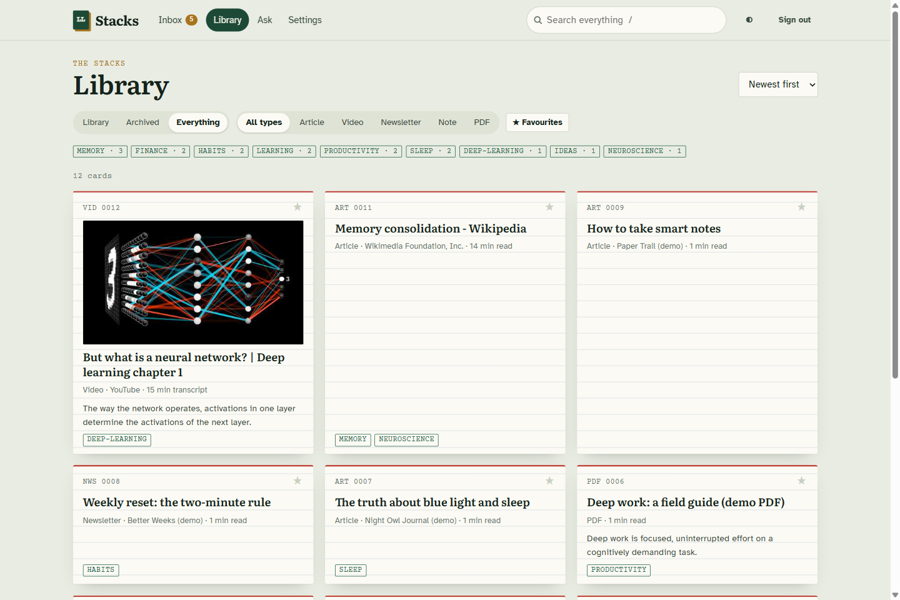
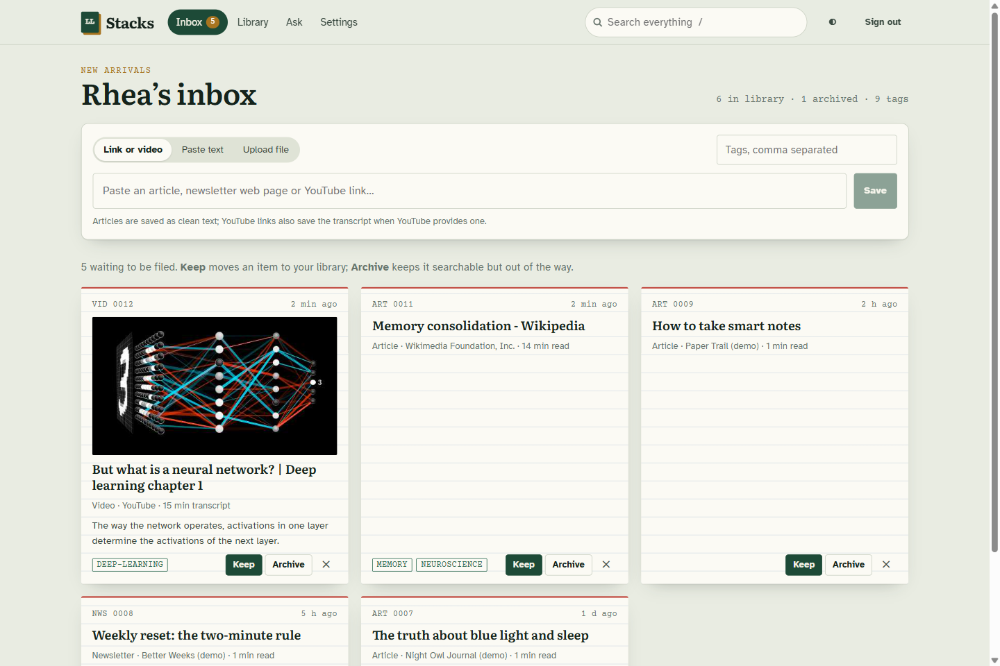
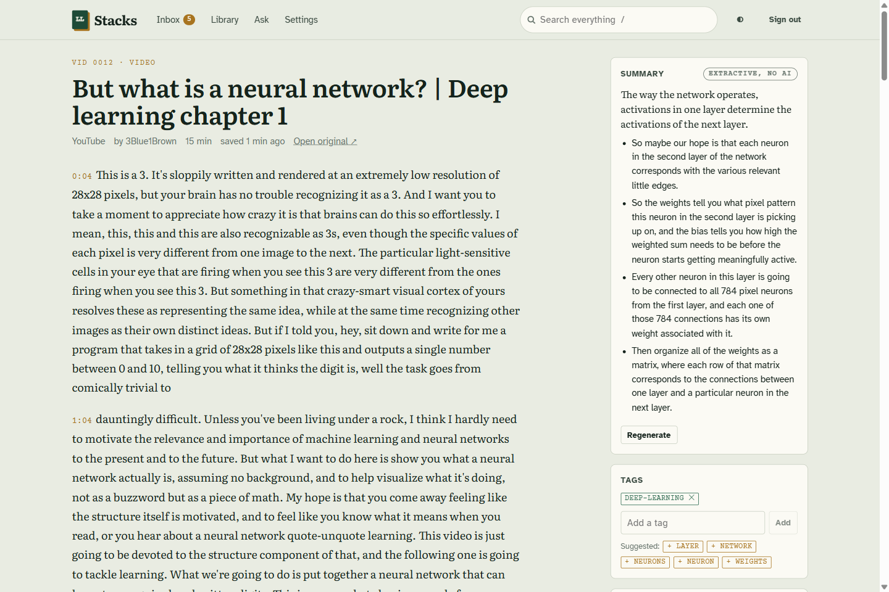
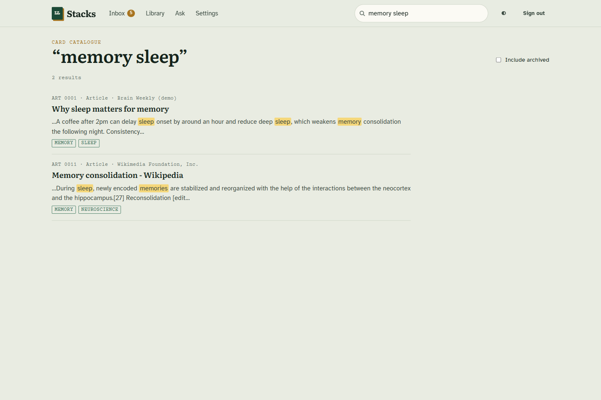
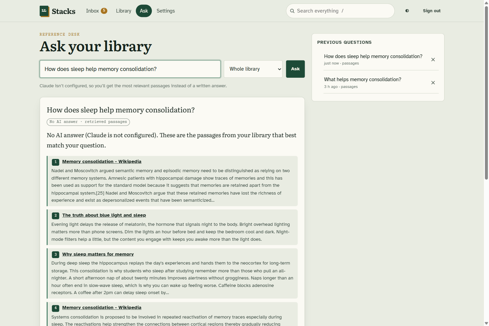
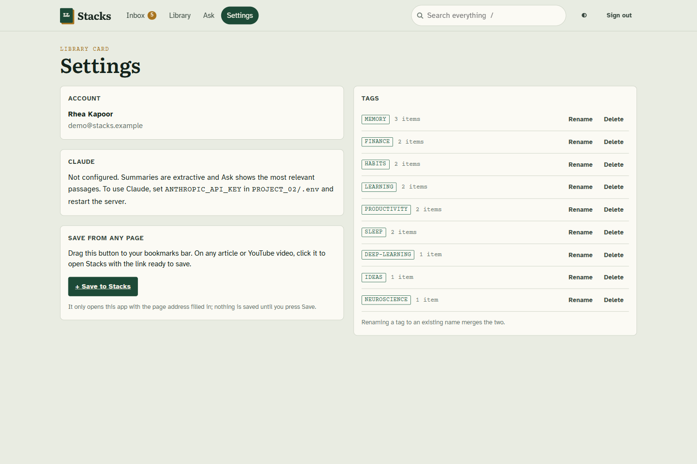
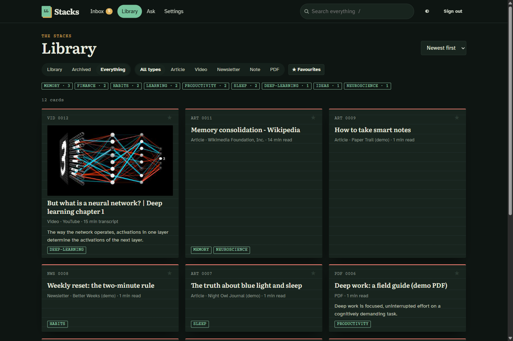
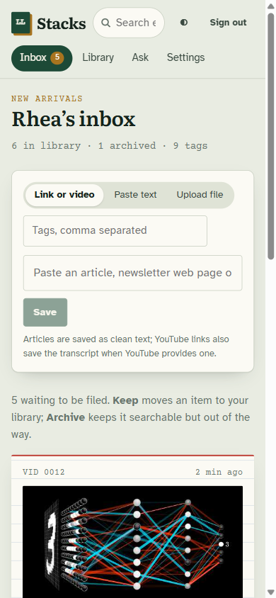
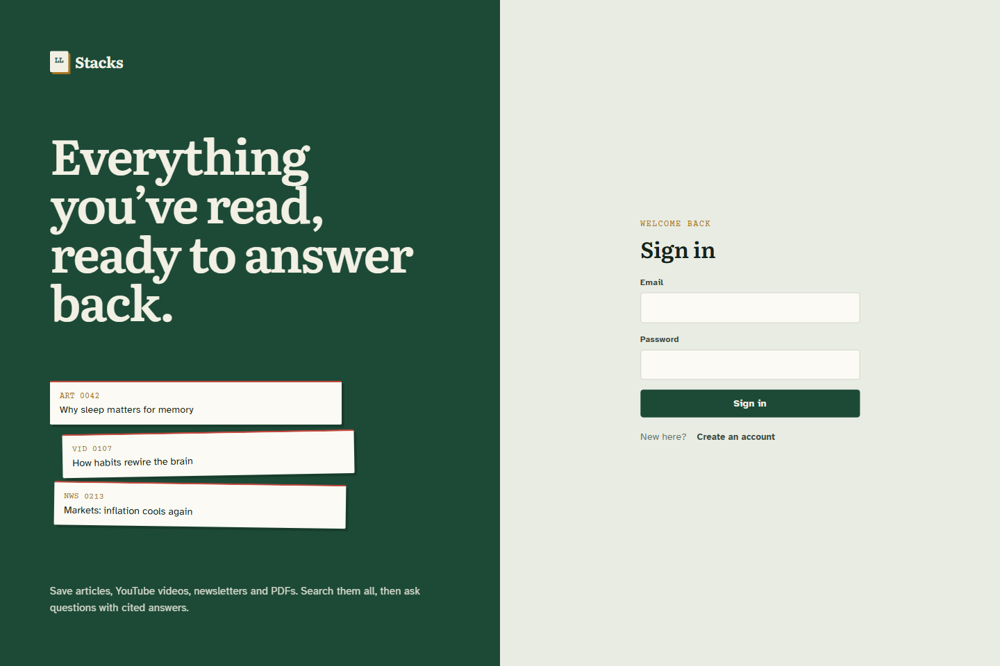

# Project 02: Second Brain / Life Library ("Stacks")

**Author:** Swayam · **Category:** 1. Personal Productivity & Life Management · **Status:** Completed (v1.1)

Stacks is a personal reading library. Save articles, YouTube videos, newsletters, PDFs and
notes; triage them in an inbox; find anything with full-text search; get summaries; and
**ask your library** questions that are answered from your own saved items, with citations.



## 1. Overview

A self-hosted web app: FastAPI + SQLite (FTS5) backend and a React frontend designed like a
library card catalogue. Every saved item becomes an index card with a call number (e.g.
`VID 0012`), tags, an optional summary and full readable text.

## 2. Problem statement

Things worth keeping get scattered across bookmarks, read-later apps, inboxes and note apps.
Months later you remember that you read something useful, but not where, and you can't ask a
question across all of it. Stacks keeps the readable text of everything you save, so it stays
searchable and answerable. See the [PRD](docs/PRD.md).

## 3. Features

| Area | What you can do |
|---|---|
| Capture | Paste a link: the article's readable text, title, site and author are extracted. Paste a YouTube link: title and channel (oEmbed) plus the **transcript** with timestamps when YouTube provides one. Paste text (newsletter / note). Upload `.pdf`, `.eml` (newsletters), `.md`, `.txt`, `.html`. Duplicate links are detected. A **bookmarklet** saves from any page |
| Content inbox | New items land in the inbox: **Keep** (to the library), **Archive** or delete, with undo |
| Tags | Add, remove or suggest tags per item; rename, merge or delete tags globally; filter by tag |
| Library | Index-card grid with Library / Archived / Everything shelves, type filters, favourites and sorting |
| Search | Full-text search over titles, tags and text (BM25 ranking, word-stem matching, prefixes), with highlighted passages; falls back to "any word" when no item has every word |
| Summaries | TL;DR, key points and tag suggestions, written by **Claude** when `ANTHROPIC_API_KEY` is set; otherwise a labelled **extractive** summary |
| Ask Your Library | Retrieves the best passages from your items, then Claude answers **only from them** with numbered citations linking back to the items. Without a key, the passages themselves are shown (labelled). Question history |
| Reader | Clean reading view (video transcripts with timestamps), edit or paste text (for example a transcript), open the original, filing, favourite, delete |
| UI | "Daylight" and "after hours" themes, responsive to phone size, keyboard shortcut `/` for search, loading, empty, error and confirmation states |

## 4. Technology stack

| Layer | Technology |
|---|---|
| Backend | Python 3.11+ (tested on 3.13), FastAPI, Pydantic v2, SQLAlchemy 2, Alembic, Uvicorn |
| Search | SQLite **FTS5** with the Porter stemmer: `items_fts` (title/tags/body) and `chunks_fts` (passages) |
| Capture | `trafilatura` (main-content extraction), `youtube-transcript-api`, YouTube oEmbed, `pypdf`, stdlib `email` |
| AI | `anthropic` SDK, `claude-opus-5-5`, structured JSON output, server-side refusal fallback |
| Frontend | React 19, TypeScript, Vite, TanStack Query, React Router |
| Design | Literata (reading), Atkinson Hyperlegible (UI) and Courier Prime (catalogue labels), bundled locally |
| Tests | pytest (60), Vitest + Testing Library (12) |

## 5. Architecture

```text
Browser (React) ──/api──▶ FastAPI ──▶ SQLite: items, tags, chunks, questions + FTS5 indexes
                              ├──▶ fetcher: SSRF-safe http(s) GET, every redirect re-checked
                              ├──▶ extract: trafilatura / pypdf / email
                              ├──▶ YouTube oEmbed + transcript (best effort)
                              └──▶ Claude (optional): summaries, cited answers
```

- **Capture pipeline:** fetch (public hosts only, 15 s, 8 MB), then extract, then chunk into
  ~1,200-character passages, then write FTS rows. Content is stored and shown as plain text, never as HTML.
- **Ask:** the question becomes an FTS query, BM25 picks the top 8 passages (max 3 per item, optionally
  within one tag), and Claude answers as JSON `{answer, cited_sources, confidence}`. Citations that
  don't match a provided source are removed. Any API error, refusal or malformed answer falls back
  to showing the passages, with a note.
- **Security:** scrypt passwords, HttpOnly SameSite=Lax session cookie, CSRF header on writes, login
  rate limiting, per-user scoping (404 for other users' records), private-network fetch blocking,
  upload type and size limits.
- **Honest identity when fetching:** the app sends
  `LifeLibrary/1.0 (+https://github.com/Swaraj52/top-50-claude-projects; …)` and never pretends to
  be a browser. Sites like Wikipedia require such a contactable identity.

Details: [docs/ARCHITECTURE.md](docs/ARCHITECTURE.md).

## 6. Folder structure

```text
PROJECT_02/
├── .env.example · README.md
├── data/                        # SQLite databases (git-ignored)
├── docs/  PRD.md · ARCHITECTURE.md · screenshots/
├── backend/
│   ├── app/
│   │   ├── main.py · config.py · db.py · models.py · schemas.py · security.py · deps.py
│   │   ├── routers/             # auth, items, tags, search, ask, meta, common
│   │   └── services/            # fetcher, extract, youtube, indexer, text, ai, summarize, ask
│   ├── alembic/                 # 0001: tables + FTS5 virtual tables
│   ├── scripts/                 # seed_demo.py, preview.py
│   └── tests/                   # pytest suite
└── frontend/
    └── src/  api/ · components/ (AddBar, IndexCard, TagEditor, Layout, …) · features/ · lib/ · styles/
```

## 7. Installation

Requirements: **Python 3.11+** and **Node.js 20+**.

```bash
cd PROJECT_02/backend
python -m venv .venv
# Windows: .venv\Scripts\activate    macOS/Linux: source .venv/bin/activate
pip install -r requirements-dev.txt
```

```bash
cd PROJECT_02/frontend
npm install
```

## 8. Environment configuration

Copy `PROJECT_02/.env.example` to `PROJECT_02/.env`. Every value is optional.

| Variable | Default | Purpose |
|---|---|---|
| `DATABASE_URL` | `sqlite:///…/PROJECT_02/data/library.db` | Database location |
| `ANTHROPIC_API_KEY` | *(empty)* | Enables Claude summaries and answers |
| `ANTHROPIC_MODEL` | `claude-opus-5-5` | Model for both features |
| `COOKIE_SECURE` / `SESSION_DAYS` | `false` / `14` | Session cookie settings |
| `FETCH_TIMEOUT` / `FETCH_MAX_BYTES` | `15` / 8 MB | Limits for saving links |
| `ALLOW_PRIVATE_FETCH` | `false` | Allow fetching private network addresses (trusted local setups only) |

## 9. Database setup

Migrations (including the FTS5 indexes) run automatically when the server starts. To run them by hand:

```bash
cd PROJECT_02/backend
alembic upgrade head
```

## 10. API documentation

Interactive docs at **http://localhost:8002/docs** while the server runs.

| Area | Endpoints |
|---|---|
| Auth | `POST /api/auth/register`, `/login`, `/logout`; `GET /api/auth/me` |
| Capture | `POST /api/items/url`, `POST /api/items/text`, `POST /api/items/upload` |
| Items | `GET /api/items?status&kind&tag&favorite&sort`, `GET /api/items/stats`, `GET/PATCH/DELETE /api/items/{id}`, `POST /api/items/{id}/summarize` |
| Tags | `GET /api/tags`, `PATCH /api/tags/{id}` (rename/merge), `DELETE /api/tags/{id}` |
| Search | `GET /api/search?q&include_archived` |
| Ask | `POST /api/ask`, `GET /api/ask/history`, `DELETE /api/ask/{id}` |
| Meta | `GET /api/health`, `GET /api/meta` |

Writes need the header `X-Requested-With: library`. Errors look like `{"detail": "message"}`.

## 11. How to run locally

**Live preview with demo data** (one command; separate `data/demo.db`, real data untouched):

```bash
python PROJECT_02/backend/scripts/preview.py        # http://127.0.0.1:8002
```

Use the backend virtualenv's Python and build the UI once first (`npm run build`). The demo
account is recreated on each start. Its sign-in details are at the top of
`backend/scripts/seed_demo.py`, and all demo items are labelled "(demo)". In the Claude desktop
app the same preview is the `project-02-stacks` entry in `.claude/launch.json`.

**Development** (hot reload):

```bash
cd PROJECT_02/backend
uvicorn app.main:create_app --factory --reload --port 8002
```

```bash
cd PROJECT_02/frontend
npm run dev                                          # http://localhost:5102
```

**Production-style:** `npm run build` in `frontend/`, then run uvicorn without `--reload`. The
backend serves the UI at http://localhost:8002.

## 12. Testing

```bash
cd PROJECT_02/backend
pytest               # 60 passed
```

```bash
cd PROJECT_02/frontend
npm test             # 12 passed
npm run typecheck
```

- **Backend:**
  - SSRF guard: private and loopback hosts, redirect hops, size and type limits
  - Extraction: article, `.eml`, PDF and Markdown fixtures
  - YouTube: URL forms, oEmbed and transcript (faked), formatting with timestamps
  - Library: duplicates, inbox transitions, tags (merge, delete, cleanup), FTS ranking, stemming,
    snippets, operator-safe queries, archived filtering
  - Ask: passages mode, nothing found (no AI call), cited AI answers with invalid citations
    stripped, four failure fallbacks, tag scope, history, rate limits
  - Summaries: AI with validation and tag normalisation, fallback note, extractive
  - Platform: auth, CSRF, per-user isolation, migrations matching the models, SPA serving
- **Frontend:** link validation and saving with tags (tags clear afterwards), bookmarklet prefill,
  inbox triage, safe highlight rendering (no HTML injection), AI vs passage labels, citations,
  asking within a tag, sign-in/out, formatting helpers.

**Manual check (2026-11-09):** the built app was driven in a real browser. It saved a **live Wikipedia
article** (about 3,200 words, 21 passages) and a **live YouTube video with its real transcript** (about 3,400
words, timestamped). I fixed and re-tagged an item, generated an extractive summary, ran highlighted
searches over the real transcript, asked a question that retrieved passages from the real and demo
items, and checked the light, dark and mobile layouts. The run found three issues, now fixed: Wikipedia
rejected the original User-Agent, tags carried over between saves, and cards showed a duplicate label.

## 13. Screenshots

All screenshots are captures of the running app using the demo account plus the two live captures
described above.

| | |
|---|---|
|  Inbox with add bar (link, text, file) |  Library of index cards |
|  Reader: video transcript, summary, tags |  Highlighted full-text search |
|  Ask your library (no key: passages) |  Settings, bookmarklet, tag manager |
|  After-hours (dark) theme |  Mobile |
|  Sign in | |

## 14. Known limitations

- **Claude not verified live.** No API key was available, so summaries and answers were tested only
  against a fake client, using the request shape documented for `anthropic` 2.6. Each Summarize or
  Ask is one billed call. They are rate-limited (6 summaries and 10 questions per minute).
- **Lexical retrieval.** Ask uses BM25 over passages, not embeddings, so it finds passages that share
  words (and stems) with the question, not paraphrases. Rephrasing with the item's own words helps.
- **YouTube transcripts are best effort.** They depend on YouTube allowing the request. Without one,
  the video is saved with its title, and you can paste a transcript into the item.
- **Paywalled and JavaScript-only pages** may yield no text. They are then saved as bookmarks (title + link).
- **Scanned PDFs** (images only) have no extractable text and are rejected with a message.
- **Search is SQLite-specific** (FTS5). The indexer would need porting for Postgres.
- **Single process:** rate limits are in memory; there is no background re-fetching of changed pages.
- **Bookmarklet:** opens the app with the link filled in. Saving still needs a click, and the user
  must be signed in.

## 15. Future improvements

- Hybrid retrieval: embeddings (e.g. Voyage) plus BM25, with re-ranking
- Highlights and annotations inside the reader; spaced-repetition review of key points
- Browser extension / mobile share target and an email-forwarding address for newsletters
- Speech-to-text for videos without transcripts; podcast feeds (overlaps with Project 31)
- Export (Markdown / JSON) and import from Pocket, Instapaper and Readwise
