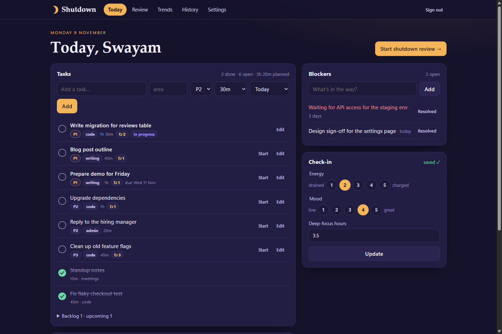
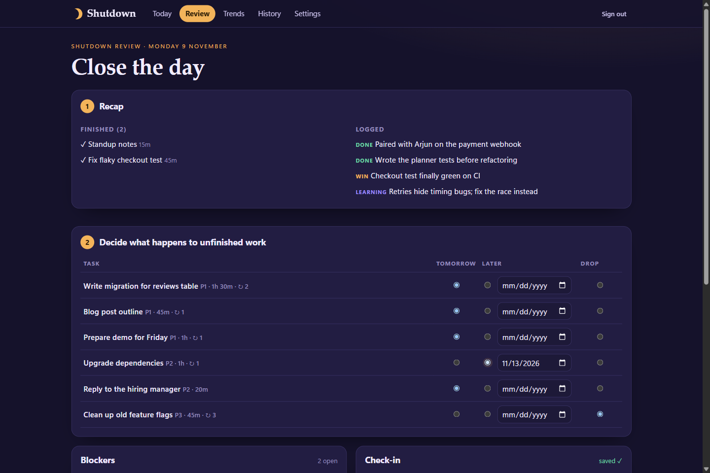
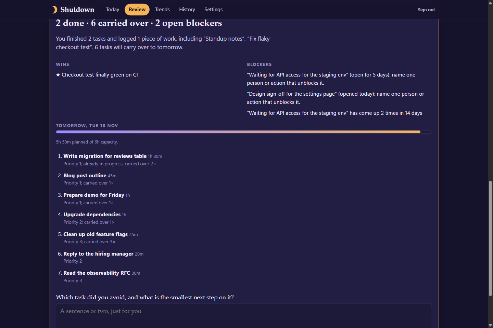
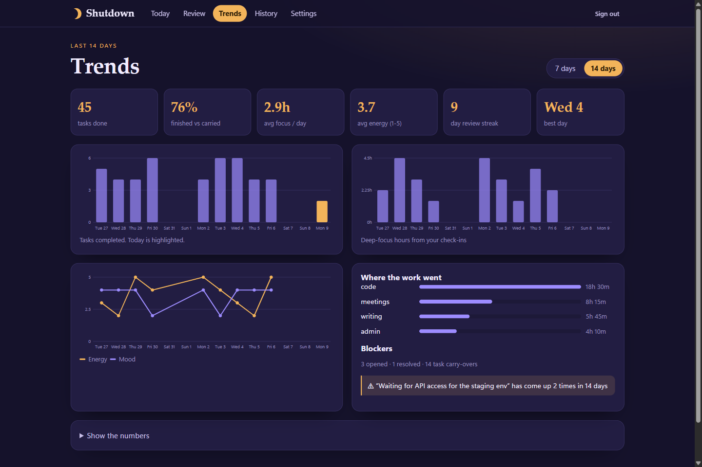
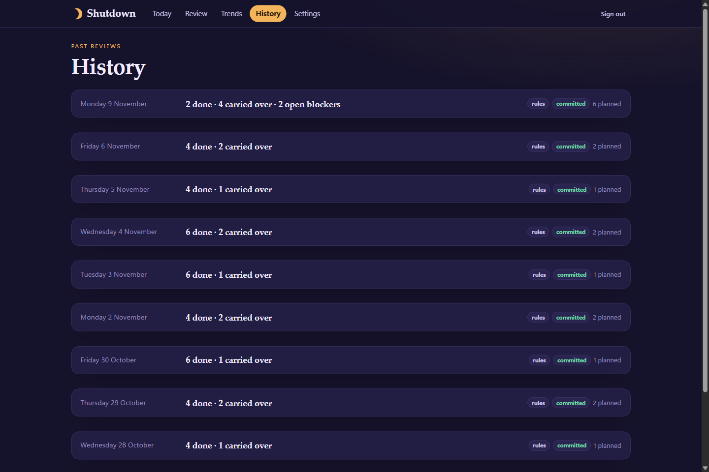
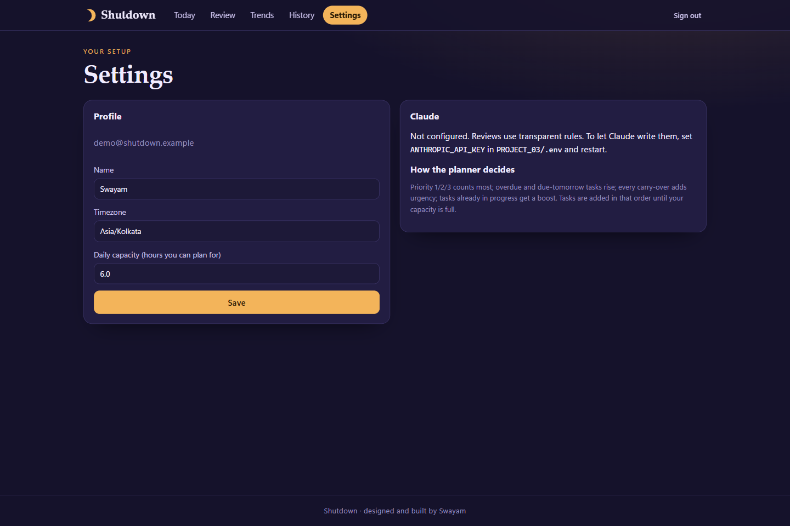
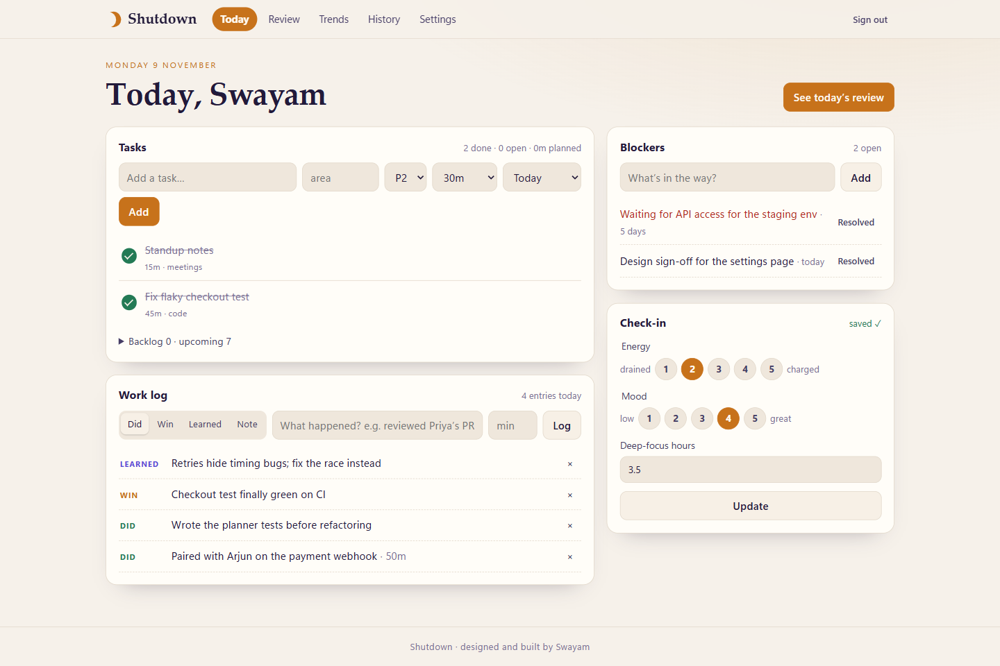
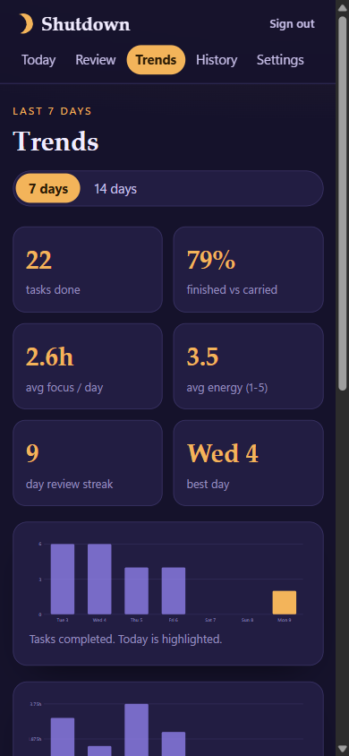
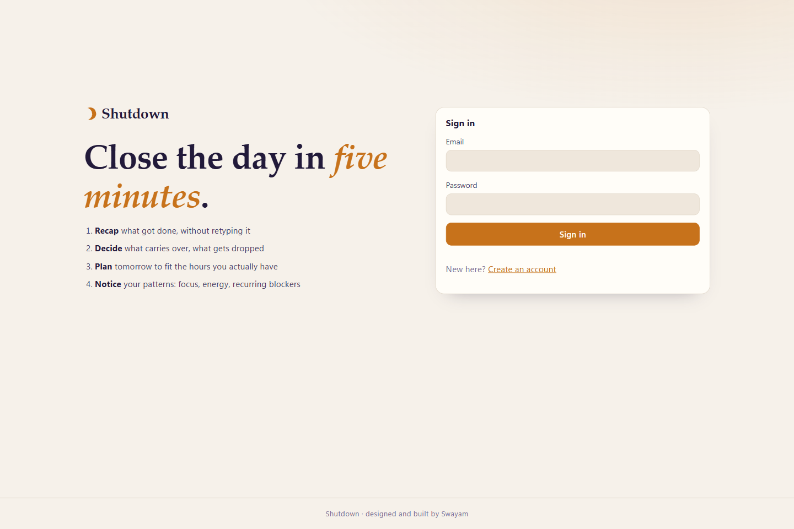

# Project 03: Daily Review Agent ("Shutdown")

**Author:** Swayam · **Category:** 1. Personal Productivity & Life Management · **Status:** Completed (v1.0)

Shutdown is an end-of-day review for your work. During the day you tick off tasks and jot
down what you did; at the end of the day it writes a review of what got done, what's still
open and what's blocking you, then helps you decide what carries over and plans tomorrow to
fit your capacity. Over time it shows trends: completion, carry-overs, focus, energy and your
review streak.



## 1. Overview

A self-hosted, server-rendered web app: FastAPI + Jinja2 templates + SQLite, with
[HTMX](https://htmx.org) for in-place updates. One process serves everything on port 8003.
There's no frontend build step, and every page also works without JavaScript.

The review comes from **Claude** when an API key is configured. Otherwise it comes from
transparent, rule-based logic. Either way, a deterministic planner builds tomorrow's plan, so the
plan is always valid and fits your capacity.

## 2. Problem statement

Most days end abruptly. Unfinished work silently rolls into tomorrow, the same blockers come back
week after week, and nobody notices that "tomorrow" has twelve hours of work planned in it. A short
shutdown ritual fixes that: it closes the day, makes each leftover a decision instead of an
accident, and starts tomorrow with a realistic plan. See the [PRD](docs/PRD.md).

## 3. Features

| Area | What you can do |
|---|---|
| Today | Add tasks (area, priority, estimate, due date); mark them doing, done or dropped; edit and delete. Tasks carried over show how many times they've been carried |
| Work log | Log finished work (with minutes), wins, learnings and notes for the day |
| Blockers | Open blockers, resolve or reopen them, delete them. Ages are shown, and **recurring blockers** (the same wording again, or open more than 3 days) are flagged |
| Check-in | Energy and mood (1–5) and focus hours for the day |
| **Daily recap** | One click writes the review: headline, recap of what actually got done, wins, blockers with a next step, tomorrow's focus with a reason per task, and a reflection question. Written by **Claude** when `ANTHROPIC_API_KEY` is set; otherwise by labelled rules |
| **Triage** | Decide each unfinished task: **carry** to tomorrow, move it **later** (pick a date) or **drop** it |
| **Tomorrow plan** | Scored by priority, due dates, overdue days, carry count and age, then filled greedily up to your daily capacity. Shows load vs capacity and warns when over. **Commit** applies every decision and plans tomorrow. Add a note for tomorrow-you |
| **Weekly trends** | 7- or 14-day view: tasks completed, carry-overs, completion rate, focus hours, energy and mood lines, blockers opened vs resolved, minutes by area, best day, and a review streak that doesn't break on rest days. Charts are inline SVG with text alternatives |
| History | Every past review with its plan and your notes |
| Settings | Display name, timezone (all "days" are local days), daily capacity in hours |
| UI | "Dusk" (dark) and "Dawn" (light) themes, responsive to phone size, keyboard-friendly, toasts for errors, confirmation before deleting |

## 4. Technology stack

| Layer | Technology |
|---|---|
| Backend | Python 3.11+ (tested on 3.13), FastAPI, SQLAlchemy 2, Alembic, Uvicorn, Pydantic Settings |
| UI | Jinja2 templates, HTMX 2.0.11 (vendored, no CDN), hand-written CSS, a small `app.js`; inline SVG charts drawn on the server |
| Database | SQLite (`data/shutdown.db`) |
| AI | `anthropic` SDK, `claude-opus-5-5`, structured JSON output, effort `low`, server-side refusal fallback |
| Tests | pytest + FastAPI TestClient (33 tests) |

## 5. Architecture

```text
Browser ──forms / HTMX──▶ FastAPI (Jinja2)
                            ├── routes: auth, today (tasks, log, blockers, check-in),
                            │           review (generate, commit), insights (trends, history, settings)
                            ├── services: day (snapshot) · planner (deterministic plan)
                            │             reviewer (Claude or rules) · trends + charts (SVG)
                            └── SQLAlchemy ──▶ SQLite        └──▶ Claude API (optional)
```

- **Review pipeline:** snapshot of the day, then the planner scores the candidate tasks and fills
  tomorrow to capacity, then the reviewer writes the narrative. Claude receives the snapshot and the
  candidate list. It may reorder the plan, but only with existing task ids, and the result is checked
  against capacity again. Any API error, refusal or malformed output falls back to the rule-based
  review with a visible note.
- **Commit:** your decisions are applied in one step. Carried tasks get `carry_count + 1` (only once
  per review, even if you generate it again), "later" tasks move to the chosen date, dropped tasks
  are marked dropped, and plan items are planned for tomorrow.
- **Security:** scrypt passwords, HttpOnly SameSite=Lax session cookie (only its SHA-256 is
  stored), a per-session CSRF synchronizer token on every form and HTMX request, login rate limiting,
  per-user scoping (404 for other users' rows), autoescaped templates, and a Content-Security-Policy
  that allows only self-hosted scripts.

Details: [docs/ARCHITECTURE.md](docs/ARCHITECTURE.md).

## 6. Folder structure

```text
PROJECT_03/
├── .env.example · README.md
├── data/                        # SQLite databases (git-ignored)
├── docs/  PRD.md · ARCHITECTURE.md · YOUR_DATA.md · screenshots/
└── backend/
    ├── app/
    │   ├── main.py · config.py · db.py · models.py · security.py · web.py · timeutil.py
    │   ├── routes/              # auth, today, review, insights
    │   ├── services/            # day, planner, reviewer, ai, trends, charts
    │   ├── templates/           # pages + partials/ (HTMX fragments)
    │   └── static/              # app.css, app.js, htmx.min.js, favicon.svg
    ├── alembic/                 # 0001: all tables
    ├── scripts/                 # seed_demo.py, preview.py, import_data.py
    └── tests/                   # pytest suite
```

## 7. Installation

Requirements: **Python 3.11+**. No Node.js needed.

```bash
cd PROJECT_03/backend
python -m venv .venv
# Windows: .venv\Scripts\activate    macOS/Linux: source .venv/bin/activate
pip install -r requirements-dev.txt
```

## 8. Environment configuration

Copy `PROJECT_03/.env.example` to `PROJECT_03/.env`. Every value is optional.

| Variable | Default | Purpose |
|---|---|---|
| `DATABASE_URL` | `sqlite:///…/PROJECT_03/data/shutdown.db` | Database location |
| `ANTHROPIC_API_KEY` | *(empty)* | Enables Claude-written reviews |
| `ANTHROPIC_MODEL` | `claude-opus-5-5` | Model for reviews |
| `COOKIE_SECURE` / `SESSION_DAYS` | `false` / `30` | Session cookie settings |
| `LOG_LEVEL` | `INFO` | Server log level |

## 9. Database setup

Migrations run automatically when the server starts. To run them by hand:

```bash
cd PROJECT_03/backend
alembic upgrade head
```

## 10. API documentation

Shutdown is a server-rendered app, so its interface is HTML pages and form posts rather than a
JSON API (the OpenAPI pages are turned off). Every unsafe request needs the session's CSRF token,
either as the `csrf_token` form field or the `X-CSRF-Token` header.

| Area | Routes |
|---|---|
| Auth | `GET/POST /login`, `GET/POST /register`, `POST /logout` |
| Today | `GET /today`; `POST /tasks`, `/tasks/{id}/status`, `/tasks/{id}/update`, `/tasks/{id}/delete` |
| Log, blockers, check-in | `POST /log`, `/log/{id}/delete`, `/blockers`, `/blockers/{id}/resolve`, `/blockers/{id}/delete`, `/checkin` |
| Review | `GET /review`, `POST /review/generate` (fields `decision_{id}` = carry, later or drop, and `later_{id}` = date), `POST /review/commit` |
| Insights | `GET /trends?span=7\|14`, `GET /history`, `GET /history/{YYYY-MM-DD}`, `GET/POST /settings` |
| Health | `GET /health` returns `{"status": "ok", "version": "…"}` |

HTMX requests (`HX-Request: true`) receive an HTML fragment instead of a redirect. Errors on HTMX
requests come back as an `HX-Trigger: {"app-error": "message"}` header shown as a toast.

## 11. How to run locally

**Live preview with demo data** (one command; separate `data/demo.db`, your real data untouched):

```bash
python PROJECT_03/backend/scripts/preview.py        # http://127.0.0.1:8003
```

Use the backend virtualenv's Python. The demo account ("Swayam") is recreated on each start with
two weeks of history; its sign-in details are at the top of `backend/scripts/seed_demo.py`. In the
Claude desktop app the same preview is the `project-03-shutdown` entry in `.claude/launch.json`.

**Development** (auto reload):

```bash
cd PROJECT_03/backend
uvicorn app.main:create_app --factory --reload --port 8003
```

Open http://localhost:8003, create an account (your browser's timezone is filled in), and start
adding tasks. At the end of the day open **Review**.

**Your own data:** see [docs/YOUR_DATA.md](docs/YOUR_DATA.md). Tasks, blockers and settings can be
imported from a JSON file with `python -m scripts.import_data --email you@example.com mydata.json`.

## 12. Testing

```bash
cd PROJECT_03/backend
pytest               # 33 passed
```

- **Auth and safety:** registration and login validation, rate limiting, CSRF rejection, escaping of
  user content, per-user isolation (404s), security headers.
- **Today:** task lifecycle, validation shown as toasts, HTMX fragments vs plain-form redirects,
  work log, blockers (open, resolve, reopen), check-in upsert.
- **Planner:** scoring (priority, overdue, due tomorrow, carry count, age), capacity fill, the
  oversized-task warning, preferred order.
- **Review:** triage and commit (carry, later with a date, drop), commit without a review rejected,
  regeneration rate limit, Claude via a fake client (plan reordered, invented task ids removed), four
  failure fallbacks (unreadable output, incomplete review, refusal, connection error).
- **Trends:** totals and rates in local days (non-UTC timezone), streaks across rest days, the
  trends/history/settings pages, SVG output with titles.
- **Platform:** Alembic migrations match the models; the data import script.

**Manual check (2026-11-09):** the app was driven in a real browser with the demo account. I
triaged four unfinished tasks (one dropped, one moved later to a picked date, two carried), generated
and committed the review, then checked the database: the dropped task was marked dropped, the
"later" task moved to its date without a carry increment, the carried tasks were planned for
tomorrow with `carry_count + 1`, and the note was saved. I also checked trends, history, settings,
both themes and the phone layout. The run found and fixed five issues: in-progress tasks were listed
last, the review streak broke on weekends, "open for 0 day(s)" wording, the phone navigation
overflowed, and choosing "later" needed JavaScript.

## 13. Screenshots

All screenshots are captures of the running app with the demo account.

| | |
|---|---|
|  Today (Dusk theme) |  Review: triage unfinished tasks |
|  Review: recap and tomorrow plan |  Trends over 14 days |
|  History of reviews |  Settings |
|  Dawn (light) theme |  Mobile |
|  Sign in | |

## 14. Known limitations

- **Claude not verified live.** No API key was available, so Claude reviews were tested only
  against a fake client, using the request shape documented for `anthropic` 2.6. Every review
  shown in the screenshots is the rule-based one. With a key, each generated review is one billed call.
  Generating is limited to once per 20 seconds per user.
- **No automatic task import.** Tasks are entered in the app or loaded from JSON. There's no sync
  with calendars, Todoist, Jira or GitHub yet.
- **Estimates drive the plan.** Tasks without an estimate count as 30 minutes, so a plan is only as
  realistic as its estimates.
- **One review per day.** Generating again replaces that day's review. Tasks already committed to
  tomorrow stay there (they can still be edited on Today).
- **Single process:** rate limits are kept in memory.

## 15. Future improvements

- Pull done work automatically from Daybook (Project 01), GitHub commits and calendar events
- An evening reminder (email or push) and a morning brief from the committed plan
- Learn real durations from history to correct estimates
- Weekly review: a Claude-written summary of the week's trends and repeated blockers
- Export history to Markdown
