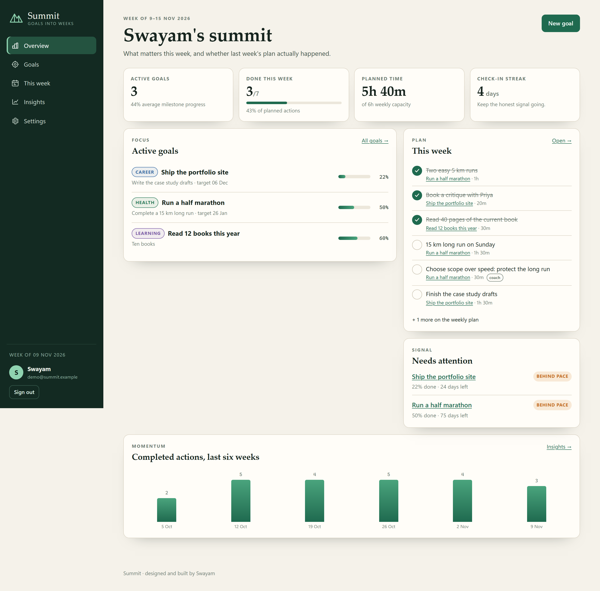
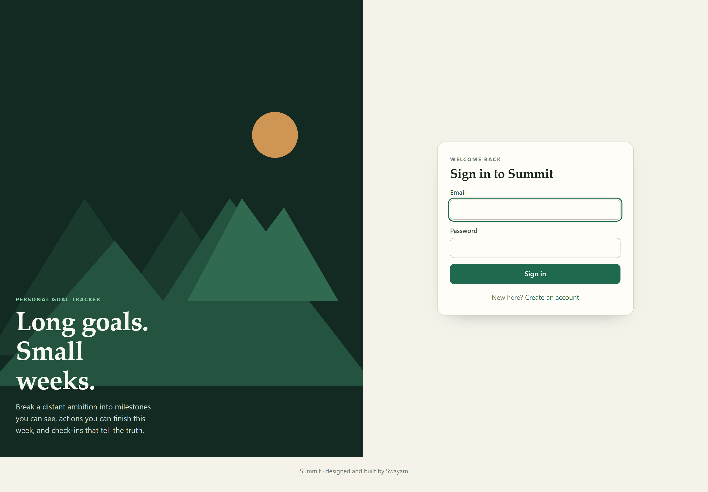
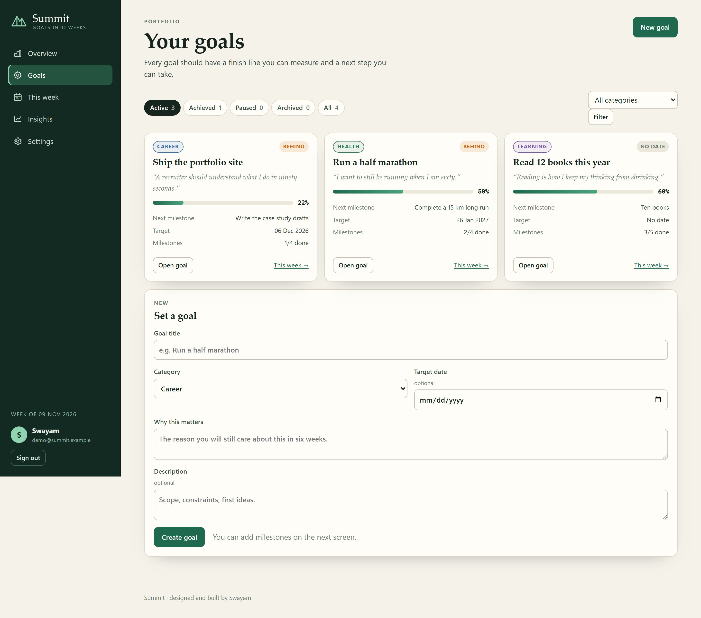
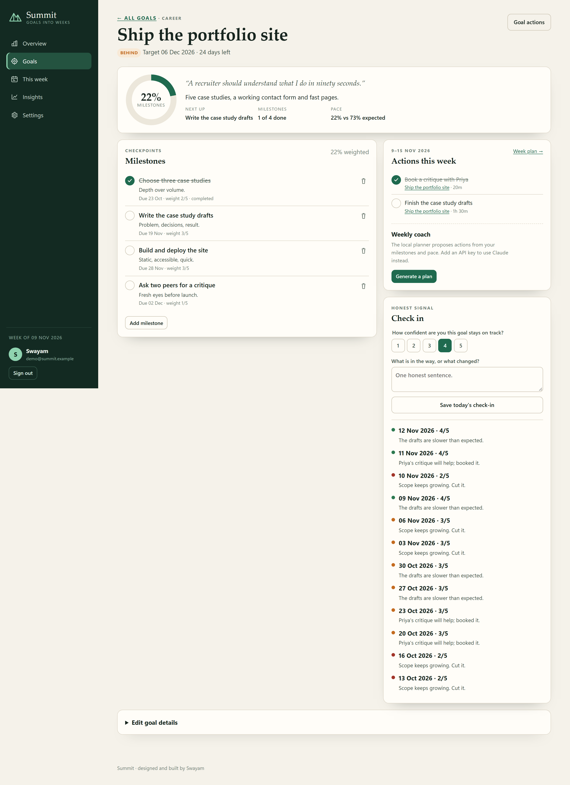
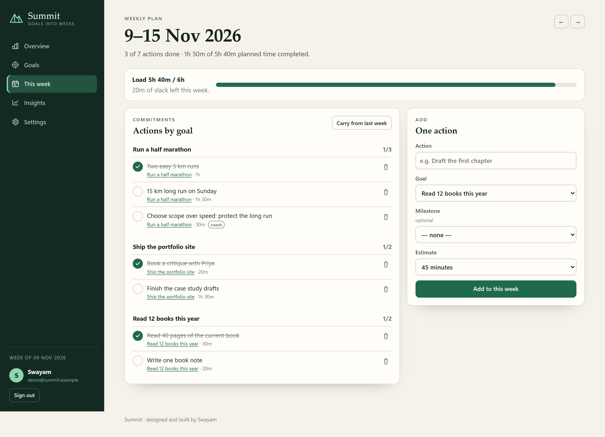
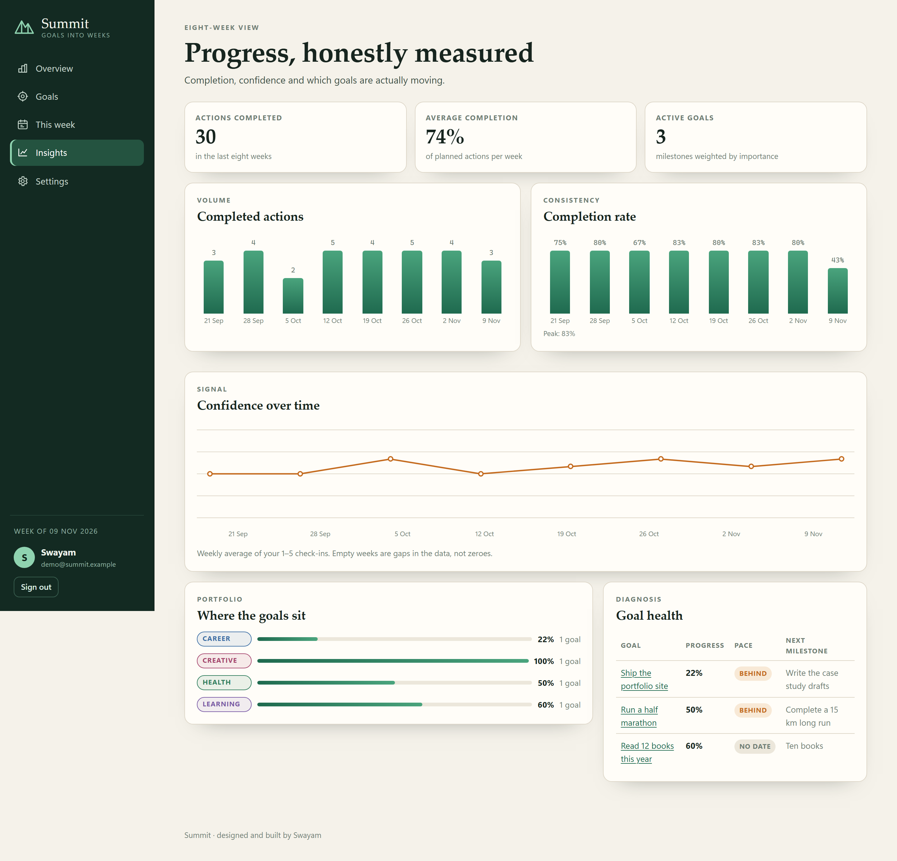
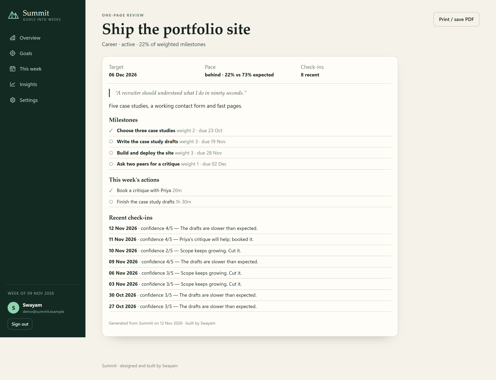
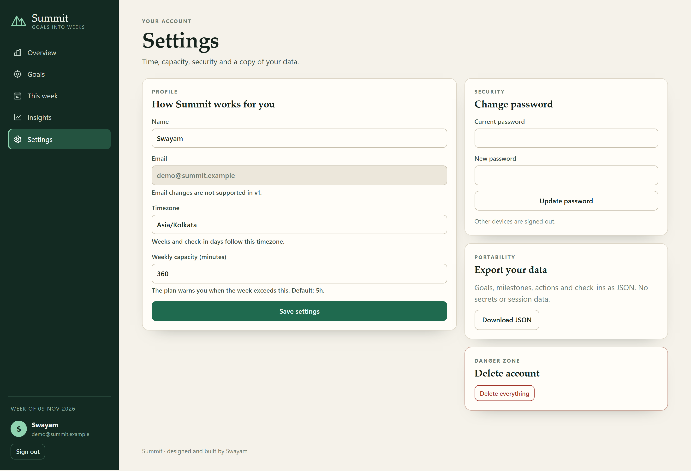
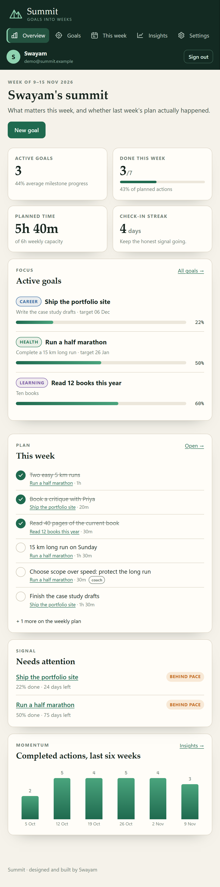
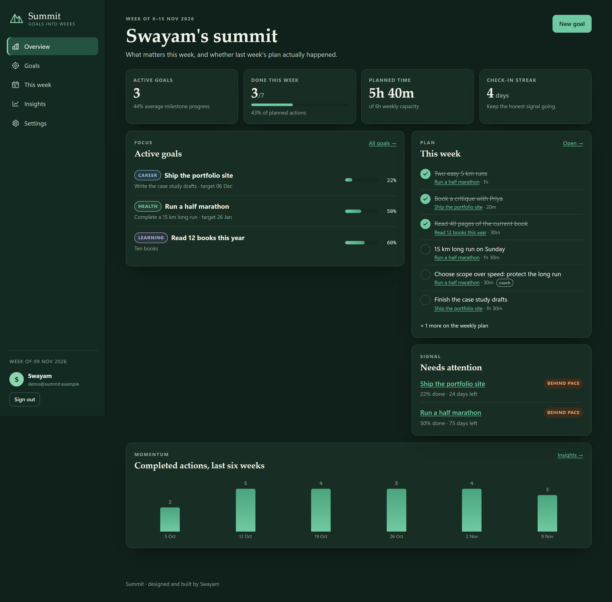

# Project 04: Personal Goal Tracker ("Summit")

**Author:** Swayam · **Category:** 1. Personal Productivity & Life Management · **Status:** Completed (v1.0)

Summit turns a distant ambition into a small number of visible milestones and a plan for this
week. Each goal gets a weighted progress bar, a straight-line pace check, weekly actions you can
actually finish, and a one-tap confidence check-in. The dashboard answers one question honestly:
*what matters this week, and did last week's plan actually happen?*



## 1. Overview

A self-hosted, server-rendered web app: FastAPI + Jinja2 templates + SQLite, with
[HTMX](https://htmx.org) for in-place action toggles. One process serves everything on port 8004.
There is no frontend build step, and every page works without JavaScript.

The weekly coach comes from **Claude** when an API key is configured. Otherwise a deterministic,
clearly labelled local planner writes the plan. Both paths produce the same validated shape, so
the rest of the app cannot tell the difference.

## 2. Problem statement

Long-term goals fail in the gap between the goal and the week. A deadline months away creates no
useful pressure, milestone lists turn into decoration, and a missed week is easy to hide from
yourself. Most trackers record a percentage that nobody trusts. Summit makes the middle layer
explicit: a few weighted milestones, a handful of actions for *this* week, and a confidence signal
that changes when reality changes. See the [PRD](docs/PRD.md).

## 3. Features

| Area | What you can do |
|---|---|
| Dashboard | Active goals with progress, done-this-week count, planned minutes vs weekly capacity, check-in streak, goals that need attention, and a six-week momentum chart |
| Goals | Create, edit, pause, achieve, archive and delete goals; six categories; optional target date and a "why" that survives a bad week |
| **Weighted milestones** | Break a goal into checkpoints with a 1–5 importance weight and optional due date. Progress is the share of *weight* completed, not the share of checkboxes |
| **Pace** | Compare real progress with the straight line from creation to target date. States: ahead, on track, behind, overdue, setup, no date |
| Goal detail | Progress ring, expected-vs-actual pace, next milestone, this week's actions, add/toggle/delete milestones, edit details, and a printable goal review |
| **Weekly plan** | Add actions with a goal, optional milestone and a time estimate; toggle done with HTMX or a plain form; delete; browse previous/next weeks; **carry unfinished actions** from last week without duplicates |
| **Check-ins** | Rate confidence 1–5 and write one honest sentence. One check-in per goal per day (saving again updates it). A streak tracks consecutive days with any check-in |
| **Coach** | Generate 3–5 concrete actions for the current week. Claude when `ANTHROPIC_API_KEY` is set; otherwise the labelled local planner. Every action is filed against a real goal/milestone and rate-limited |
| Insights | Eight weeks of completed actions, completion rate, weekly confidence, category balance and a goal-health table (progress, pace, next milestone) |
| Settings | Display name, IANA timezone, weekly capacity, password change (signs out other devices), full JSON export, account deletion |
| UI | "Paper and pine" light-first design with a dark variant from `prefers-color-scheme`, phone layout, keyboard focus states, toasts for errors, confirmation before destructive actions |

## 4. Technology stack

| Layer | Technology |
|---|---|
| Backend | Python 3.11+ (tested on 3.13), FastAPI, SQLAlchemy 2, Alembic, Uvicorn, Pydantic Settings |
| UI | Jinja2 templates, HTMX 2.0.11 (vendored, no CDN), hand-written CSS and a small `app.js`; server-rendered HTML/CSS bars and an SVG confidence line |
| Database | SQLite (`data/summit.db`) |
| AI | Direct `httpx` call to the Anthropic Messages API, `claude-opus-5-5` by default, JSON output validated against this goal's milestone ids |
| Tests | pytest + FastAPI TestClient (41 tests) |

## 5. Architecture

```text
Browser ──forms / HTMX──▶ FastAPI (Jinja2)
                            ├── routes: auth, goals (dashboard, goals, milestones,
                            │           check-ins, coach), weekly (plan, carry),
                            │           insights (charts, review), settings
                            ├── services: goalmath (weighted progress, pace, series)
                            │             coach (deterministic plan) · ai (Claude or fallback)
                            │             charts (HTML bars + SVG line)
                            └── SQLAlchemy ──▶ SQLite        └──▶ Claude API (optional)
```

- **Weighted progress:** each milestone has weight 1–5. Progress is `done weight / total weight`,
  so a heavy checkpoint counts more than a footnote. A goal with no milestones is explicitly
  "setup", not 0% done.
- **Pace:** expected progress interpolates from the goal's creation date to its target date. The
  delta between actual and expected drives the ahead / on-track / behind / overdue labels and the
  "needs attention" list.
- **Coach pipeline:** the local planner always runs first. With a key, Claude receives the goal,
  milestones, recent check-ins and computed progress/pace, and may only reference milestone ids
  that exist. Every field is length-checked and clamped; malformed output, refusal or a network
  error falls back to the local plan with a visible note.
- **Weekly actions are the only editable plan.** Completing an action is independent of milestone
  completion: you decide when a checkpoint is genuinely done.
- **Security:** scrypt passwords, HttpOnly SameSite=Lax session cookie (only its SHA-256 is
  stored), a per-session CSRF token on every unsafe request, login and coach rate limiting,
  per-user scoping (404 for other users' rows), autoescaped templates, and a Content-Security-Policy
  that allows only self-hosted scripts.

Details: [docs/ARCHITECTURE.md](docs/ARCHITECTURE.md).

## 6. Folder structure

```text
PROJECT_04/
├── .env.example · README.md
├── data/                        # SQLite databases (git-ignored)
├── docs/  PRD.md · ARCHITECTURE.md · YOUR_DATA.md · screenshots/
└── backend/
    ├── app/
    │   ├── main.py · config.py · db.py · models.py · security.py · web.py · timeutil.py
    │   ├── routes/              # auth, goals, weekly, insights, settings
    │   ├── services/            # goalmath, coach, ai, charts
    │   ├── templates/           # pages + partials/action_row.html
    │   └── static/              # app.css, app.js, htmx.min.js, favicon.svg
    ├── alembic/                 # 0001: all tables
    ├── scripts/                 # seed_demo.py, preview.py, import_data.py
    └── tests/                   # pytest suite
```

## 7. Installation

Requirements: **Python 3.11+**. No Node.js needed.

```bash
cd PROJECT_04/backend
python -m venv .venv
# Windows: .venv\Scripts\activate    macOS/Linux: source .venv/bin/activate
pip install -r requirements-dev.txt
```

## 8. Environment configuration

Copy `PROJECT_04/.env.example` to `PROJECT_04/.env`. Every value is optional.

| Variable | Default | Purpose |
|---|---|---|
| `DATABASE_URL` | `sqlite:///…/PROJECT_04/data/summit.db` | Database location |
| `ANTHROPIC_API_KEY` | *(empty)* | Enables Claude-written weekly plans |
| `ANTHROPIC_MODEL` | `claude-opus-5-5` | Model for the coach |
| `AI_TIMEOUT_SECONDS` | `30` | Coach request timeout |
| `COOKIE_SECURE` / `SESSION_DAYS` | `false` / `30` | Session cookie settings |
| `RUN_MIGRATIONS` | `true` | Apply Alembic migrations at startup |
| `LOG_LEVEL` | `INFO` | Server log level |

## 9. Database setup

Migrations run automatically when the server starts. To run them by hand:

```bash
cd PROJECT_04/backend
alembic upgrade head
```

The initial migration creates `users`, `sessions`, `goals`, `milestones`, `weekly_actions` and
`checkins`, with check constraints for categories, statuses, weights, estimates and confidence.

## 10. API documentation

Summit is a server-rendered app, so its interface is HTML pages and form posts rather than a JSON
API (the OpenAPI pages are turned off). Every unsafe request needs the session's CSRF token,
either as the `csrf_token` form field or the `X-CSRF-Token` header.

| Area | Routes |
|---|---|
| Auth | `GET/POST /login`, `GET/POST /register`, `POST /logout` |
| Dashboard | `GET /` |
| Goals | `GET /goals?status=active\|achieved\|paused\|archived\|all&category=…`, `POST /goals`, `GET /goals/{id}`, `POST /goals/{id}/update`, `POST /goals/{id}/status`, `POST /goals/{id}/delete` |
| Milestones | `POST /goals/{id}/milestones`, `POST /milestones/{id}/toggle`, `POST /milestones/{id}/delete` |
| Check-ins | `POST /goals/{id}/checkins` with `confidence=1..5` and `note` (upserts today) |
| Coach | `POST /goals/{id}/coach` |
| Weekly plan | `GET /weekly?week=YYYY-MM-DD`, `POST /weekly/actions`, `POST /weekly/actions/{id}/toggle`, `POST /weekly/actions/{id}/delete`, `POST /weekly/carry` |
| Insights | `GET /insights`, `GET /goals/{id}/review` |
| Settings | `GET/POST /settings`, `POST /settings/password`, `GET /settings/export`, `POST /settings/delete` |
| Health | `GET /health` returns `{"status": "ok", "version": "…"}` |

HTMX requests (`HX-Request: true`) receive an HTML fragment for action toggles instead of a
redirect. Errors on HTMX requests come back as an `HX-Trigger: {"app-error": "message"}` header
shown as a toast.

## 11. How to run locally

**Live preview with demo data** (one command; separate `data/demo.db`, your real data untouched):

```bash
python PROJECT_04/backend/scripts/preview.py        # http://127.0.0.1:8004
```

Use the backend virtualenv's Python. The demo account ("Swayam") is recreated on each start with
eight weeks of actions and check-ins; its sign-in details are at the top of
`backend/scripts/seed_demo.py`. In the Claude desktop app the same preview is the
`project-04-summit` entry in `.claude/launch.json`.

**Development** (auto reload):

```bash
cd PROJECT_04/backend
uvicorn app.main:create_app --factory --reload --port 8004
```

Open http://localhost:8004, create an account (your browser's timezone is filled in), add one goal,
then break it into three weighted milestones. Open **This week**, add two actions, and use the
coach if you want a starting plan.

**Your own data:** see [docs/YOUR_DATA.md](docs/YOUR_DATA.md). A Summit JSON export can be imported
with `python -m scripts.import_data --email you@example.com mydata.json` (`--dry-run` supported).

## 12. Testing

```bash
cd PROJECT_04/backend
pytest               # 41 passed
```

- **Auth and safety:** registration and login validation, duplicate email, rate limiting, CSRF
  rejection, escaping of user content, per-user isolation (404s), security headers.
- **Goals:** create/edit/delete, validation, cascade deletes, weighted milestone progress,
  milestone deletion, status filters, check-in upsert for the same day, JSON export.
- **Pace and planning:** pace maths (ahead, on track, behind, overdue, setup), `days_left`,
  next-milestone ordering, weekly stats and capacity.
- **Weekly plan:** create/toggle/delete actions, goal and milestone ownership, HTMX fragment vs
  plain redirect, previous/next week navigation, carry-over without duplicates.
- **Coach:** local planner produces 3–5 actions, rate limit, AI fallback is labelled, API output
  validation rejects invented milestone ids and too-short plans, insights and review pages render.
- **Platform:** Alembic migrations match the models; health endpoint; settings profile and
  password change; account deletion; the importer accepts a real Summit export shape (top-level
  actions and check-ins) and nested hand-written JSON.

**Manual check (2026-11-12):** the app was driven in a real browser with the demo account at phone
and desktop sizes, in light and dark colour schemes. I opened the dashboard, goals, a goal detail,
the weekly plan, insights, the printable review and settings; captured every screenshot from that
run. The check found and fixed three real UI issues: the CSS `.bar` class used by the dashboard
collided with the SVG bar class and made insight bars overlap, stretched SVG text distorted the
confidence chart, and the sidebar sign-out button was dark text on a dark panel. The demo seed also
gained eight weeks of check-ins so the confidence chart shows a real trend instead of one point.

## 13. Screenshots

All screenshots are captures of the running app with the demo account.

| | |
|---|---|
|  Sign in |  Dashboard |
|  Goals and filters |  Goal detail, milestones, coach and check-ins |
|  Weekly plan |  Eight-week insights |
|  Printable goal review |  Settings |
|  Mobile dashboard |  Dark colour scheme |

## 14. Known limitations

- **Claude not verified live.** No API key was available, so the Claude path was tested only with
  a fake HTTP response using the documented Messages API shape. Every plan in the screenshots comes
  from the local planner and says so. With a key, each generated plan is one billed call, limited to
  six per user per ten minutes.
- **Weekly actions are not calendar events.** There is no reminder, notification or calendar sync.
- **Pace is a straight line.** It does not model seasonal load, holidays or deliberately front-loaded
  work; that is why the check-in and coach exist alongside it.
- **Milestones are manual.** Marking a checkpoint done does not auto-complete related actions (or
  vice versa).
- **One check-in per goal per day.** A later check-in replaces that day's rating and note.
- **Single process:** rate limits are kept in memory, so they reset when the server restarts.
- **No team sharing.** Every goal belongs to exactly one account.

## 15. Future improvements

- Calendar integration: place weekly actions in real free slots and read back completion
- Optional weekly review email generated from insights and check-ins
- Sub-goals / dependencies between milestones
- Recurring actions (e.g. "long run every Sunday") with streak tracking
- Import from Notion, Todoist or a Markdown goal file
- A shareable, read-only progress page for accountability partners
- Learn realistic action estimates from completed history
