# Project 05: Habit & Routine Coach ("Cadence")

**Author:** Swayam · **Category:** 1. Personal Productivity & Life Management · **Status:** Completed (v1.0)

Cadence tracks the routines you actually have, not an aspirational list you abandon in February.
It shows today's schedule, protects streaks, turns the week into an honest grid, and asks four
reflection questions on Sunday. When a habit keeps slipping, a coach reads your own logs and
suggests a smaller version of it.

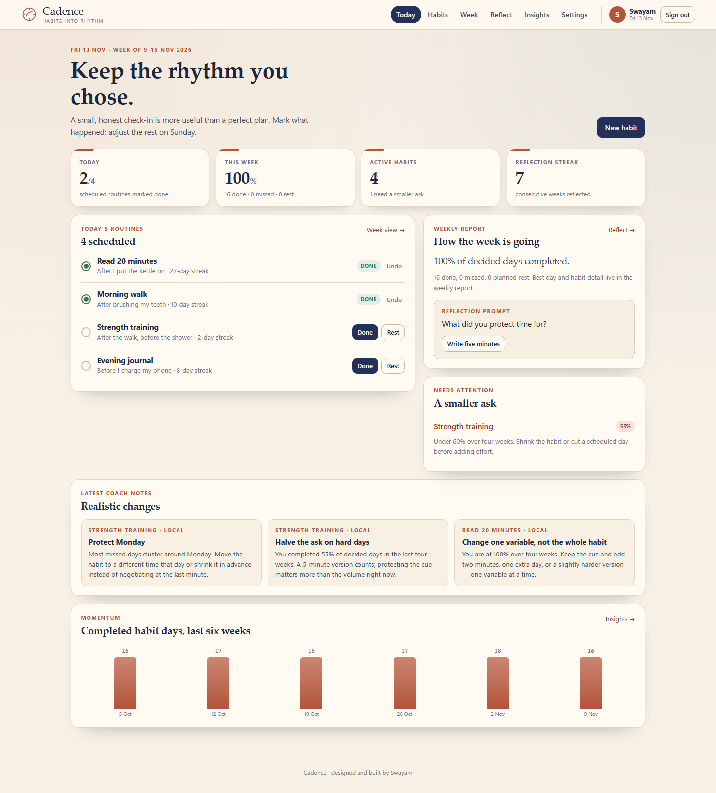

## 1. Overview

A self-hosted, server-rendered web app: FastAPI + Jinja2 + SQLite, with
[HTMX](https://htmx.org) for in-place routine toggles. One process serves everything on port 8005.
There is no frontend build step, and every core action works without JavaScript.

The coach is produced by **Claude** when an API key is configured. Without a key, a deterministic
local coach writes suggestions from the same computed statistics, and the UI labels every note
`LOCAL` so a rule-based suggestion is never mistaken for a model response.

## 2. Problem statement

Habit apps usually optimise for the first week: a beautiful streak, a long list, a daily push
notification. Real life interrupts. A missed Tuesday becomes a hidden week, the streak resets to
zero, and the app that was supposed to help starts producing guilt instead of information.

Cadence is built around three repairs:

1. **Planned rest is not failure.** A skipped day is a decision, not a miss. Rates exclude it.
2. **Today is still open.** An unchecked habit this morning is `pending`, never "missed".
3. **A paused habit should not drag down the numbers.** Paused and archived routines disappear
   from Week, Reflect and Insights until you resume them.

The weekly reflection then closes the loop: what worked, what got in the way, and one change for
next week. See the [PRD](docs/PRD.md).

## 3. Features

| Area | What you can do |
|---|---|
| Dashboard | Today's scheduled routines with one-tap done/undo and rest, done-today and weekly completion, active habit count, reflection streak, weekly report, habits that need attention, recent coach notes, and six weeks of completed habit days |
| Habits | Create a habit with title, intention, cue and scheduled weekdays; filter active / paused / archived; pause, resume, archive or delete; edit without losing history |
| Habit detail | Current and best streak, last-7-day and last-4-week rates, month calendar with done / missed / open today / rest / off states, log or undo today, recent log history with removal, coach, printable view |
| **Week grid** | Every active habit × every day of the week. Click a scheduled day to mark it done, click again to undo. Planned rest is marked separately. Future days cannot be logged. Previous/next week navigation |
| **Honest stats** | Completion counts decided days only: `done / (done + missed)`. Today is pending until logged. Paused and archived habits are excluded from week and insight reports |
| **Reflect** | One reflection per week: mood 1–5 plus *what worked*, *what got in the way* and *one change*. Saving the same week updates it instead of duplicating. Seven-week reflection streak |
| **Insights** | Eight-week completion volume, completion by weekday, per-habit done/rate/streak/read, strongest and weakest day, "honest read" paragraph and a next step that links back to the week grid |
| **Coach** | 2–3 concrete suggestions for the next two weeks. Claude when `ANTHROPIC_API_KEY` is set (validated JSON, 2–4 items); otherwise the clearly labelled local coach. Rate-limited to six runs per ten minutes |
| Settings | Display name, IANA timezone, password change (signs out other devices), full JSON export, account deletion with password and typed confirmation |
| Auth | Register, sign in, sign out; hashed passwords; server-side sessions in an `HttpOnly`, `SameSite=Lax` cookie; CSRF token on every state-changing form |
| UI | Warm cream / navy / terracotta design with a full dark variant from `prefers-color-scheme`, phone and tablet layouts, keyboard focus states, toasts, empty states, and confirmation before destructive actions |

### What the screens look like

| | |
|---|---|
| 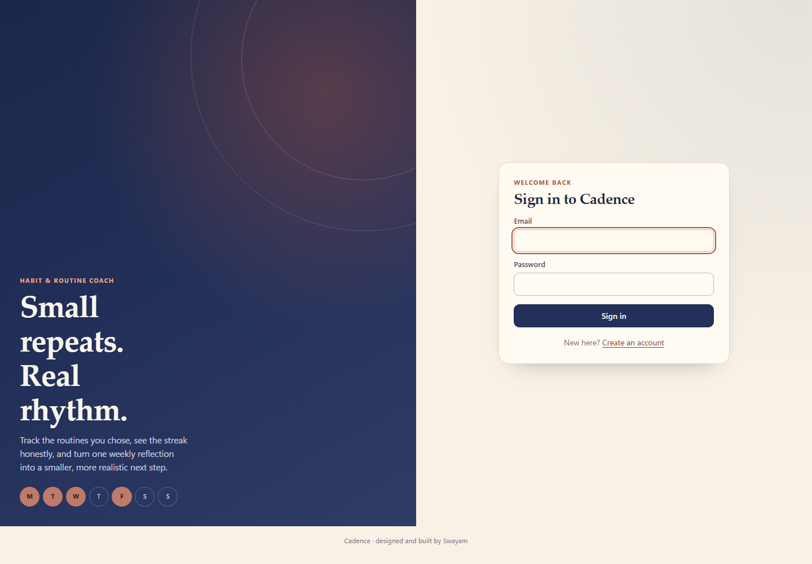 | 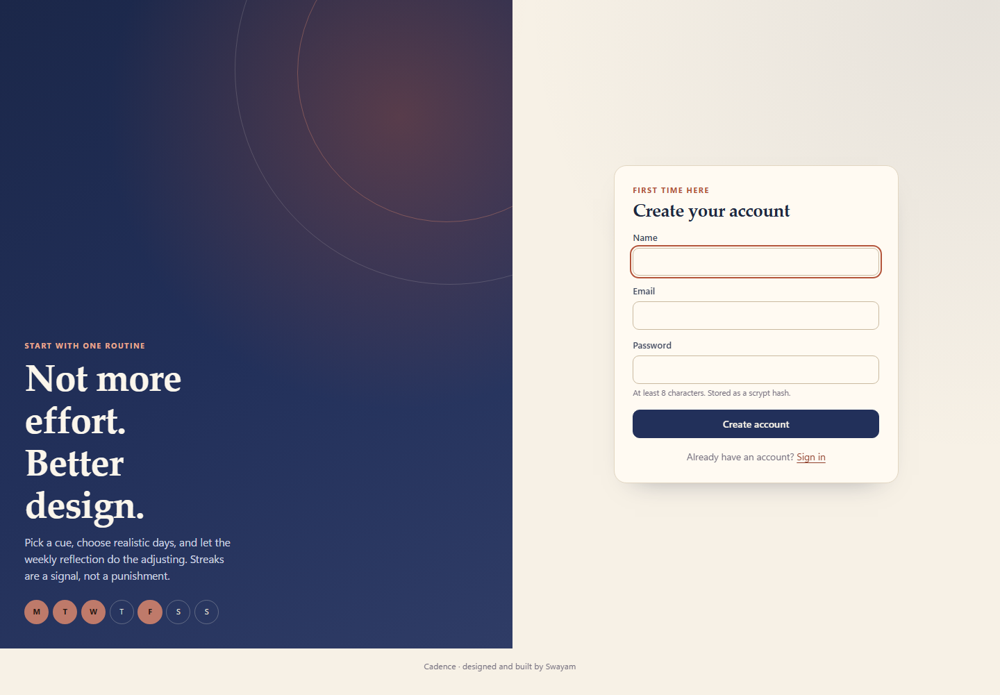 |
| 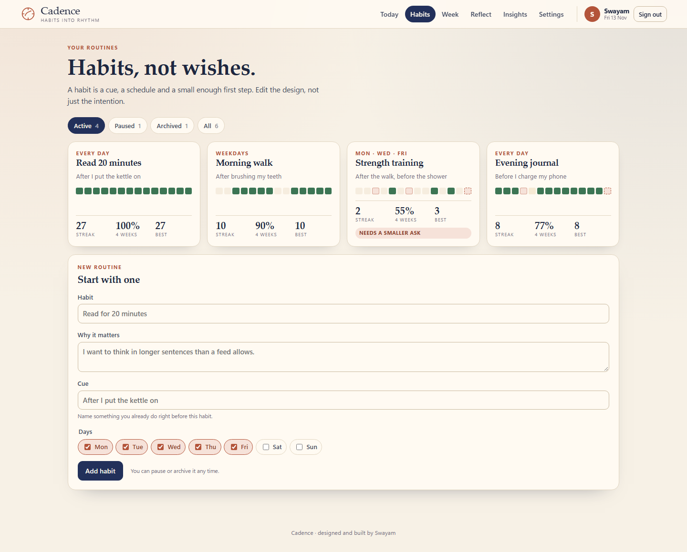 | 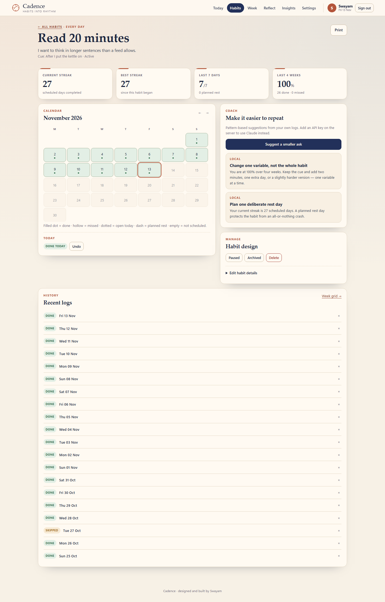 |
| 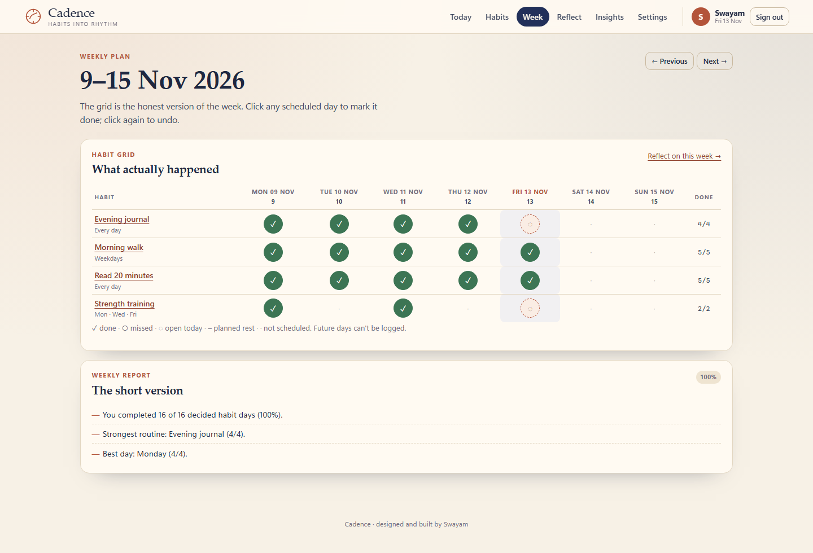 | 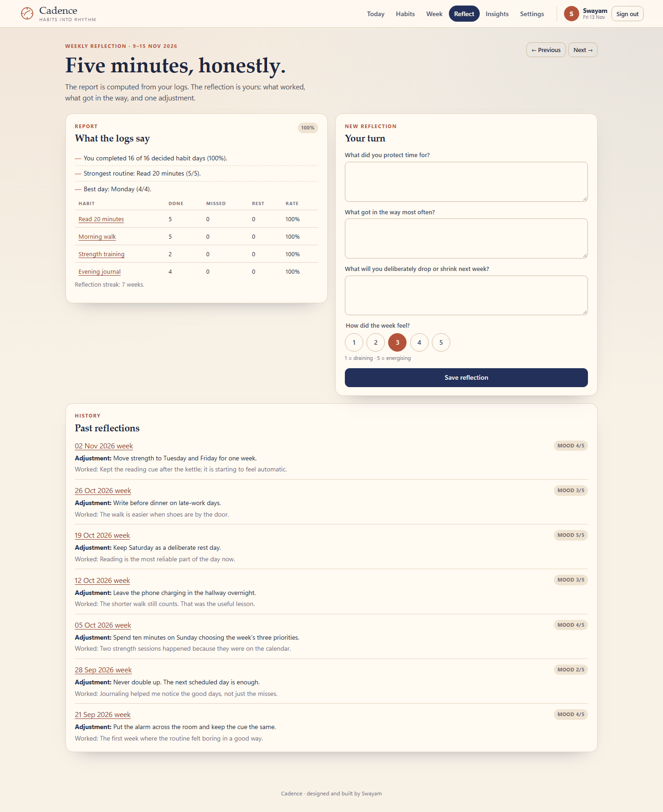 |
| 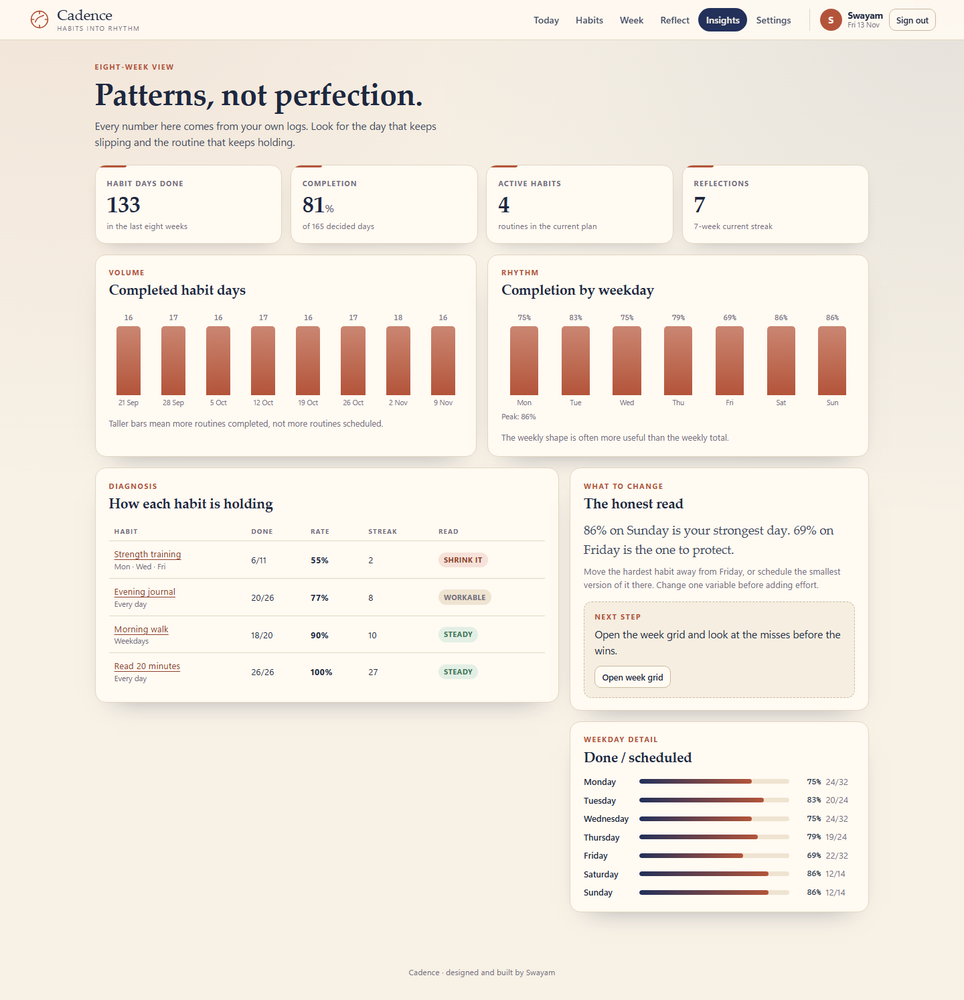 | 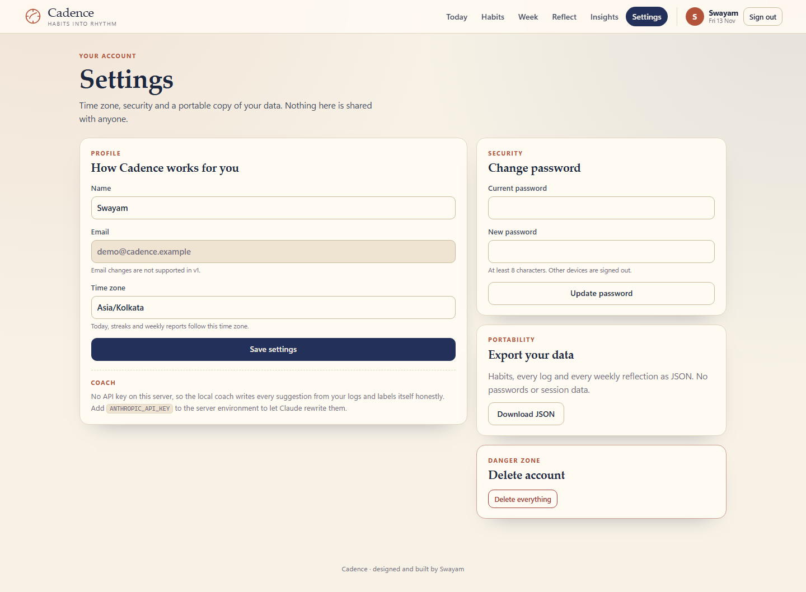 |

<table>
  <tr>
    <td>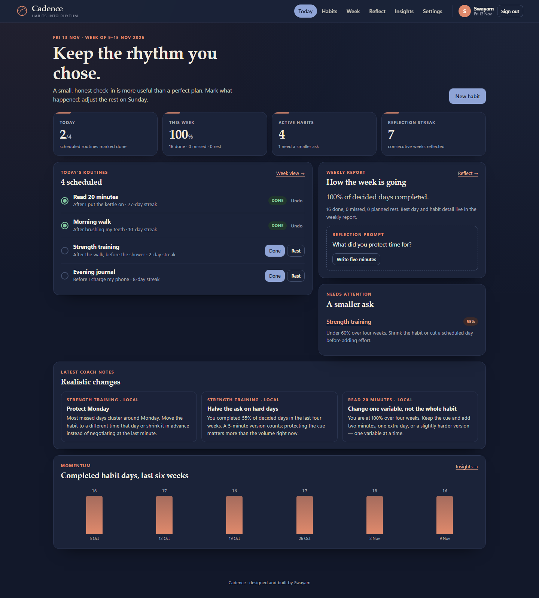</td>
    <td>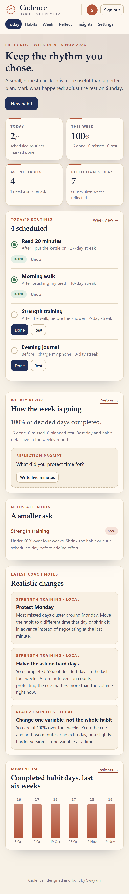</td>
    <td>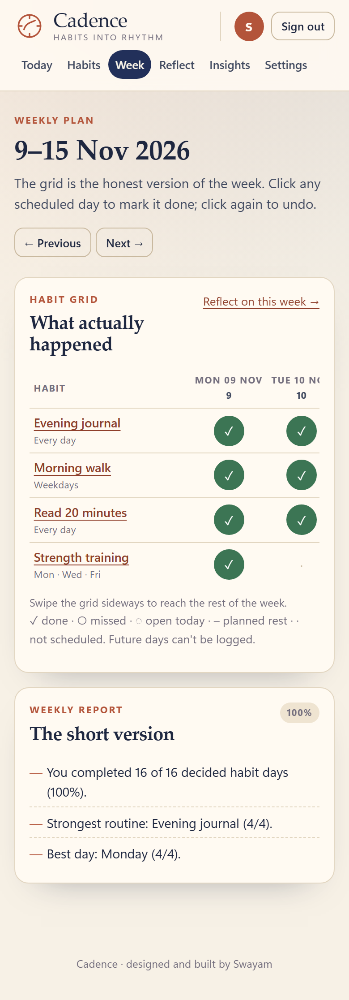</td>
  </tr>
</table>

All screenshots are genuine captures of this application running against the seeded demo database.

## 4. Technology stack

| Layer | Technology |
|---|---|
| Backend | Python 3.11+ (tested on 3.13), FastAPI 0.138, SQLAlchemy 2.0, Alembic, Uvicorn, Pydantic Settings |
| UI | Jinja2 templates, HTMX 2.0.11 (vendored, no CDN), hand-written CSS and a small `app.js`; server-rendered HTML/CSS bars and a month calendar |
| Database | SQLite (`data/cadence.db`; `data/demo.db` for the preview) |
| AI | Direct `httpx` call to the Anthropic Messages API, `claude-opus-5-5` by default, JSON output validated and clamped before storage |
| Tests | pytest + FastAPI TestClient (76 tests) |

## 5. Architecture

```text
Browser ──forms / HTMX──▶ FastAPI (Jinja2)
                            ├── routes: auth · habits (dashboard, habits, detail, logs, coach)
                            │           reflect (week, reflection, insights) · settings
                            ├── services: habitmath (streaks, rates, calendar, reports)
                            │             coach (deterministic suggestions)
                            │             ai (Claude JSON or labelled fallback)
                            └── SQLAlchemy ──▶ SQLite        └──▶ Claude API (optional)
```

- **Streaks** walk backwards over *scheduled* days only. Planned rest is neutral; an unlogged
  today does not break a streak until the day is over.
- **Rates** use decided days (`done + missed`), so a rest day neither helps nor hurts. Today is
  excluded while it is still open.
- **Week grid** derives each cell from the habit schedule and the log map; `future`, `off`,
  `pending`, `done`, `skipped` and `missed` are distinct states with distinct controls.
- **Coach pipeline:** the local coach always runs first and is returned immediately when no key is
  configured. With a key, only the habit, schedule, recent logs and computed stats are sent;
  the response must parse as JSON and contain 2–4 valid suggestions. Any failure returns the local
  result with a visible note. `source` and `model` are stored on every suggestion row.
- **Reflections** are unique per `(user, week_start)`, so re-saving a week updates it. All habits
  and reflections are scoped by `user_id` on every query; ownership checks return 404 rather than
  leaking another account's habit.
- **Time** is stored in UTC and converted with the user's IANA timezone before deciding "today".
  This is why the preview shows the correct local date regardless of the server clock.

Details, table definitions and route contracts: [ARCHITECTURE.md](docs/ARCHITECTURE.md).

## 6. Folder structure

```text
PROJECT_05/
├── README.md
├── .env.example
├── backend/
│   ├── alembic.ini
│   ├── pytest.ini
│   ├── requirements.txt
│   ├── requirements-dev.txt
│   ├── alembic/
│   │   └── versions/0001_initial_schema.py
│   ├── app/
│   │   ├── main.py            # app factory, middleware, error pages, /health
│   │   ├── config.py          # Pydantic settings
│   │   ├── db.py              # engine, Base, UTCDateTime
│   │   ├── models.py          # User, Session, Habit, HabitLog, Reflection, Suggestion
│   │   ├── security.py        # password hashing, tokens, rate limiter
│   │   ├── timeutil.py        # timezone-aware today, weekday parsing, filters
│   │   ├── web.py             # context, auth dependencies, CSRF, rendering
│   │   ├── routes/            # auth, habits, reflect, settings
│   │   ├── services/          # habitmath, coach, ai, charts
│   │   ├── templates/         # 11 Jinja2 pages
│   │   └── static/            # app.css, app.js, htmx.min.js, favicon
│   ├── scripts/
│   │   ├── seed_demo.py       # demo account + eight weeks of history
│   │   ├── preview.py         # one-command demo server on :8005
│   │   └── import_data.py     # import a Cadence JSON export
│   └── tests/                 # 76 tests across 7 files
├── data/                      # SQLite databases (git-ignored)
└── docs/
    ├── PRD.md
    ├── ARCHITECTURE.md
    ├── YOUR_DATA.md
    └── screenshots/           # 12 genuine PNGs
```

## 7. Installation

```powershell
cd "C:\Users\Swayam Naik\TOP-50-CLAUDE-PROJECTS\PROJECT_05\backend"

# Use the shared programme environment (a junction to shared-resources/.venv)
# or create a normal one:
python -m venv .venv
.\.venv\Scripts\Activate.ps1

python -m pip install -r requirements-dev.txt
```

Requirements are pinned. Python 3.11 or newer is required (3.13 is what the tests run on).

## 8. Environment configuration

Copy `PROJECT_05/.env.example` to `PROJECT_05/.env`. Every value is optional:

| Variable | Default | Purpose |
|---|---|---|
| `DATABASE_URL` | `sqlite:///PROJECT_05/data/cadence.db` | SQLAlchemy URL |
| `COOKIE_SECURE` | `false` | Set `true` when serving over HTTPS |
| `SESSION_DAYS` | `30` | Session lifetime in days |
| `ANTHROPIC_API_KEY` | empty | Enables Claude suggestions; empty means local coach |
| `ANTHROPIC_MODEL` | `claude-opus-5-5` | Model id used for suggestions |
| `AI_TIMEOUT_SECONDS` | `30` | Hard timeout for the model call |
| `RUN_MIGRATIONS` | `true` | Run Alembic on startup |
| `LOG_LEVEL` | `INFO` | Python logging level |

No key is required, and none is committed. `.env` is git-ignored.

## 9. Database setup

The app runs Alembic on startup. To do it manually:

```powershell
cd PROJECT_05\backend
.\.venv\Scripts\python.exe -m alembic upgrade head
```

Tables: `users`, `sessions`, `habits`, `habit_logs`, `reflections`, `suggestions`.

For demo data, use the preview command (it creates a separate `data/demo.db`):

```powershell
.\.venv\Scripts\python.exe scripts\preview.py
# http://127.0.0.1:8005 — demo@cadence.example / cadence-demo
```

`scripts/seed_demo.py` wipes and recreates **only** the demo account. It never touches a real
account in `cadence.db`, and the preview points at `demo.db`.

To import your own export (after creating your account in the app):

```powershell
.\.venv\Scripts\python.exe -m scripts.import_data --email you@example.com mydata.json --dry-run
.\.venv\Scripts\python.exe -m scripts.import_data --email you@example.com mydata.json
```

See [YOUR_DATA.md](docs/YOUR_DATA.md) for the JSON shape and privacy notes.

## 10. API and form endpoints

This is a server-rendered app, so most endpoints accept HTML forms and return `303` redirects.
There is no public JSON API (the interactive docs are intentionally disabled). `GET /health`
returns:

```json
{"status": "ok", "version": "1.0.0"}
```

| Method | Path | Purpose |
|---|---|---|
| GET | `/` | Dashboard |
| GET/POST | `/register`, `/login` | Account creation and sign-in |
| POST | `/logout` | End session |
| GET | `/habits?status=active\|paused\|archived` | Habit list |
| POST | `/habits` | Create habit |
| GET | `/habits/{id}?month=YYYY-MM` | Habit detail and calendar |
| POST | `/habits/{id}/update` | Edit title, intention, cue, days |
| POST | `/habits/{id}/status` | Pause, resume, archive |
| POST | `/habits/{id}/delete` | Delete habit and its logs |
| POST | `/habits/{id}/log` | Set `done`, `skipped` or `clear` for a day |
| POST | `/habits/{id}/coach` | Generate suggestions (rate-limited) |
| GET | `/week?week=YYYY-MM-DD` | Weekly grid and report |
| GET/POST | `/reflect?week=YYYY-MM-DD` | Weekly reflection form |
| GET | `/insights` | Eight-week analysis |
| GET/POST | `/settings` | Profile and timezone |
| POST | `/settings/password` | Change password |
| GET | `/settings/export` | Download `cadence-export-v1` JSON |
| POST | `/settings/delete` | Delete account (password + `DELETE`) |

All state-changing forms require a CSRF token. Cross-account habit ids return `404`.

## 11. How to run locally

```powershell
cd "C:\Users\Swayam Naik\TOP-50-CLAUDE-PROJECTS\PROJECT_05\backend"
.\.venv\Scripts\python.exe scripts\preview.py
```

Open <http://127.0.0.1:8005> and sign in with the demo account. For a real, empty database:

```powershell
.\.venv\Scripts\python.exe -m uvicorn --factory app.main:create_app --host 127.0.0.1 --port 8005
```

Register a new account on first run. There is no public deployment and no external service
required.

## 12. Testing

```powershell
cd PROJECT_05\backend
.\.venv\Scripts\python.exe -m pytest
```

**76 tests pass** across seven files:

| File | Covers |
|---|---|
| `test_auth.py` | Registration, validation, duplicate email, login/logout, session expiry, CSRF, open redirects |
| `test_habits.py` | Create/edit/status/delete, scheduling, day logging, ownership, calendar, coach rate limit |
| `test_habitmath.py` | Streaks, planned rest, pending today, decided-day rates, calendars, weekly series, weekday patterns, reflection streak |
| `test_week.py` | Grid states, completion toggles, report counts, navigation, invalid week |
| `test_reflect_insights.py` | Reflection upsert, prompts, history, insight charts, local coach, AI validation and fallback |
| `test_settings.py` | Profile, timezone validation, password change, export, deletion, security headers, 404 page |
| `conftest.py` | Isolated SQLite database per test, browser helper with CSRF-aware form posts |

The suite uses a temporary database and does not touch `data/cadence.db` or the demo data.

## 13. Screenshots

Twelve screenshots in [`docs/screenshots/`](docs/screenshots) are captured from the live preview
with Playwright at 1440×980 (desktop) and 390×844 (mobile), in light and dark colour schemes.
They show the seeded eight-week account, so the charts and streaks are real computations.

## 14. Known limitations

- **Single-user scale.** SQLite and in-process rate limiters are right for a personal app, not a
  multi-tenant service. Running multiple workers would need a shared limiter store.
- **Weeks start on Monday.** The week grid, reflection keys and reports assume ISO weeks; there is
  no Sunday-start option.
- **One schedule per habit.** Weekdays are a fixed set; there is no "every other day", monthly
  schedule, or holiday calendar. Pausing is the escape hatch.
- **Reflection is weekly, not daily.** Mood is one number per week, not a daily journal.
- **AI is optional and unverified without a key.** The Claude path validates shape and length, but
  the programme has no API key, so only the local path is exercised in the recorded tests. The
  fallback is always labelled `LOCAL`.
- **No email delivery.** Password reset, verification and reminders are out of scope; there is no
  mail service to configure without spending money.
- **Timezone changes do not rewrite history.** Existing logs keep their calendar dates; only
  "today" and future decisions use the new zone.
- **Screenshots contain demo data only.** The demo name is "Swayam", but the habits, logs and
  reflections are generated samples, not the author's real routine.

## 15. Future improvements

- Daily notes on a log entry, shown in the habit history (the `note` column already exists).
- Flexible schedules: every N days, times per week, and a pause range with an end date.
- A printable monthly review that combines the week grid and reflections.
- Optional reminder delivery through a local mechanism, without a paid service.
- Import from common habit-tracker CSV exports.
- A small JSON read API for a native or mobile client, reusing the same service layer.
- Server-side session cleanup job and configurable rate-limit storage for multi-worker setups.
