# Project 06: Meeting Memory Assistant ("Quorum")

**Author:** Swayam · **Category:** 1. Personal Productivity & Life Management · **Status:** Completed (v1.0)

Quorum turns the notes from a meeting into a summary, a decision log and follow-ups with owners
and due dates. The point is not another task list; it is the record you can still search three
months later, when someone asks why a decision was made and who left with the job.

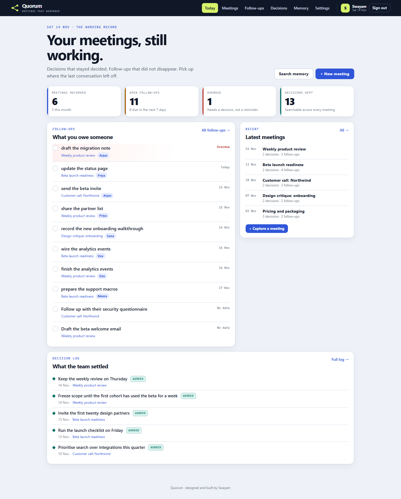

## 1. Overview

A self-hosted, server-rendered web app: FastAPI + Jinja2 + SQLite, with a little
[HTMX](https://htmx.org) for in-place actions. One process serves everything on port 8006. There is
no frontend build step, and every core action works without JavaScript.

Extraction runs in one of two modes. With an `ANTHROPIC_API_KEY`, Quorum asks **Claude** for strict
JSON and validates every field before storing it. Without a key — the default here — a deterministic
local extractor reads the same notes with rules, and the UI labels the result **Local extractor**.
The local path is always available, even when Claude times out or returns something invalid.

## 2. Problem statement

Meeting notes are written once and read never. Decisions dissolve into a paragraph of discussion,
owners are implied rather than assigned, and the follow-up is remembered by whoever happened to be
paying attention. Search is worse: the answer exists in a doc, a chat thread or somebody's notebook,
but not where you need it.

Quorum is built around four repairs:

1. **Separate the decision from the discussion.** Only agreements are logged as decisions; topics
   stay in the summary.
2. **Give every follow-up an owner and a date when the notes allow it.** A blank owner is honest;
   an invented one is not.
3. **Keep the original notes.** Every summary links back to what was actually said.
4. **Make the archive searchable in one place.** Meetings, decisions and follow-ups share one index.

The full product thinking is in the [PRD](docs/PRD.md).

## 3. Features

| Area | What you can do |
|---|---|
| Dashboard | Counts for meetings, open follow-ups, overdue items and decisions; the next seven days; the open loop with quick completion; latest meetings; the five most recent decisions |
| Meetings | Newest-first archive with search across titles, notes and summaries, and a Claude / Local source filter |
| **Capture** | Paste a transcript or rough notes, add a title, date and attendees. Quorum extracts a summary, decisions, owners and due dates, then stores all of it |
| Meeting detail | Summary, record metadata, decision log with Agreed / Revisit status, follow-ups with completion, inline edit and delete, add a missing decision or follow-up, re-read the notes, original notes, edit, print and delete |
| Follow-ups | Grouped into Overdue, Today, This week, Later and No date; filters for Open, Done and All; owner filter; one-tap complete or reopen; inline edit; delete |
| Decisions | Searchable decision log with All / Agreed / Revisit filters; flip a decision between agreed and revisit; delete a decision |
| **Memory** | One search across meeting summaries and notes, decision text and follow-up titles, scoped to the signed-in account |
| Settings | Display name, IANA timezone, password change (signs out other devices), full JSON export, account deletion with password and typed confirmation |
| Auth | Register, sign in, sign out; hashed passwords; server-side sessions in an `HttpOnly`, `SameSite=Lax` cookie; CSRF token on every state-changing form; login and extraction rate limits |
| UI | Cobalt / lime design on an ink masthead, a full dark variant from `prefers-color-scheme`, phone and tablet layouts, keyboard focus states, toasts, empty states, and confirmation before destructive actions |

### What the screens look like

| | |
|---|---|
| 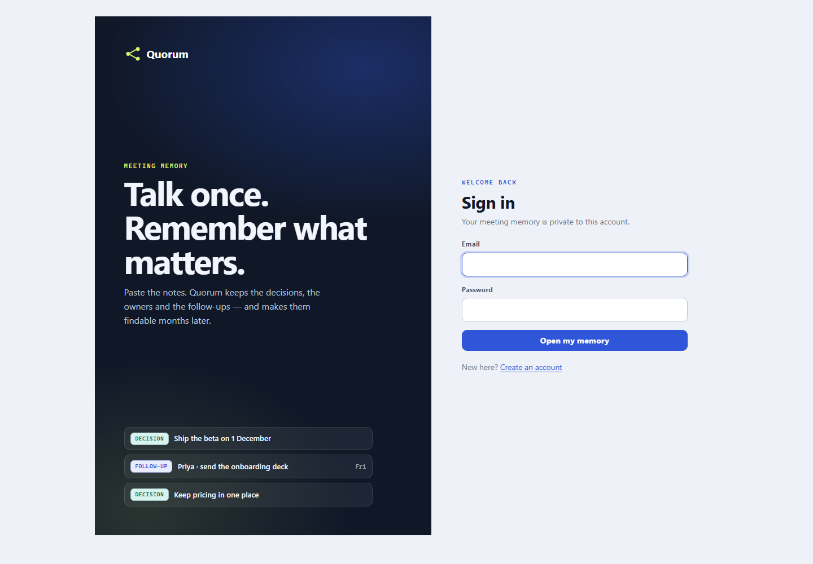 | 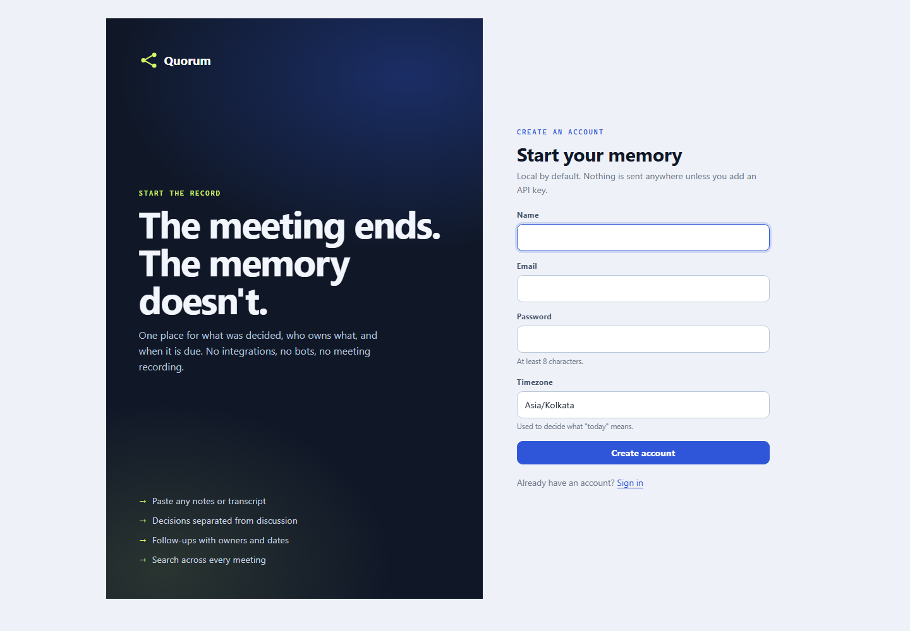 |
| 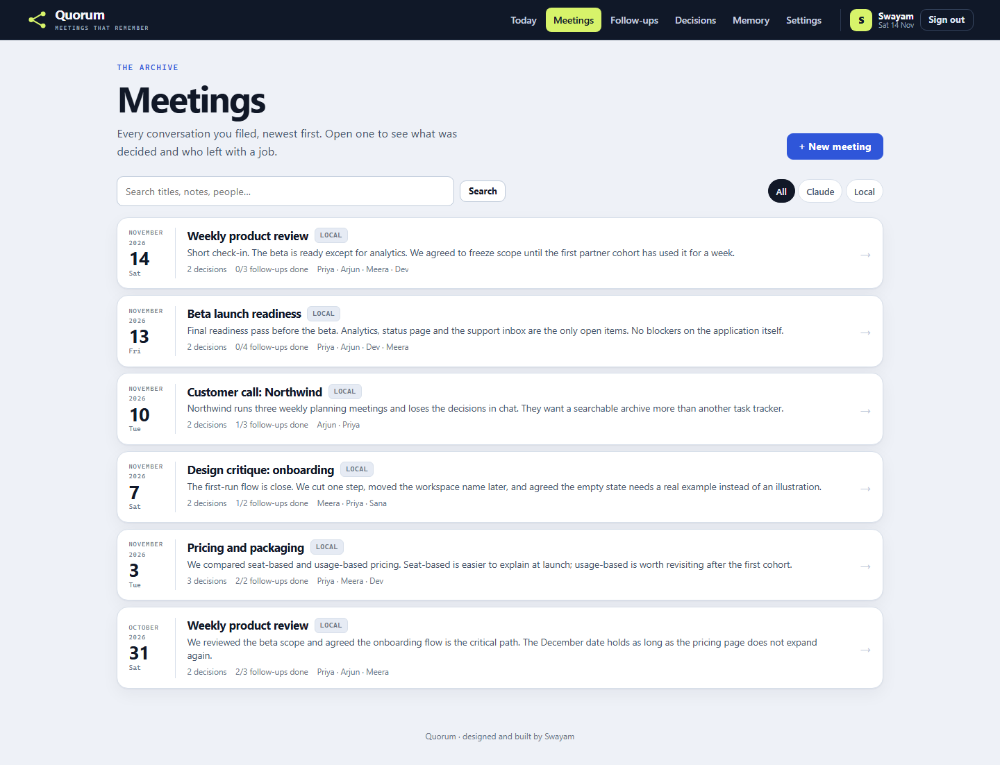 | 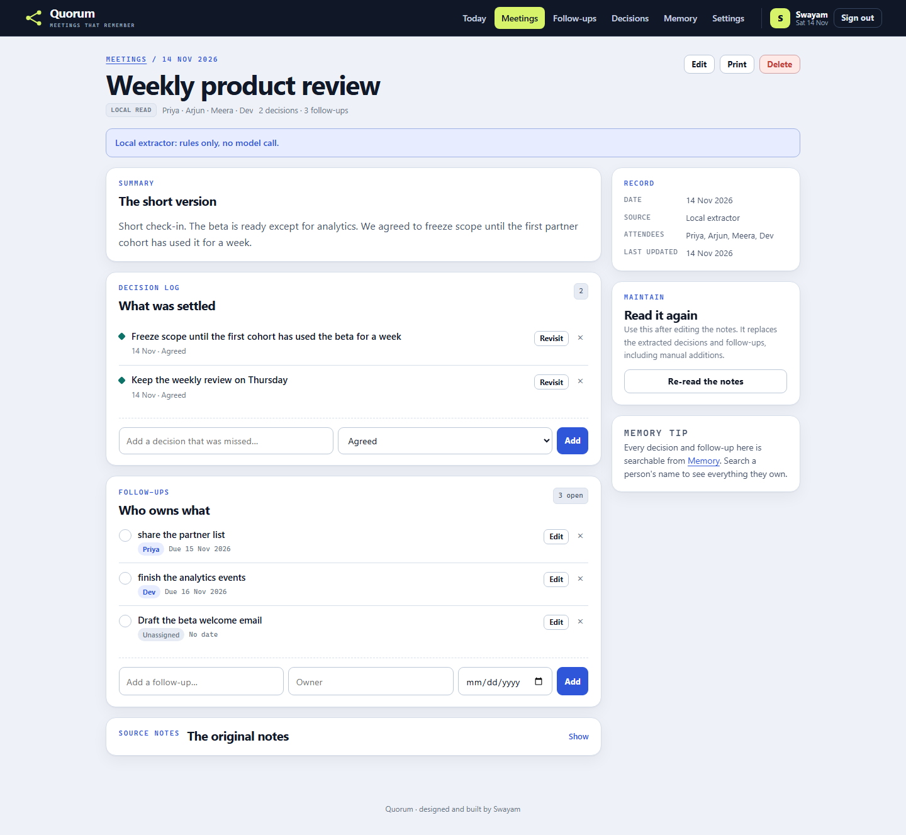 |
| 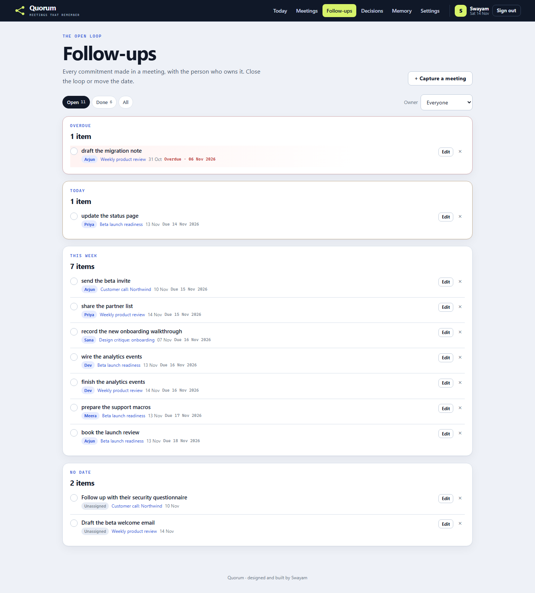 | 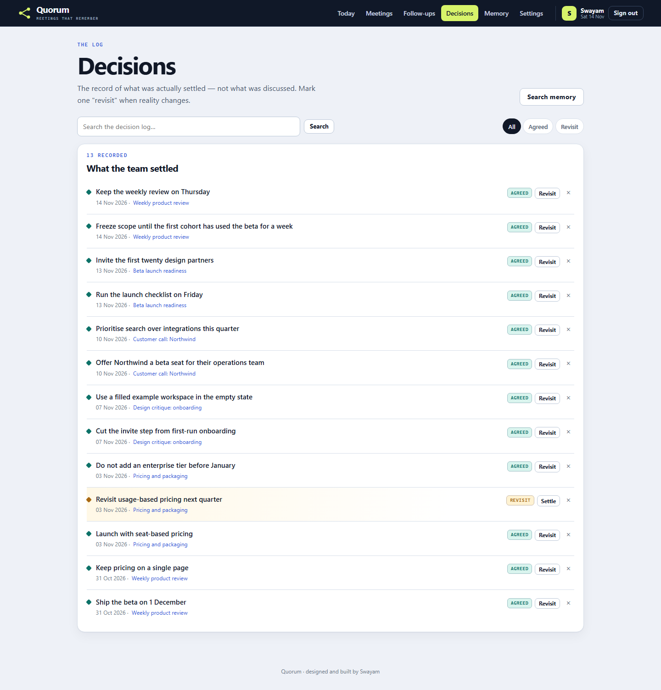 |
| 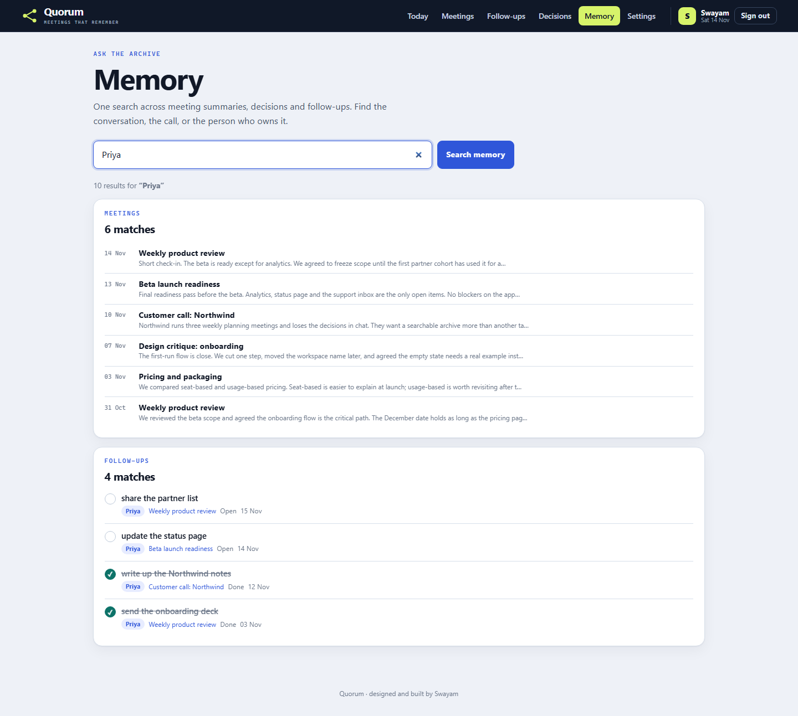 | 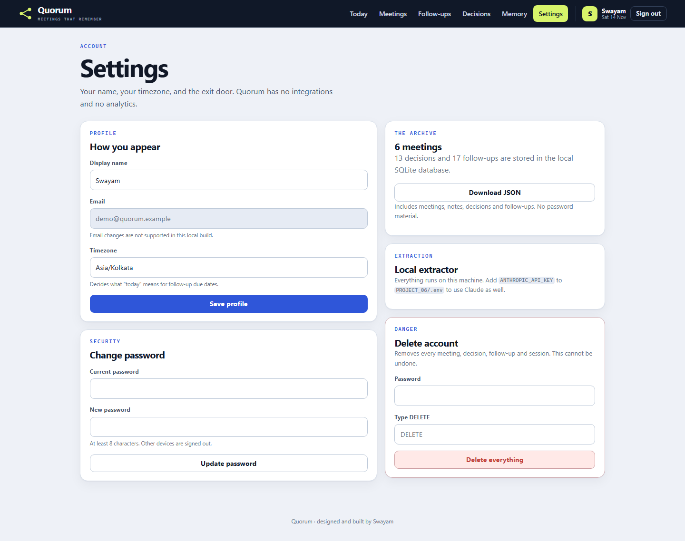 |

<table>
  <tr>
    <td>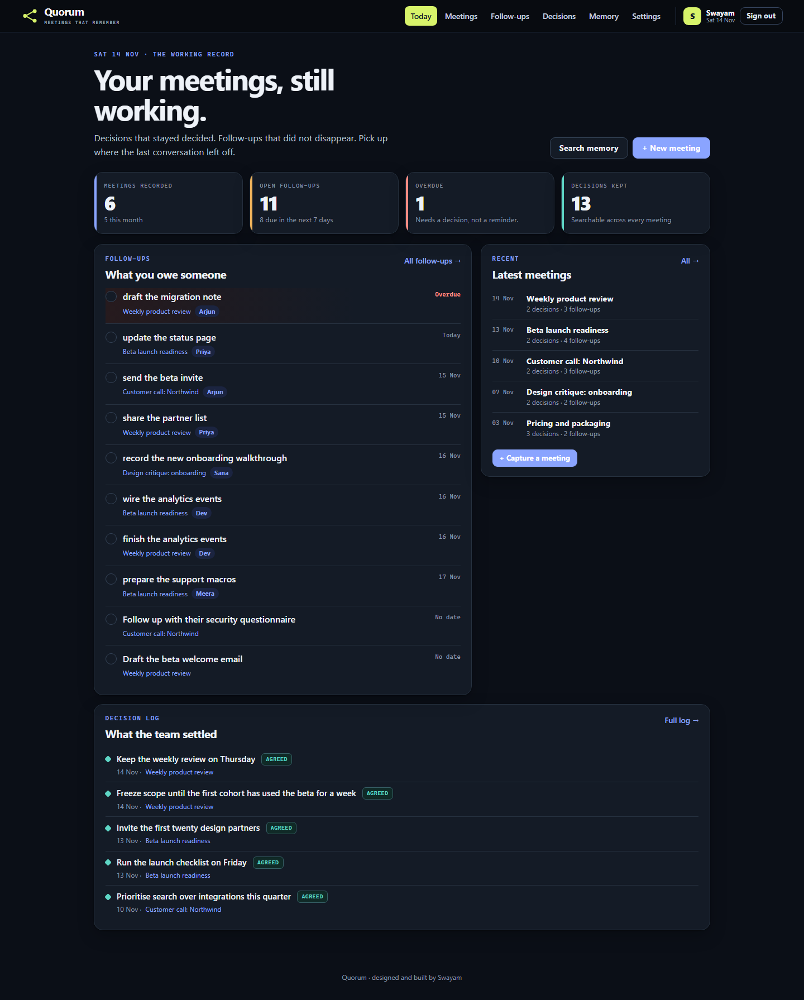</td>
    <td>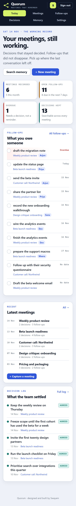</td>
    <td>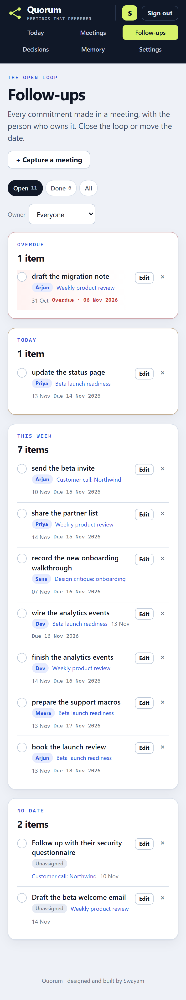</td>
    <td>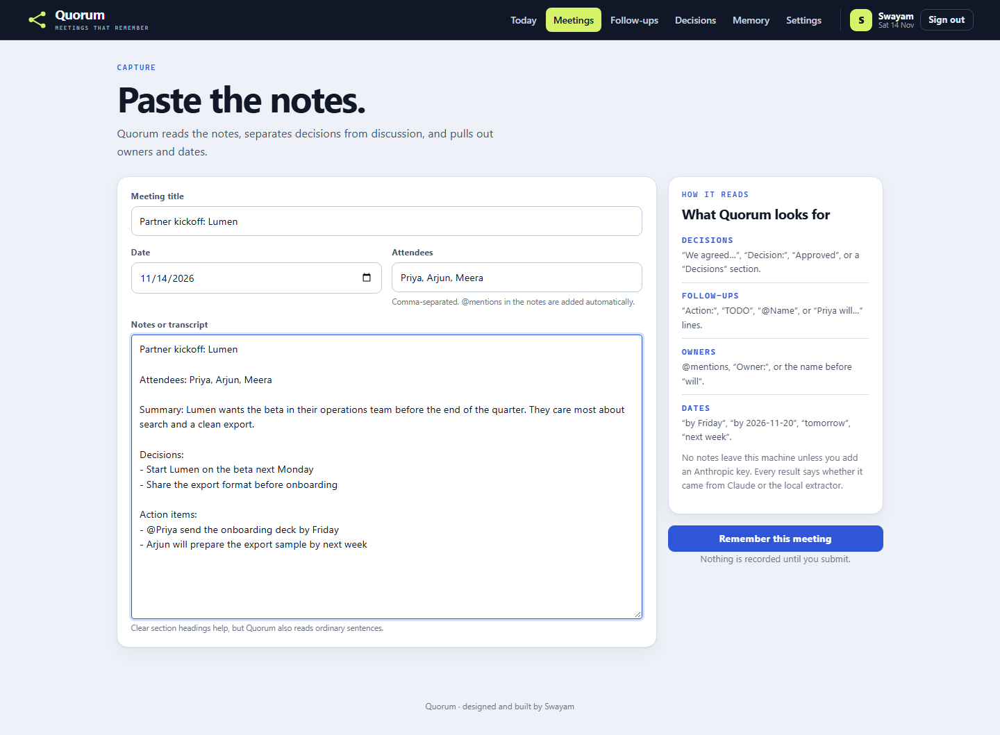</td>
  </tr>
</table>

All screenshots are genuine captures of this application running against the seeded demo database.

## 4. Technology stack

| Layer | Technology |
|---|---|
| Backend | Python 3.11+ (tested on 3.13), FastAPI 0.138, SQLAlchemy 2.0, Alembic, Uvicorn, Pydantic Settings |
| UI | Jinja2 templates, HTMX 2.0.11 (vendored, no CDN), hand-written CSS and a small `app.js`; server-rendered HTML with no chart library |
| Database | SQLite (`data/quorum.db`; `data/demo.db` for the preview) |
| AI | Direct `httpx` call to the Anthropic Messages API, `claude-opus-5-5` by default. Output is parsed as strict JSON, clamped and validated; any failure falls back to the local extractor with a visible note |
| Tests | pytest + FastAPI TestClient (144 tests) |

## 5. Architecture

```text
Browser ──forms / HTMX──▶ FastAPI (Jinja2)
                            ├── routes: auth · meetings (dashboard, archive, capture, detail,
                            │           actions, decisions, memory) · settings
                            ├── services: extract (rule-based structure)
                            │             ai (Claude JSON, validation, labelled fallback)
                            └── SQLAlchemy ──▶ SQLite        └──▶ Claude API (optional)
```

- **The local extractor is the baseline.** It understands section headers (`Summary:`, `Decisions:`,
  `Action items:`), bullet styles, `@mentions`, `Owner:` labels, "Name will…" phrases, attendee names
  at the start of an action, and due phrases such as `by Friday`, `tomorrow`, `next week` or
  `2026-11-20`. It deduplicates, clamps lengths and never raises on odd input.
- **Claude is optional and fenced.** Every model response must parse as JSON and pass
  `_validate`: correct types, summary at least four characters, decisions and actions capped at 8
  and 12, dates parsed against the meeting day and rejected when more than two years away. A
  network error, a non-200 response, malformed JSON or an empty result returns the local result
  with `Claude was unavailable or returned an invalid result; the local extractor was used.`
- **Ownership is enforced in the query, not the template.** Every meeting, decision and follow-up
  lookup includes the signed-in `user_id`; another account's ids return `404`, not a hidden page.
- **Editing is explicit.** Saving an edited meeting updates the record but keeps its extracted
  items; ticking **Re-read the notes** replaces them. Moving a meeting's date moves every decision
  with it, so the log does not lie about when something was settled.
- **Time** is stored in UTC and converted with the user's IANA timezone before deciding "today".
  Follow-up groups (overdue / today / this week / later) use that local date.

Details, table definitions and route contracts: [ARCHITECTURE.md](docs/ARCHITECTURE.md).

## 6. Folder structure

```text
PROJECT_06/
├── README.md
├── .env.example
├── backend/
│   ├── alembic.ini
│   ├── pytest.ini
│   ├── requirements.txt
│   ├── requirements-dev.txt
│   ├── alembic/
│   │   └── versions/0001_initial_schema.py
│   ├── app/
│   │   ├── main.py            # app factory, middleware, error pages, /health
│   │   ├── config.py          # Pydantic settings
│   │   ├── db.py              # engine, Base, UTCDateTime
│   │   ├── models.py          # User, Session, Meeting, Decision, ActionItem
│   │   ├── security.py        # password hashing, tokens, rate limiter
│   │   ├── timeutil.py        # timezone-aware today, due-date parsing, attendees
│   │   ├── web.py             # context, auth dependencies, CSRF, rendering
│   │   ├── routes/            # auth, meetings, settings
│   │   ├── services/          # extract, ai
│   │   ├── templates/         # 12 Jinja2 pages
│   │   └── static/            # app.css, app.js, htmx.min.js, favicon
│   ├── scripts/
│   │   ├── seed_demo.py       # demo account + six meetings of history
│   │   ├── preview.py         # one-command demo server on :8006
│   │   └── import_data.py     # import a Quorum JSON export
│   └── tests/                 # 144 tests across 7 files
├── data/                      # SQLite databases (git-ignored)
└── docs/
    ├── PRD.md
    ├── ARCHITECTURE.md
    ├── YOUR_DATA.md
    └── screenshots/           # 13 genuine PNGs
```

## 7. Installation

```powershell
cd "C:\Users\Swayam Naik\TOP-50-CLAUDE-PROJECTS\PROJECT_06\backend"

# Use the shared programme environment (a junction to shared-resources/.venv)
# or create a normal one:
python -m venv .venv
.\.venv\Scripts\Activate.ps1

python -m pip install -r requirements-dev.txt
```

Requirements are pinned. Python 3.11 or newer is required (3.13 is what the tests run on).

## 8. Environment configuration

Copy `PROJECT_06/.env.example` to `PROJECT_06/.env`. Every value is optional:

| Variable | Default | Purpose |
|---|---|---|
| `DATABASE_URL` | `sqlite:///PROJECT_06/data/quorum.db` | SQLAlchemy URL |
| `COOKIE_SECURE` | `false` | Set `true` when serving over HTTPS |
| `SESSION_DAYS` | `30` | Session lifetime in days |
| `ANTHROPIC_API_KEY` | empty | Enables Claude extraction; empty means the local extractor |
| `ANTHROPIC_MODEL` | `claude-opus-5-5` | Model id used for extraction |
| `AI_TIMEOUT_SECONDS` | `30` | Hard timeout for the model call |
| `RUN_MIGRATIONS` | `true` | Run Alembic on startup |
| `LOG_LEVEL` | `INFO` | Python logging level |

No key is required, and none is committed. `.env` is git-ignored.

## 9. Database setup

The app runs Alembic on startup. To do it manually:

```powershell
cd PROJECT_06\backend
.\.venv\Scripts\python.exe -m alembic upgrade head
```

Tables: `users`, `sessions`, `meetings`, `decisions`, `action_items`.

For demo data, use the preview command (it creates a separate `data/demo.db`):

```powershell
.\.venv\Scripts\python.exe scripts\preview.py
# http://127.0.0.1:8006 — demo@quorum.example / quorum-demo
```

`scripts/seed_demo.py` wipes and recreates **only** the demo account. It builds its six meetings by
running the real local extractor over realistic notes, so the demo archive is internally consistent
rather than typed into the database by hand. It never touches a real account in `quorum.db`.

To import your own export (after creating your account in the app):

```powershell
.\.venv\Scripts\python.exe -m scripts.import_data --email you@example.com mydata.json --dry-run
.\.venv\Scripts\python.exe -m scripts.import_data --email you@example.com mydata.json
```

See [YOUR_DATA.md](docs/YOUR_DATA.md) for the JSON shape and privacy notes.

## 10. API and form endpoints

This is a server-rendered app, so most endpoints accept HTML forms and return `303` redirects.
There is no public JSON API (the interactive docs are intentionally disabled). `GET /health`
returns:

```json
{"status": "ok", "version": "1.0.0"}
```

| Method | Path | Purpose |
|---|---|---|
| GET | `/` | Dashboard |
| GET/POST | `/register`, `/login` | Account creation and sign-in |
| POST | `/logout` | End session |
| GET | `/meetings?q=&source=local\|claude` | Meeting archive |
| GET/POST | `/meetings/new`, `/meetings` | Capture form and create |
| GET | `/meetings/{id}` | Meeting detail |
| GET/POST | `/meetings/{id}/edit` | Edit the record; optional `reextract=1` |
| POST | `/meetings/{id}/delete` | Delete meeting and its children |
| POST | `/meetings/{id}/extract` | Re-read the notes (rate-limited) |
| POST | `/meetings/{id}/actions` | Add a follow-up |
| POST | `/meetings/{id}/decisions` | Add a decision |
| GET | `/actions?status=open\|done\|all&owner=` | Follow-up list and groups |
| POST | `/actions/{id}/toggle` | Complete or reopen |
| POST | `/actions/{id}/update` | Edit title, owner, due date |
| POST | `/actions/{id}/delete` | Delete a follow-up |
| GET | `/decisions?q=&status=agreed\|revisit` | Decision log |
| POST | `/decisions/{id}/status` | Flip Agreed / Revisit |
| POST | `/decisions/{id}/delete` | Delete a decision |
| GET | `/memory?q=` | One search across the archive |
| GET/POST | `/settings` | Profile and timezone |
| POST | `/settings/password` | Change password |
| GET | `/settings/export` | Download `quorum-export-v1` JSON |
| POST | `/settings/delete` | Delete account (password + `DELETE`) |

All state-changing forms require a CSRF token. Cross-account ids return `404`. The `next` parameter
on follow-up actions only accepts same-site paths, so it cannot become an open redirect.

## 11. How to run locally

```powershell
cd "C:\Users\Swayam Naik\TOP-50-CLAUDE-PROJECTS\PROJECT_06\backend"
.\.venv\Scripts\python.exe scripts\preview.py
```

Open <http://127.0.0.1:8006> and sign in with the demo account. For a real, empty database:

```powershell
.\.venv\Scripts\python.exe -m uvicorn --factory app.main:create_app --host 127.0.0.1 --port 8006
```

Register a new account on first run. There is no public deployment and no external service
required.

## 12. Testing

```powershell
cd PROJECT_06\backend
.\.venv\Scripts\python.exe -m pytest
```

**144 tests pass** across seven files:

| File | Tests | Covers |
|---|---:|---|
| `test_auth.py` | 18 | Registration, validation, duplicate email, login/logout, session expiry, CSRF, login rate limit, password-hash leakage |
| `test_meetings.py` | 24 | Create/edit/delete, extraction storage, search and source filters, ownership, re-extraction, HTML escaping, capture rate limit, open redirects |
| `test_actions_decisions.py` | 22 | Add, complete, reopen, edit, delete and filter follow-ups; decision status; grouping; cross-account access |
| `test_memory_settings.py` | 20 | Memory search scope and matches, profile and timezone, password change, JSON export, account deletion, security headers, 404 page |
| `test_extract.py` | 26 | Section and inline headers, bullets, prefixes, owners, due dates, dedupe, clamping, odd input |
| `test_ai.py` | 23 | Claude JSON validation and clamping, request shape, code fences, no-key path, HTTP/network/timeout and invalid-JSON fallbacks |
| `test_timeutil.py` | 11 | Relative dates, weekdays, attendee parsing, timezone fallback, date formatting |
| `conftest.py` | — | Isolated SQLite database per test, browser helper with CSRF-aware form posts |

The suite uses a temporary database and does not touch `data/quorum.db` or the demo data. The Claude
tests use a fake `httpx.Client`; no real API key or network call is involved.

## 13. Screenshots

Thirteen screenshots in [`docs/screenshots/`](docs/screenshots) are captured from the live preview
with Playwright at 1440×980 (desktop) and 390×844 (mobile), in light and dark colour schemes. They
show the seeded demo archive, so the counts, groups and decision log are real computations.

## 14. Known limitations

- **Single-user scale.** SQLite and in-process rate limiters are right for a personal archive, not a
  multi-tenant service. Running multiple workers would need a shared limiter store.
- **No audio transcription.** Quorum starts from text. Recording, diarisation and speech-to-text are
  out of scope; the notes can come from any tool the user already has.
- **The local extractor is rule-based.** It reads the common shapes (headings, bullets, mentions,
  "will" phrases, a small set of due-date words) and deliberately does not guess. Unusual prose may
  produce no action rather than a wrong one.
- **AI is optional and unverified without a key.** The Claude path validates shape and length, and
  its tests use a fake transport. The programme has no API key, so only the local path runs against
  a real model endpoint. The UI labels every result `Local` or `Claude`.
- **No calendar or email integration.** Quorum does not send reminders or write to a calendar; the
  follow-up list is the reminder.
- **One timezone per account.** Dates are calendar dates, not instants; changing the timezone
  changes what "today" means but does not rewrite stored meeting dates.
- **Screenshots contain demo data only.** The demo name is "Swayam", but the meetings and people are
  invented samples, not the author's real conversations.
- **No public deployment.** The app is designed to run locally; `COOKIE_SECURE` exists for anyone who
  puts it behind HTTPS themselves.

## 15. Future improvements

- Optional audio upload with a local, free speech-to-text model.
- A "decision review" reminder for decisions marked Revisit after a chosen date.
- Tags and people pages, so the Memory search can pivot by topic as well as by name.
- Import from common note exports (Markdown, plain text) in addition to Quorum JSON.
- A small JSON read API for a native client, reusing the same service layer.
- Server-side session cleanup and configurable rate-limit storage for multi-worker setups.
