# Project 07: Email Command Center ("Switchboard")

**Author:** Swayam · **Category:** 1. Personal Productivity & Life Management · **Status:** Completed (v1.0)

Switchboard is a desk for the mail you already have. Paste a message, drop in a `.eml` file or
import a JSON export, and the rules route it to **Needs reply**, **Waiting**, **FYI**, **Newsletter**
or **Receipt**, compute an explainable priority score and write a local summary. Reply drafts stay
on the machine until you copy them out. There is no mailbox connection, no OAuth screen and no
password to hand over.

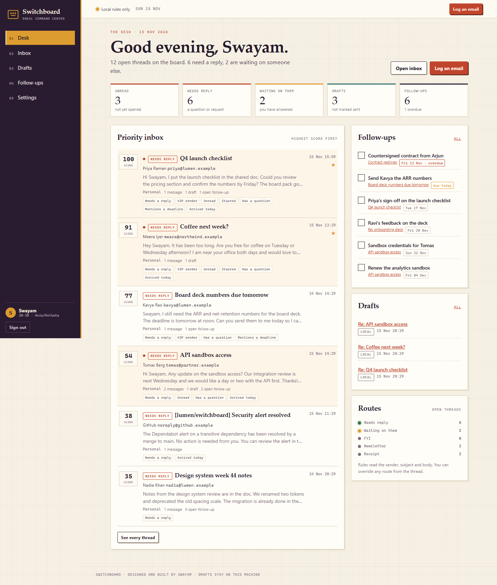

## 1. Overview

A self-hosted, server-rendered web app: FastAPI + Jinja2 + SQLite, with a little
[HTMX](https://htmx.org) for in-place actions. One process serves everything on port 8007. There is
no frontend build step, and every core action works without JavaScript.

The desk is deliberately **not** a mail client. It never talks to IMAP or SMTP, so it cannot read a
mailbox behind your back or send anything in your name. Mail arrives by paste, `.eml` upload or a
Switchboard JSON import. "Mark sent" records the reply locally and moves the thread to *Waiting on
them*; you still send the message from whichever client you already trust.

Two writing paths exist. With an `ANTHROPIC_API_KEY`, Switchboard asks **Claude** for a summary or a
reply draft and validates the response before storing it. Without a key — the default here — a
deterministic local writer produces a scaffold from the latest message, and the UI labels the result
**Local**. The local path always works, including when Claude times out or returns something invalid.

## 2. Problem statement

An inbox is sorted by arrival time, which is not the same as importance. The four questions that
actually matter are buried:

1. **What needs an answer?** A question from a customer and a newsletter have the same visual weight.
2. **What am I waiting on?** Once you reply, the thread vanishes into the archive and the promise is
   forgotten.
3. **Why is this at the top?** Most "smart inboxes" give a score with no explanation, so you cannot
   correct them.
4. **Where did my data go?** Connecting a mailbox usually means granting a third party permanent
   read access.

Switchboard is built around four repairs: five explicit routes instead of an undifferentiated list;
a follow-up list tied to the thread; a priority score with every contributing reason shown; and
intake that never asks for mailbox credentials. The full product thinking is in the
[PRD](docs/PRD.md).

## 3. Features

| Area | What you can do |
|---|---|
| Dashboard | Open-thread count, unread, needs reply, waiting, drafts and follow-ups (including overdue); the six highest-scoring rows; the next follow-ups; drafts; route counts |
| Inbox | Priority (default), All, the five routes, Starred and Closed views; search across subjects, participants and every message body; filter by mailbox; every row shows its score and the strongest reason |
| **Intake** | Paste a message, or upload a `.eml` whose headers fill in From, To, Subject and arrival time. A pasted `datetime-local` is read in your timezone. Duplicate `Message-ID`s are ignored |
| Threading | `Re:`, `Fwd:`, `Aw:`, `Sv:` and whitespace are stripped; messages join an open thread in the same mailbox. A closed thread starts a new one |
| Thread detail | Full conversation, local or Claude summary with a visible label, "Why this rank" with every reason, route and status overrides, star, unread, delete, drafts and follow-ups in one place |
| **Triage rules** | Five routes chosen from testable signals: questions and requests, VIP senders, bulk-mail wording, invoice/receipt wording. A manual route is remembered and survives new mail |
| Priority | A score out of 100 with reasons: route base, VIP, unread, starred, a question, a deadline and recency; sorted highest first |
| **Drafts** | Local scaffold in warm, brief or formal tone; optional Claude draft; edit before sending; copy to clipboard; mark sent (recorded locally); drafts page with Open / Marked sent views |
| Follow-ups | Add "what are you waiting on" and a natural-language date (`tomorrow`, `friday`, `2026-11-20`); grouped Overdue, Today, Next seven days, Later and No date; complete, reopen, edit, delete |
| Settings | Name, IANA timezone, signature, VIP list, mailbox labels, password change (signs out other devices), full JSON export, account deletion with password and typed confirmation |
| Auth | Register, sign in, sign out; `scrypt` password hashing; server-side sessions in an `HttpOnly`, `SameSite=Lax` cookie; CSRF on every state-changing form; login and AI rate limits |
| UI | Paper-and-ink palette with an aubergine rail, amber and vermilion accents, serif headings and routing-slip rows; full dark variant from `prefers-color-scheme`; phone and tablet layouts; focus states, toasts, empty states and confirmation before destructive actions |

### What the screens look like

| | |
|---|---|
| 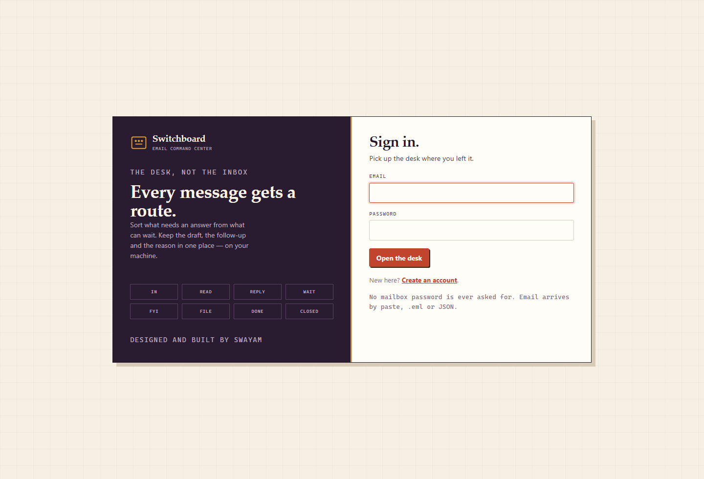 | 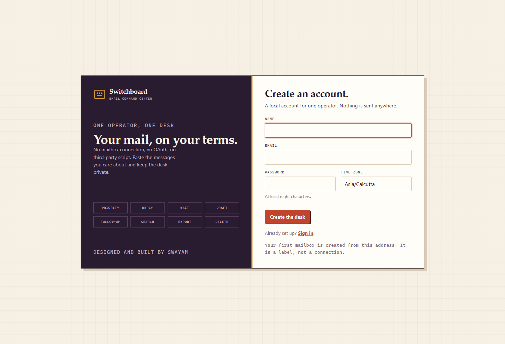 |
| 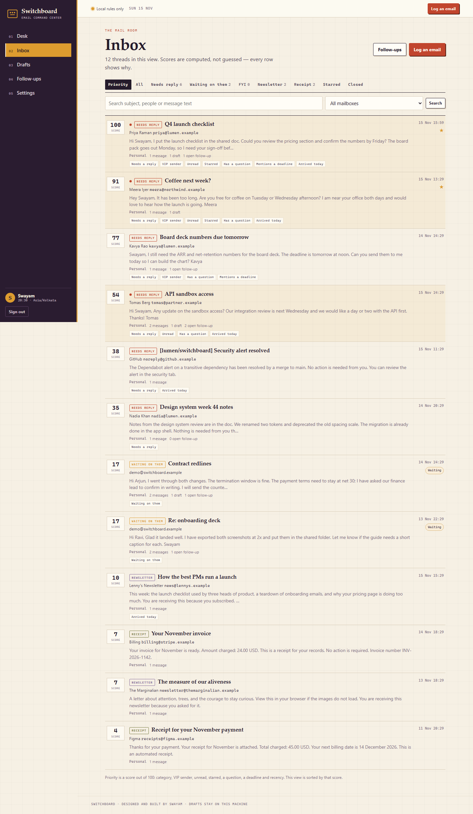 | 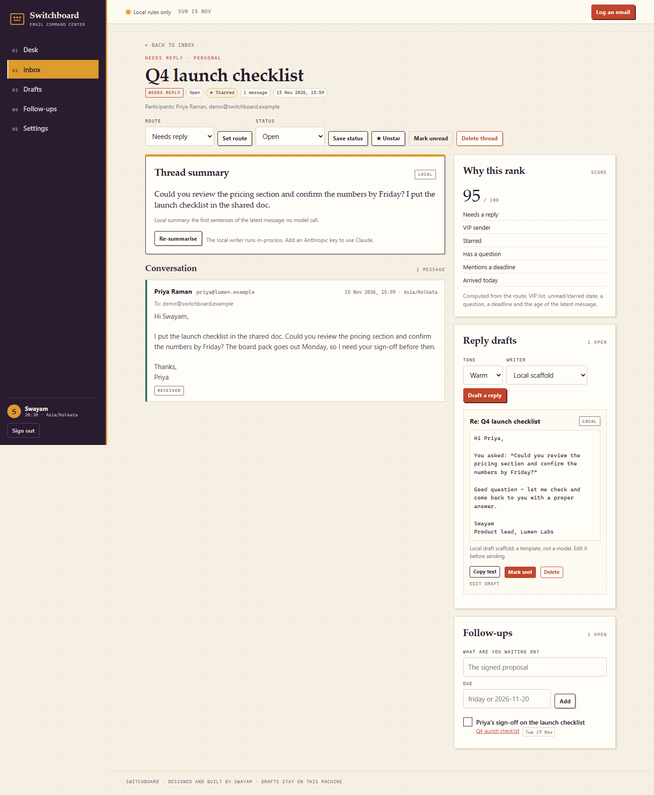 |
| 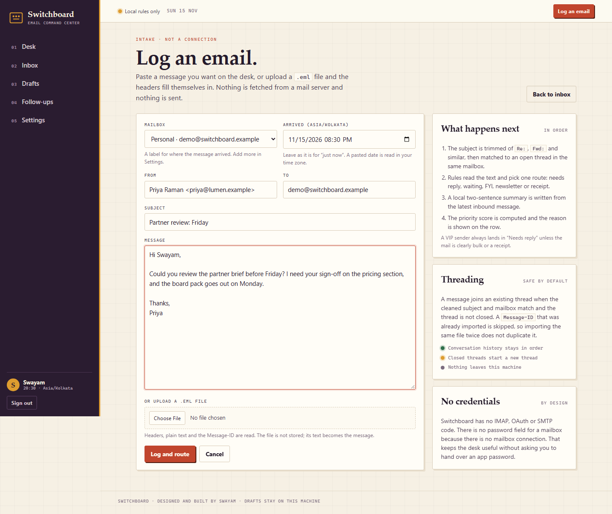 | 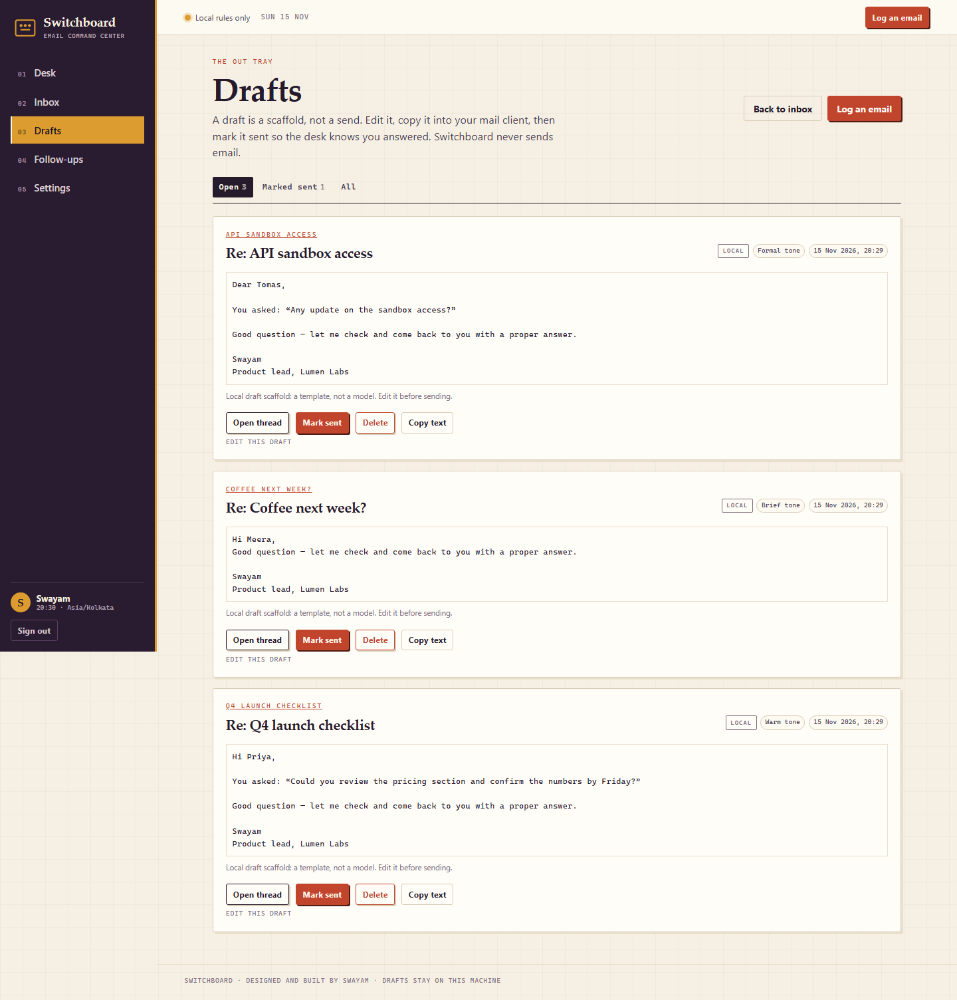 |
| 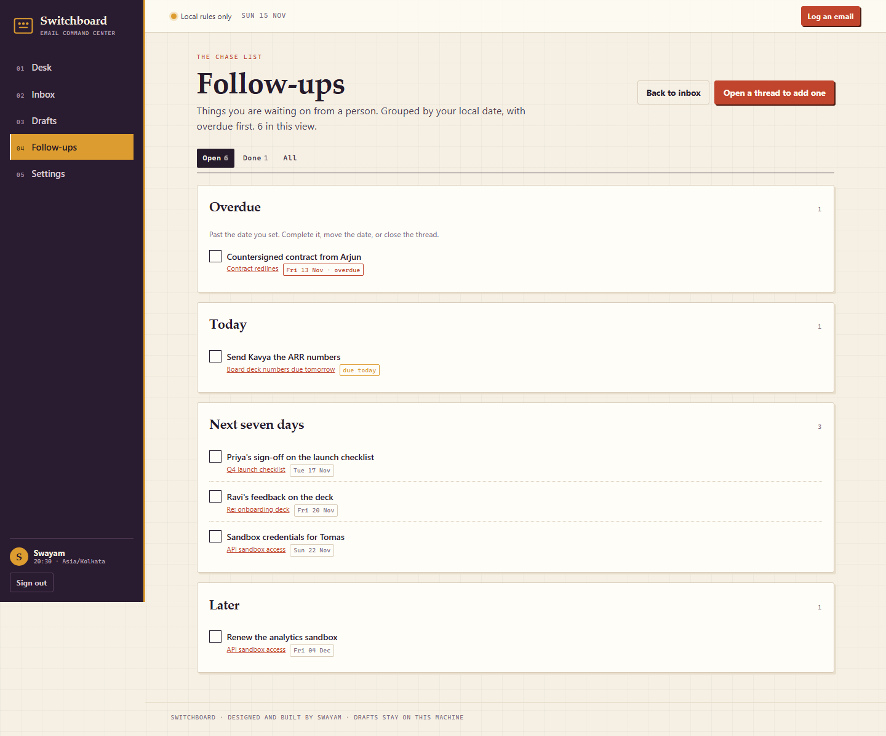 | 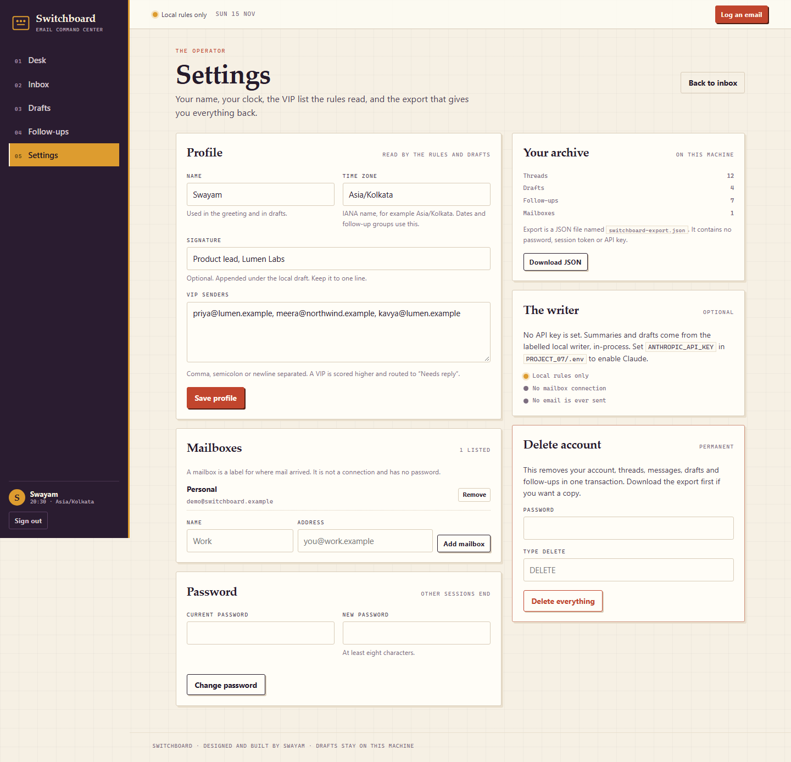 |

<table>
  <tr>
    <td>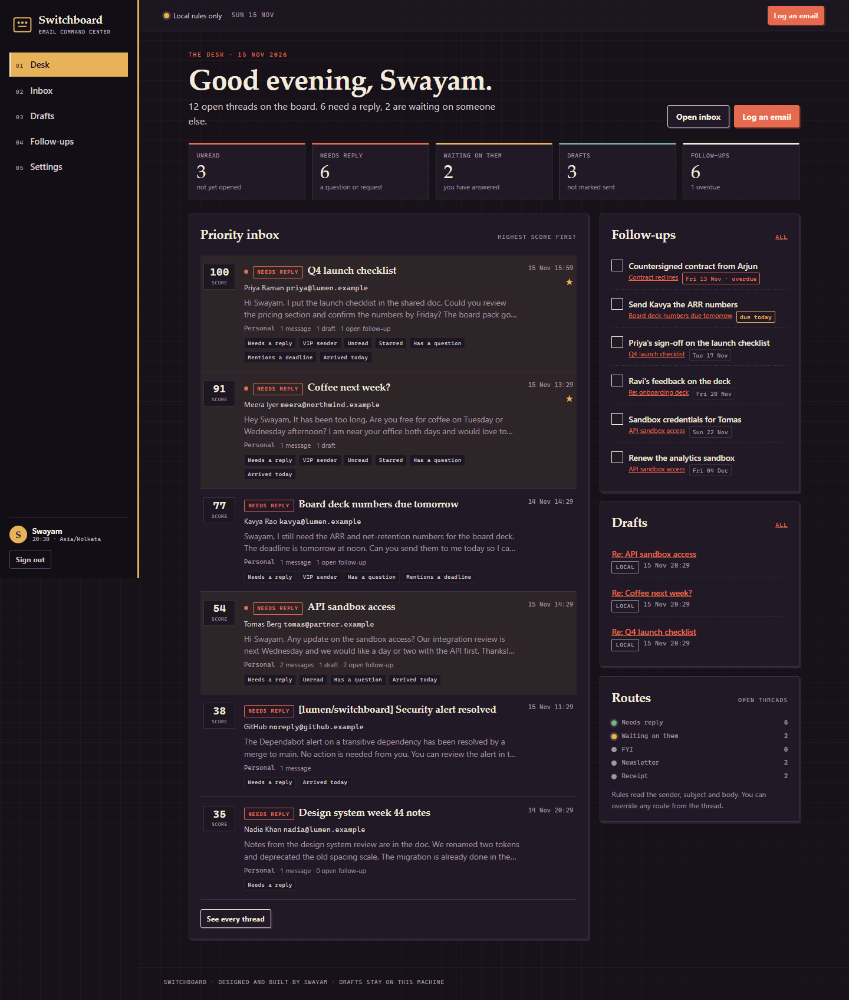</td>
    <td>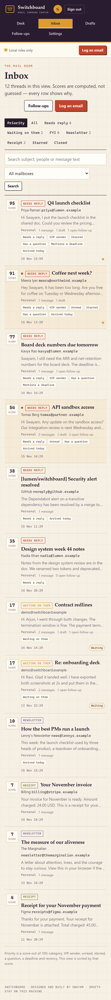</td>
    <td>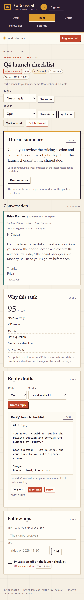</td>
  </tr>
</table>

All screenshots are genuine captures of this application running against the seeded demo database.

## 4. Technology stack

| Layer | Technology |
|---|---|
| Backend | Python 3.11+ (tested on 3.13), FastAPI 0.138, SQLAlchemy 2.0, Alembic, Uvicorn, Pydantic Settings |
| UI | Jinja2 templates, HTMX 2.0.11 (vendored, no CDN), hand-written CSS and a small `app.js`; server-rendered HTML |
| Database | SQLite (`data/switchboard.db`; `data/demo.db` for the preview) |
| AI | Direct `httpx` call to the Anthropic Messages API, `claude-opus-5-5` by default. Responses are parsed as strict JSON, clamped and validated; any failure falls back to the local writer with a visible note |
| Mail parsing | Python's `email` package for `.eml` headers, multipart bodies and `Message-ID`; a small header parser for pasted mail |
| Tests | pytest + FastAPI TestClient (201 tests) |

## 5. Architecture

```text
Browser ──forms / HTMX──▶ FastAPI (Jinja2)
                            ├── routes: auth · mail (dashboard, inbox, compose, thread,
                            │           drafts, follow-ups) · settings
                            ├── services: mail (parse, classify, score, summarise, draft)
                            │             ai (Claude JSON, validation, labelled fallback)
                            └── SQLAlchemy ──▶ SQLite        └──▶ Claude API (optional)
```

- **The rules are the baseline.** `classify()` reads the sender, subject and body for a small,
  testable set of signals. Newsletter and receipt wording win first; a question or request (or a VIP
  sender) routes to *Needs reply*; everything else is *FYI*. Each result carries the reasons that
  produced it.
- **The score is explainable.** `priority()` starts from the route and adds fixed, documented points
  for VIP, unread, starred, a question, a deadline and recency. The thread page lists every reason,
  and the inbox row shows the strongest one. Nothing is hidden inside a model.
- **Claude is optional and fenced.** Summaries must be 12–800 characters; drafts need a `Re:` subject
  and a body of at least 20 characters. A network error, non-200 response, malformed JSON or empty
  field stores the local result and records an honest note. The label always says which writer ran.
- **Ownership is enforced in the query.** Every thread, draft and follow-up lookup filters by the
  signed-in `user_id`; another account's ids return `404`, not a hidden page.
- **A manual route stays manual.** When you set a category yourself, `category_source="you"` and new
  inbound mail no longer overwrites it. The one exception is the ball-in-your-court rule after a
  reply.
- **Time** is stored in UTC and converted with the user's IANA timezone before deciding "today" and
  grouping follow-ups. Follow-up dates are calendar dates, not instants.
- **No mail transport.** The `.eml` upload is read as bytes, parsed and discarded; the text becomes a
  message row. Nothing is written back to a mail server.

Details, table definitions and route contracts: [ARCHITECTURE.md](docs/ARCHITECTURE.md).

## 6. Folder structure

```text
PROJECT_07/
├── README.md
├── .env.example
├── backend/
│   ├── alembic.ini
│   ├── pytest.ini
│   ├── requirements.txt
│   ├── requirements-dev.txt
│   ├── alembic/
│   │   └── versions/0001_initial_schema.py
│   ├── app/
│   │   ├── main.py            # app factory, middleware, error pages, /health
│   │   ├── config.py          # Pydantic settings
│   │   ├── db.py              # engine, Base, UTCDateTime
│   │   ├── models.py          # User, Session, Mailbox, Thread, Message, Draft, FollowUp
│   │   ├── security.py        # password hashing, tokens, rate limiter
│   │   ├── timeutil.py        # timezone-aware today, natural-language dates, people
│   │   ├── web.py             # context, auth dependencies, CSRF, rendering
│   │   ├── routes/            # auth, mail, settings
│   │   ├── services/          # mail, ai
│   │   ├── templates/         # 13 Jinja2 pages and partials
│   │   └── static/            # app.css, app.js, htmx.min.js, favicon
│   ├── scripts/
│   │   ├── seed_demo.py       # demo account + twelve threads of history
│   │   ├── preview.py         # one-command demo server on :8007
│   │   └── import_data.py     # import a Switchboard JSON export
│   └── tests/                 # 201 tests across 8 files
├── data/                      # SQLite databases (git-ignored)
└── docs/
    ├── PRD.md
    ├── ARCHITECTURE.md
    ├── YOUR_DATA.md
    └── screenshots/           # 12 genuine PNGs
```

## 7. Installation

```powershell
cd "C:\Users\Swayam Naik\TOP-50-CLAUDE-PROJECTS\PROJECT_07\backend"

# Use the shared programme environment (a junction to shared-resources/.venv)
# or create a normal one:
python -m venv .venv
.\.venv\Scripts\Activate.ps1

python -m pip install -r requirements-dev.txt
```

Requirements are pinned. Python 3.11 or newer is required (3.13 is what the tests run on).

## 8. Environment configuration

Copy `PROJECT_07/.env.example` to `PROJECT_07/.env`. Every value is optional:

| Variable | Default | Purpose |
|---|---|---|
| `DATABASE_URL` | `sqlite:///PROJECT_07/data/switchboard.db` | SQLAlchemy URL |
| `COOKIE_SECURE` | `false` | Set `true` when serving over HTTPS |
| `SESSION_DAYS` | `30` | Session lifetime in days |
| `ANTHROPIC_API_KEY` | empty | Enables Claude summaries and drafts; empty means the local writer |
| `ANTHROPIC_MODEL` | `claude-opus-5-5` | Model id used for writing |
| `AI_TIMEOUT_SECONDS` | `30` | Hard timeout for the model call |
| `RUN_MIGRATIONS` | `true` | Run Alembic on startup |
| `LOG_LEVEL` | `INFO` | Python logging level |

No key is required, and none is committed. `.env` is git-ignored.

## 9. Database setup

The app runs Alembic on startup. To do it manually:

```powershell
cd PROJECT_07\backend
.\.venv\Scripts\python.exe -m alembic upgrade head
```

Tables: `users`, `sessions`, `mailboxes`, `threads`, `messages`, `drafts`, `followups`.

For demo data, use the preview command (it creates a separate `data/demo.db`):

```powershell
.\.venv\Scripts\python.exe scripts\preview.py
# http://127.0.0.1:8007 — demo@switchboard.example / switchboard-demo
```

`scripts/seed_demo.py` wipes and recreates **only** the demo account. Its twelve threads are built by
running the real classifier, summariser, priority scorer and draft writer over realistic invented
mail, so the routes, scores and summaries on screen are computations rather than typed-in labels. It
never touches a real account in `switchboard.db`.

To import your own export (after creating your account in the app):

```powershell
.\.venv\Scripts\python.exe -m scripts.import_data --email you@example.com switchboard-export.json --dry-run
.\.venv\Scripts\python.exe -m scripts.import_data --email you@example.com switchboard-export.json
```

See [YOUR_DATA.md](docs/YOUR_DATA.md) for the JSON shape and privacy notes.

## 10. API and form endpoints

This is a server-rendered app, so most endpoints accept HTML forms and return `303` redirects.
There is no public JSON API (the interactive docs are intentionally disabled). `GET /health`
returns:

```json
{"status": "ok", "version": "1.0.0"}
```

| Method | Path | Purpose |
|---|---|---|
| GET | `/` | Dashboard |
| GET/POST | `/register`, `/login` | Account creation and sign-in |
| POST | `/logout` | End session |
| GET | `/inbox?view=priority\|all\|reply\|waiting\|fyi\|newsletter\|receipt\|starred\|closed&q=&mailbox=` | Inbox views, search and mailbox filter |
| GET/POST | `/compose` | Log a pasted email or upload a `.eml` |
| GET | `/threads/{id}` | Thread detail, summary, score and drafts |
| POST | `/threads/{id}/category` | Override the route (`category_source=you`) |
| POST | `/threads/{id}/status` | Open / waiting / closed |
| POST | `/threads/{id}/star` | Toggle star |
| POST | `/threads/{id}/unread` | Mark unread |
| POST | `/threads/{id}/delete` | Delete the thread and its children |
| POST | `/threads/{id}/summarize` | Re-run the writer (rate-limited) |
| POST | `/threads/{id}/draft` | Create a local or Claude draft |
| POST | `/drafts/{id}` | Edit a draft |
| POST | `/drafts/{id}/send` | Mark sent locally and move the thread to waiting |
| POST | `/drafts/{id}/delete` | Delete a draft |
| GET | `/drafts?status=draft\|sent\|all` | Draft list |
| GET | `/followups?status=open\|done\|all` | Grouped follow-up list |
| POST | `/threads/{id}/followups` | Add a follow-up |
| POST | `/followups/{id}/toggle` | Complete or reopen |
| POST | `/followups/{id}/update` | Edit title and date |
| POST | `/followups/{id}/delete` | Delete a follow-up |
| GET/POST | `/settings` | Profile, timezone, signature and VIP list |
| POST | `/settings/password` | Change password |
| POST | `/settings/mailboxes`, `/settings/mailboxes/{id}/delete` | Add or remove a mailbox label |
| GET | `/settings/export` | Download `switchboard-export-v1` JSON |
| POST | `/settings/delete` | Delete account (password + `DELETE`) |

All state-changing forms require a CSRF token. Cross-account ids return `404`. The `next` parameter
on follow-up actions only accepts same-site paths, so it cannot become an open redirect. Uploads are
capped at 2 MB and bodies at 60,000 characters.

## 11. How to run locally

```powershell
cd "C:\Users\Swayam Naik\TOP-50-CLAUDE-PROJECTS\PROJECT_07\backend"
.\.venv\Scripts\python.exe scripts\preview.py
```

Open <http://127.0.0.1:8007> and sign in with the demo account. For a real, empty database:

```powershell
.\.venv\Scripts\python.exe -m uvicorn --factory app.main:create_app --host 127.0.0.1 --port 8007
```

Register a new account on first run. There is no public deployment and no external service required.

## 12. Testing

```powershell
cd PROJECT_07\backend
.\.venv\Scripts\python.exe -m pytest
```

**201 tests pass** across eight files:

| File | Tests | Covers |
|---|---:|---|
| `test_auth.py` | 24 | Registration, validation, duplicate email, login/logout, session expiry, CSRF, login rate limit, security headers, account isolation |
| `test_ingest.py` | 22 | Paste and `.eml` intake, header parsing, duplicate `Message-ID`, threading by cleaned subject and mailbox, closed-thread split, validation, HTML escaping, ownership |
| `test_triage.py` | 46 | Subject cleanup, senders, VIP matching, every classification branch, priority reasons, local summaries, draft tones, `.eml` multipart parsing, date parsing |
| `test_threads.py` | 27 | Priority ordering, every inbox view, search across subject/body/participant, mailbox filter, route/status/star/unread changes, deletes, score panel, CSRF |
| `test_drafts.py` | 19 | Local scaffolds, all tones, Claude success and fallback, AI rate limit, editing, mark-sent semantics, duplicate send, cross-account access, drafts page |
| `test_followups.py` | 16 | Relative and ISO dates, grouping, complete/reopen, tabs, edit, delete, ownership, redirect safety |
| `test_settings.py` | 24 | Profile, timezone, signatures, VIPs, mailbox add/remove rules, password change ending other sessions, export shape and scoping, account deletion |
| `test_ai.py` | 23 | Summary and draft validation, request shape, code fences, no-key path, HTTP/network/invalid-JSON fallbacks, transcript bounds, honest labels |
| `conftest.py` | — | Isolated SQLite database per test, CSRF-aware browser helper, `compose()` and `.eml` builders |

The suite uses a temporary database and does not touch `data/switchboard.db` or the demo data. The
Claude tests patch `httpx.post`; no real API key or network call is involved.

## 13. Screenshots

Twelve screenshots in [`docs/screenshots/`](docs/screenshots) are captured from the live preview with
Playwright at 1440×980 (desktop) and 390×844 (mobile), in light and dark colour schemes. They show
the seeded demo desk, so the scores, route counts and follow-up groups are real computations.

## 14. Known limitations

- **No mailbox connection, by design.** Switchboard does not read IMAP, use OAuth or send SMTP. Mail
  must be pasted, uploaded as `.eml`, or imported from a Switchboard export. That is a deliberate
  privacy choice, not a missing feature.
- **Single-user scale.** SQLite and in-process rate limiters are right for a personal desk, not a
  multi-tenant service. Running multiple workers would need a shared limiter store.
- **The rules are heuristics.** Bulk-mail and receipt wording, question marks and a small deadline
  vocabulary cover common mail. Unusual prose may route to *FYI* rather than guess. Any route can be
  overridden, and the override is remembered.
- **AI is optional and unverified without a key.** The Claude path validates shape and length, and
  its tests use a fake transport. The programme has no API key, so only the local writer runs against
  a real model endpoint. The UI labels every result `Local` or `Claude`.
- **No calendar or reminder delivery.** A follow-up is visible in the list and on the dashboard; the
  app does not email, notify or write to a calendar.
- **One timezone per account.** Dates are calendar dates; changing the timezone changes what "today"
  means but does not rewrite stored arrival times.
- **Screenshots contain demo data only.** The demo name is "Swayam", but the mail, people and
  companies are invented samples, not the author's real inbox.
- **No public deployment.** The app is designed to run locally; `COOKIE_SECURE` exists for anyone who
  puts it behind HTTPS themselves.

## 15. Future improvements

- Optional `.mbox` and Maildir import, still read-only and still local.
- Saved searches and a "snooze until" date for threads.
- A weekly digest page built from the archive, with no email delivery.
- Bulk actions on a filtered inbox (route, close, star).
- Richer local summaries using sentence ranking rather than the first sentences.
- Server-side session cleanup and configurable rate-limit storage for multi-worker setups.
