# Project 08: Personal Knowledge Search ("Loom")

**Author:** Swayam · **Category:** 1. Personal Productivity & Life Management · **Status:** Completed (v1.0)

Loom is a quiet reading room for everything you have written down. Notes, articles, references and
snippets live in collections and carry tags; search shows the words it matched, the filters it
applied and the passage it found. Topic clusters recompute from the library itself, and **Ask** reads
the closest passages aloud as an extractive answer with citations. Nothing leaves the machine unless
you explicitly enable Claude.

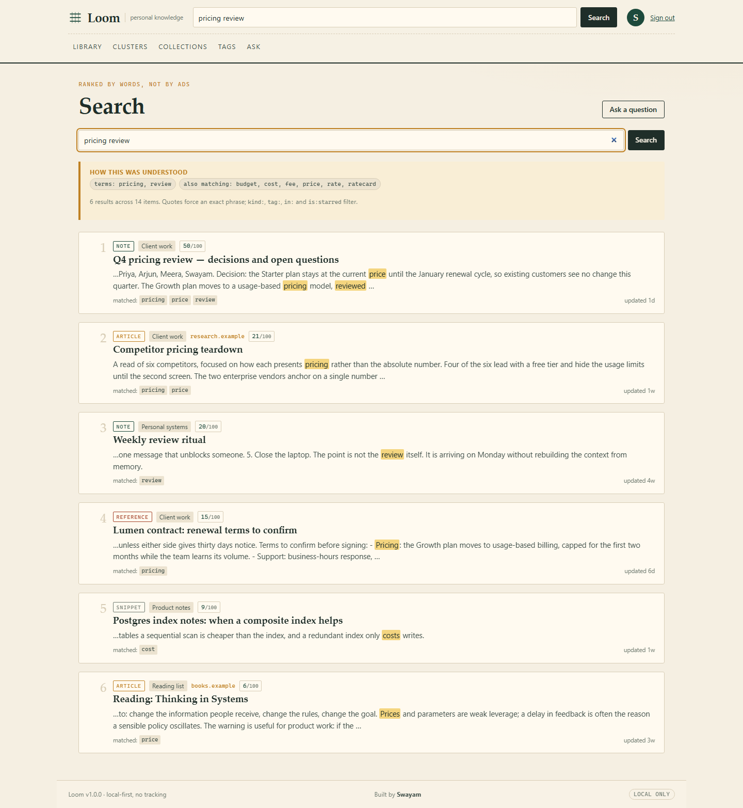

## 1. Overview

A self-hosted, server-rendered web app: FastAPI + Jinja2 + SQLite, with a little
[HTMX](https://htmx.org) for in-place actions. One process serves everything on port 8008. There is
no frontend build step, no crawler, and every core action works without JavaScript.

Loom is deliberately **not** a bookmarking service or a web clipper. It never fetches a URL. A saved
link is a title, an optional author, a source address and whatever summary *you* wrote; the page
itself stays where it is. Files arrive only by upload of `.md`, `.txt` or `.html` (512 KB maximum,
HTML reduced to text), so the library is made of text you chose to keep.

Search is **lexical and explainable**, not a black box. It drops filler words, lightly stems the
rest, expands a small fixed set of synonyms, honours quoted phrases and `kind:`/`tag:`/`in:`/
`is:starred` filters, then ranks with a BM25-style score that weights titles and tags above body
text. Every result shows the matched surface words — never an internal stem — a highlighted snippet
and a bounded score out of 100. Semantic *behaviour* comes from synonyms and query understanding you
can read on screen, not from an embedding service you cannot inspect.

**Ask** runs the same retrieval, reads up to eight items, quotes one sentence from each of up to
three, and links every citation. With an `ANTHROPIC_API_KEY`, Claude may rewrite the prose from those
same passages and is labelled **Claude** when it does. Without a key — the default here — the answer
is always the labelled **Local extract**. A timeout, a non-200 response or an invalid result falls
back to the local answer with an honest note.

## 2. Problem statement

Notes accumulate faster than they can be re-read. The tools that promise to fix this usually ask for
the opposite of trust: upload everything to a service, accept an opaque relevance score, and hope the
answer is right.

The four questions that actually matter are:

1. **Where is the thing I half-remember?** A title, a phrase, a tag, a collection — the search should
   accept whichever handle you still have.
2. **Why did this come back?** A ranked list with no explanation cannot be corrected. Loom shows the
   matched words, the filters, the phrase hits and the score.
3. **What is this library about?** Folders describe where a thing was filed, not what it is near.
   Clusters show subjects that emerge from titles and tags, and they move when the library moves.
4. **Can I ask a question without shipping my notes to a vendor?** Retrieval, answers and citations
   are local. Claude is an explicitly enabled, clearly labelled upgrade, never a requirement.

The full product thinking is in the [PRD](docs/PRD.md).

## 3. Features

| Area | What you can do |
|---|---|
| Dashboard | Item, collection, tag and word counts; the four strongest topic clusters; recent items; starred items; collection shelves; top tags; a one-field search box that is always in the masthead |
| Library | Every item as a card with kind, collection, tags, age and a snippet; filter by kind, tag, collection or starred; sort by recently updated, oldest or title; a plain-language summary of the current view |
| Item detail | Full body with preserved paragraphs, kind and origin labels, tags, author, source host and link, collection, star toggle, related items computed from shared rare terms, edit and delete |
| **Writing** | Title, body (100,000 character limit), four kinds (note, article, reference, snippet), up to ten tags, optional author and `http(s)` source link, optional collection; edit and delete; star from the detail page |
| **Upload** | `.md`, `.txt` or `.html` up to 512 KB; UTF-8 BOM tolerated; HTML is stripped to text with scripts and styles removed; the new item opens in the edit form for review |
| **Search** | BM25-style ranking with IDF, title/tag boosts, synonyms, quoted phrases, filters, highlighted snippets, per-result matched words, phrase count and score; an explicit "How this was understood" panel; ignored filters named rather than silently dropped |
| **Ask** | Natural-language question; retrieval, one quoted sentence per citation (up to three), citation links, closest passages, and an explanation of the pipeline; local extractive by default, Claude rewrite optional and labelled |
| **Clusters** | Up to six clusters built from shared tags first, then title terms; generic words excluded; clusters may overlap; dashboard shows the top four; each cluster lists its members newest first and explains that it is recomputed, not stored |
| Collections | Create, rename and delete shelves with a case-insensitive unique name; deleting a collection keeps its items; an "Not on a shelf" list for unfiled items |
| Tags | Tag inventory with counts, case-insensitive grouping and links into the filtered library |
| Settings | Name and IANA timezone; password change (signs out other sessions); counts; full `loom-export-v1` JSON download; account deletion with password and typed confirmation; AI status explained |
| Auth | Register, sign in, sign out; `scrypt` password hashing; server-side sessions in an `HttpOnly`, `SameSite=Lax` cookie; CSRF on every state-changing form; login and AI rate limits |
| Import | `python -m scripts.import_data --email you@example.com loom-export.json [--dry-run]`; creates missing collections, clamps invalid values, and is idempotent by title plus the first 250 characters of body |
| UI | Warm cream paper, deep spruce ink, ochre and rust accents, serif display type and mono metadata; a masthead search that never disappears; dark variant from `prefers-color-scheme`; phone and tablet layouts; focus states, toasts, empty states and confirmation before destructive actions |

### What the screens look like

| | |
|---|---|
| 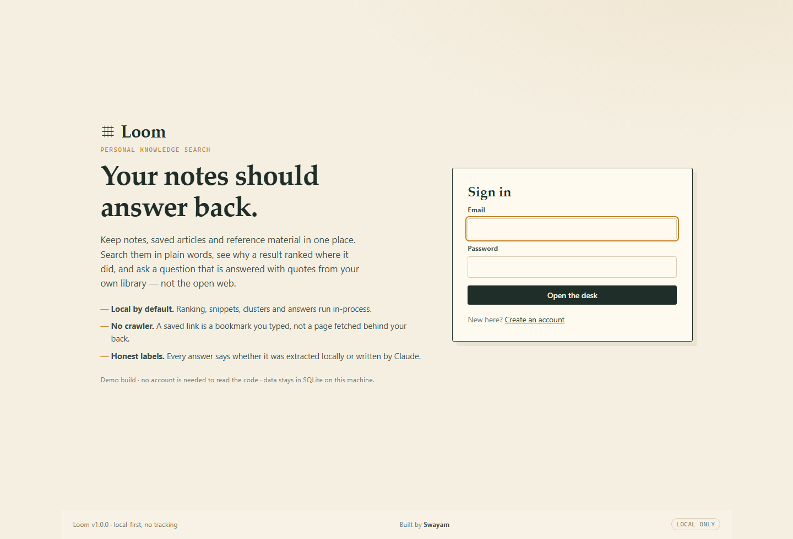 | 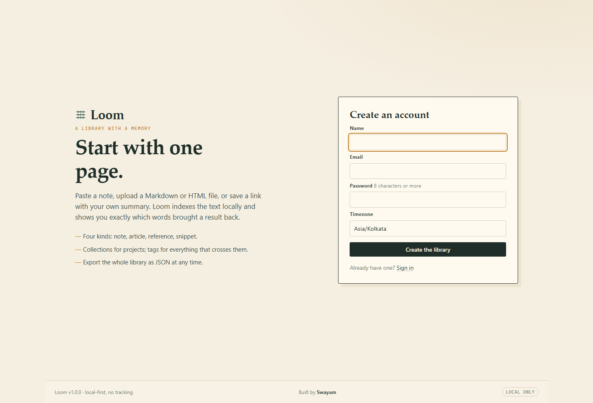 |
| 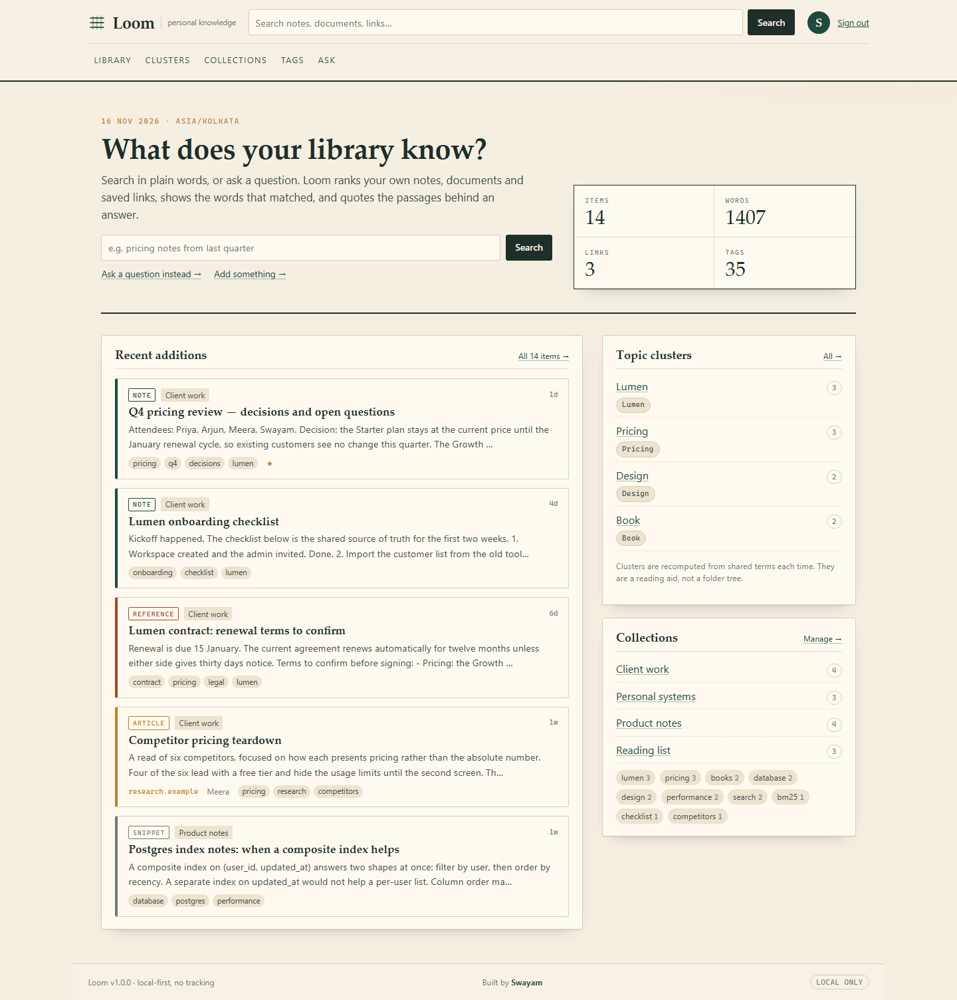 | 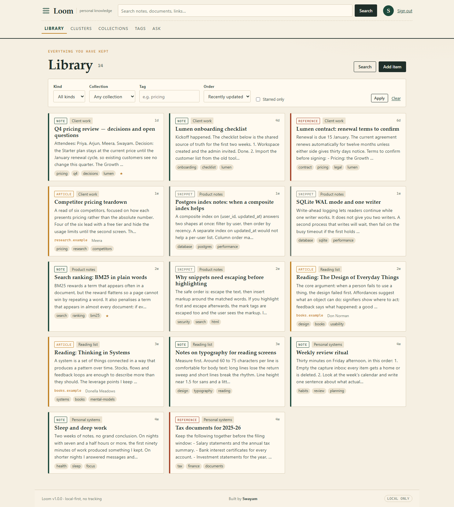 |
|  | 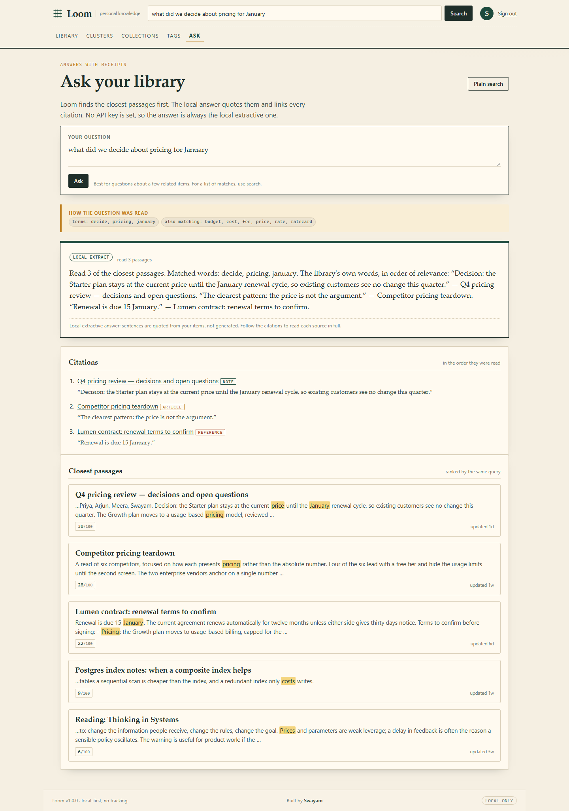 |
| 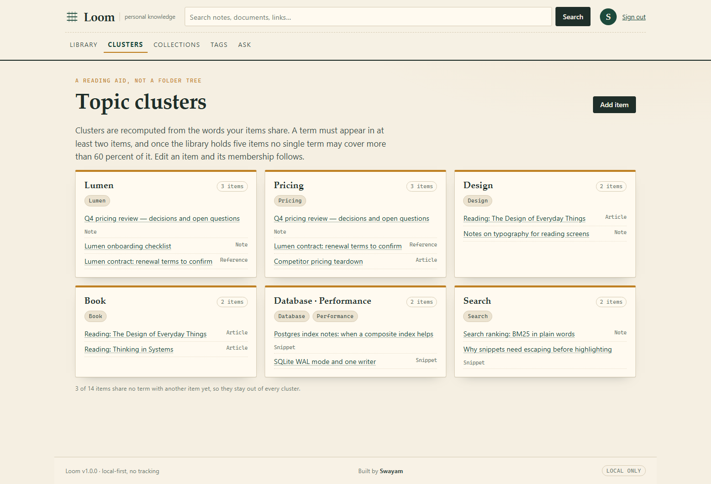 | 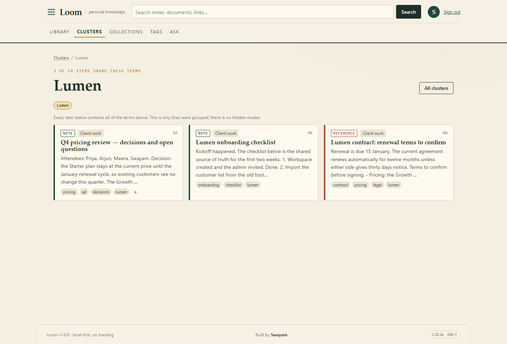 |
| 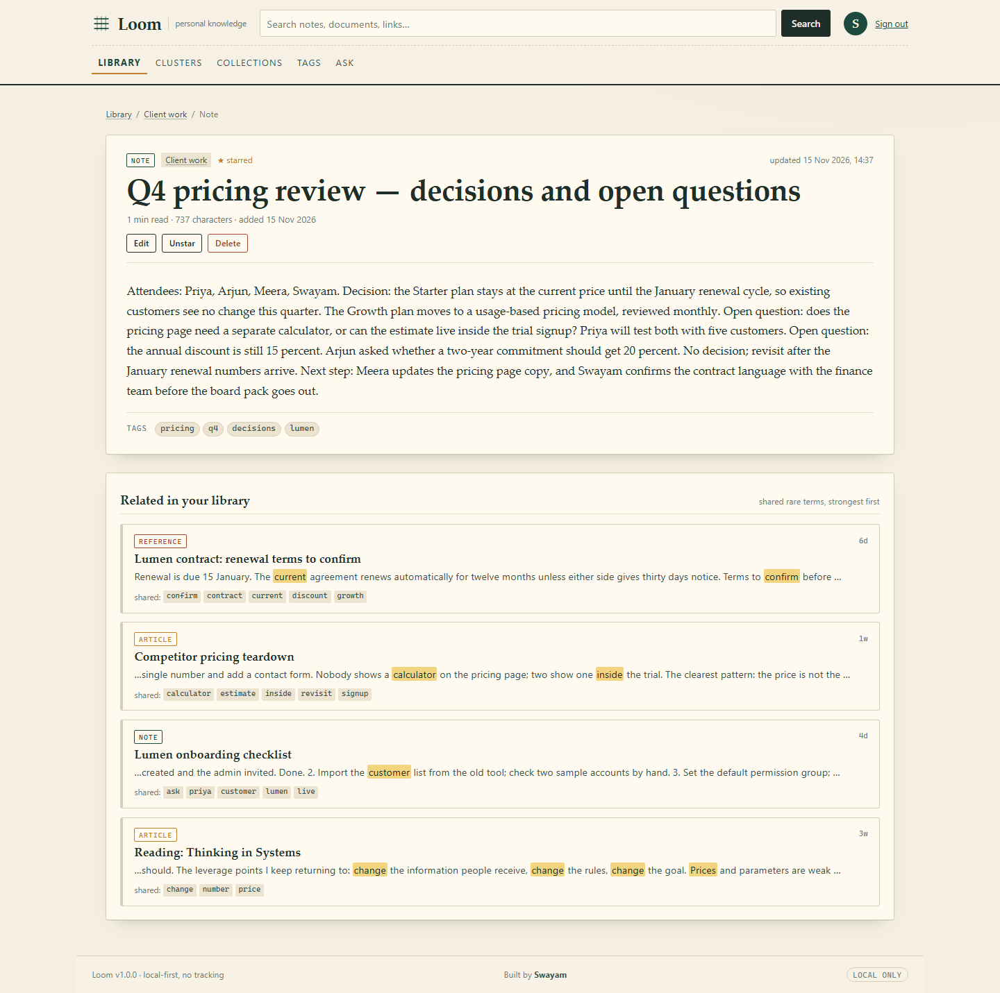 | 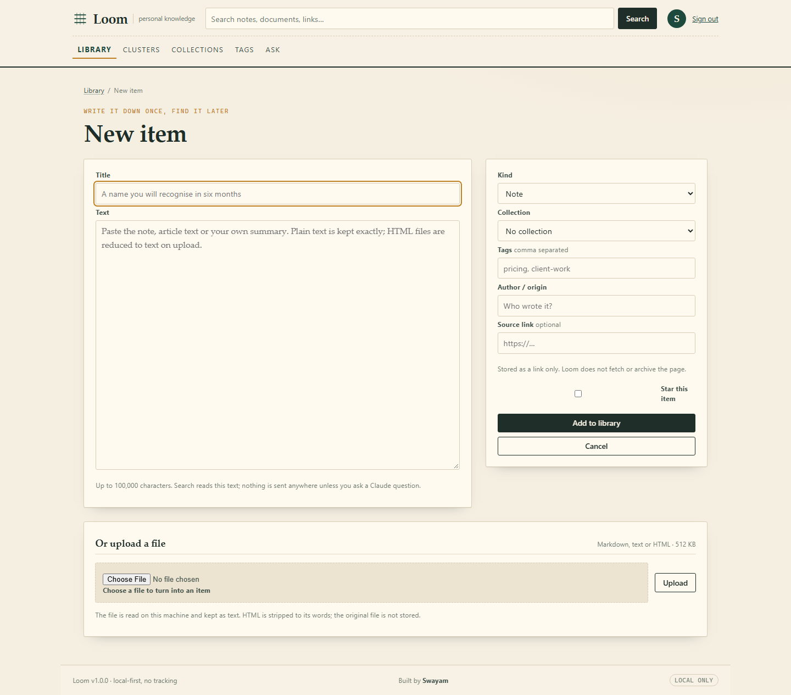 |

<table>
  <tr>
    <td>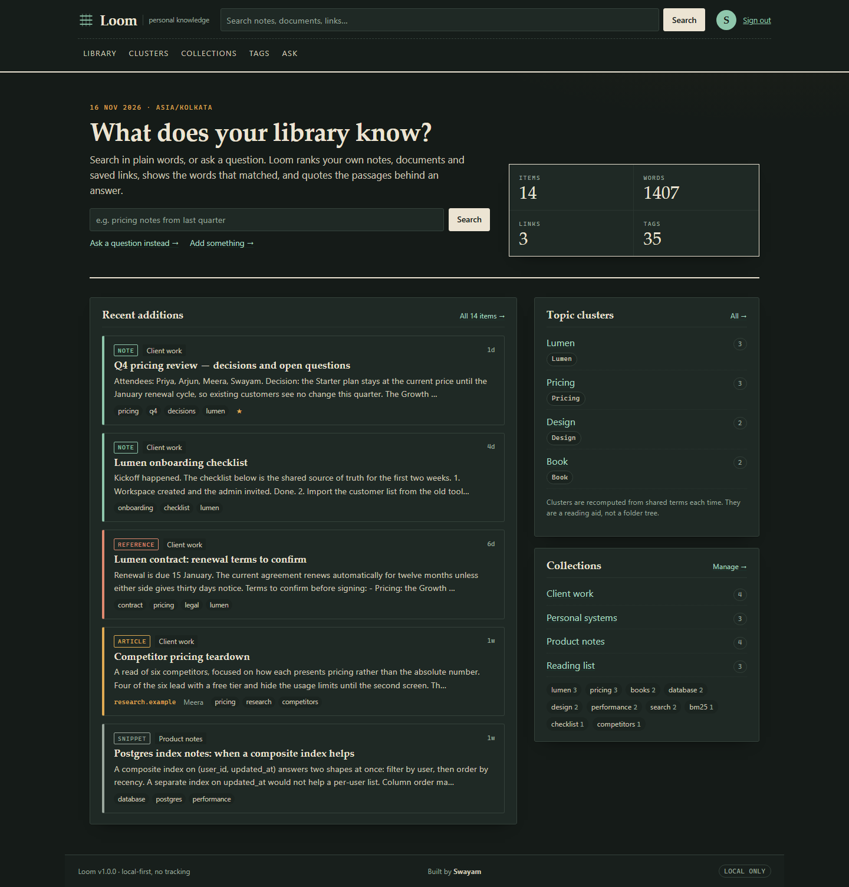</td>
    <td>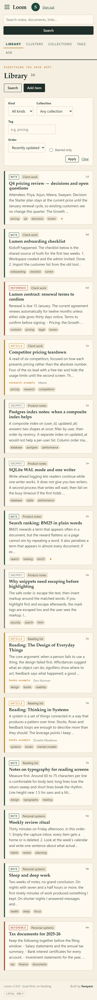</td>
  </tr>
</table>

All screenshots are genuine captures of this application running against the seeded demo database.

## 4. Technology stack

| Layer | Technology |
|---|---|
| Backend | Python 3.11+ (tested on 3.13), FastAPI 0.138, SQLAlchemy 2.0, Alembic, Uvicorn, Pydantic Settings |
| UI | Jinja2 templates, HTMX 2.0.11 (vendored, no CDN), hand-written CSS and a small `app.js`; server-rendered HTML |
| Database | SQLite (`data/loom.db`; `data/demo.db` for the preview) |
| Search | In-process lexical engine: Unicode normalisation, stopwords, a small suffix stemmer, symmetric synonyms, phrase counting, BM25-style IDF with field boosts, snippet highlighting |
| Clusters | In-process term grouping over tags and titles; no model, no stored taxonomy |
| AI | Direct `httpx` call to the Anthropic Messages API, `claude-opus-5-5` by default. Strict JSON, length-clamped, any failure falls back to the local answer with a visible note |
| Tests | pytest + FastAPI TestClient (181 tests) |

## 5. Architecture

```text
Browser ──forms / HTMX──▶ FastAPI (Jinja2)
                            ├── routes: auth · library (dashboard, library, search, ask,
                            │           clusters, collections, tags, items, upload) · settings
                            ├── services: search (parse, rank, snippet, related)
                            │             clusters · ask (extract, cite)
                            │             ai (Claude JSON, validation, labelled fallback)
                            └── SQLAlchemy ──▶ SQLite        └──▶ Claude API (optional)
```

- **Retrieval is the product.** `parse_query()` turns the raw box into terms, expansions, phrases and
  filters, and keeps the surface form of every term so the UI can say "pricing", never "pric".
  Unknown filters are collected in `ignored` and shown. `search()` scores with IDF, field weights
  (title 3×, tags 2×, body 1×), a phrase bonus and an all-terms bonus; the percent is a bounded
  presentation of that score, not a probability.
- **Clusters are recomputed, never stored.** Candidates come from tags first, then title terms.
  Function words and filler (`first`, `note`, `keep`, `return`, …) are excluded by a documented
  blacklist; a term shared by almost every item is not a subject. Clusters may overlap because they
  are lenses, not a partition, and identical member sets are not repeated.
- **Ask quotes before it writes.** The local answer picks one sentence per item by term overlap,
  clamps it, and cites the item. Claude receives only the question and up to four trimmed passages,
  after the local answer already exists; its JSON is length-checked (20–1600 characters) and any
  failure returns the local answer with `FALLBACK_NOTE`.
- **Ownership is enforced in the query.** Every item, collection, cluster member and export lookup is
  filtered by the signed-in `user_id`; another account's ids return `404`, not a hidden page.
- **Uploads are text, not archives.** The extension decides the parser; size is checked before
  decoding; HTML is reduced with `HTMLParser` to text, dropping `script` and `style`. No URL is
  fetched, ever.
- **Time** is stored as aware UTC through a `UTCDateTime` type and rendered relative to now. Item
  timestamps are user-editable only through import, so the demo's ages stay believable.

Details, table definitions and route contracts: [ARCHITECTURE.md](docs/ARCHITECTURE.md).

## 6. Folder structure

```text
PROJECT_08/
├── README.md
├── .env.example
├── backend/
│   ├── alembic.ini
│   ├── pytest.ini
│   ├── requirements.txt
│   ├── requirements-dev.txt
│   ├── alembic/
│   │   └── versions/0001_initial_schema.py
│   ├── app/
│   │   ├── main.py            # app factory, middleware, error pages, /health
│   │   ├── config.py          # Pydantic settings
│   │   ├── db.py              # engine, Base, UTCDateTime
│   │   ├── models.py          # User, Session, Collection, Item
│   │   ├── security.py        # password hashing, tokens, rate limiter
│   │   ├── timeutil.py        # timezone validation and relative time
│   │   ├── web.py             # context, auth dependencies, CSRF, rendering
│   │   ├── routes/            # auth, library, settings
│   │   ├── services/          # search, clusters, ask, ai
│   │   ├── templates/         # 15 Jinja2 pages and partials
│   │   └── static/            # app.css, app.js, htmx.min.js, favicon
│   ├── scripts/
│   │   ├── seed_demo.py       # demo account + fourteen items, four collections
│   │   ├── preview.py         # one-command demo server on :8008
│   │   └── import_data.py     # import a Loom JSON export
│   └── tests/                 # 181 tests across 8 files
├── data/                      # SQLite databases (git-ignored)
└── docs/
    ├── PRD.md
    ├── ARCHITECTURE.md
    ├── YOUR_DATA.md
    └── screenshots/           # 12 genuine PNGs
```

## 7. Installation

```powershell
cd "C:\Users\Swayam Naik\TOP-50-CLAUDE-PROJECTS\PROJECT_08\backend"

# Use the shared programme environment (a junction to shared-resources/.venv)
# or create a normal one:
python -m venv .venv
.\.venv\Scripts\Activate.ps1

python -m pip install -r requirements-dev.txt
```

Requirements are pinned. Python 3.11 or newer is required (3.13 is what the tests run on).

## 8. Environment configuration

Copy `PROJECT_08/.env.example` to `PROJECT_08/.env`. Every value is optional:

| Variable | Default | Purpose |
|---|---|---|
| `DATABASE_URL` | `sqlite:///PROJECT_08/data/loom.db` | SQLAlchemy URL |
| `COOKIE_SECURE` | `false` | Set `true` when serving over HTTPS |
| `SESSION_DAYS` | `30` | Session lifetime in days |
| `ANTHROPIC_API_KEY` | empty | Enables the Claude answer rewrite; empty means the local answer only |
| `ANTHROPIC_MODEL` | `claude-opus-5-5` | Model id used for the rewrite |
| `AI_TIMEOUT_SECONDS` | `30` | Hard timeout for the model call |
| `RUN_MIGRATIONS` | `true` | Run Alembic on startup |
| `LOG_LEVEL` | `INFO` | Python logging level |

No key is required, and none is committed. `.env` is git-ignored.

## 9. Database setup

The app runs Alembic on startup. To do it manually:

```powershell
cd PROJECT_08\backend
.\.venv\Scripts\python.exe -m alembic upgrade head
```

Tables: `users`, `sessions`, `collections`, `items`.

For demo data, use the preview command (it creates and seeds `data/demo.db`):

```powershell
.\.venv\Scripts\python.exe scripts\preview.py
# http://127.0.0.1:8008 — demo@loom.example / loom-demo
```

`scripts/seed_demo.py` recreates **only** the demo account: fourteen items across four collections
(Client work, Research, Reading, Personal systems), including a starred pricing review, a contract
note, upload-flavoured references and a search-engineering memo. It never touches a real account in
`loom.db`.

To import your own export (after creating your account in the app):

```powershell
.\.venv\Scripts\python.exe -m scripts.import_data --email you@example.com loom-export.json --dry-run
.\.venv\Scripts\python.exe -m scripts.import_data --email you@example.com loom-export.json
```

See [YOUR_DATA.md](docs/YOUR_DATA.md) for the JSON shape and privacy notes.

## 10. API and form endpoints

This is a server-rendered app, so most endpoints accept HTML forms and return `303` redirects.
There is no public JSON API (the interactive docs are intentionally disabled). `GET /health`
returns:

```json
{"status": "ok", "version": "1.0.0"}
```

| Method | Path | Purpose |
|---|---|---|
| GET | `/` | Dashboard |
| GET/POST | `/register`, `/login` | Account creation and sign-in |
| POST | `/logout` | End session |
| GET | `/library?kind=&tag=&collection=&starred=&sort=recent\|oldest\|title` | Filtered and sorted library |
| GET | `/search?q=` | Ranked search with query understanding, filters and snippets |
| GET/POST | `/ask` | Ask page and question submission (POST, CSRF) |
| GET | `/clusters` | Topic clusters computed from the library |
| GET | `/clusters/{slug}` | Cluster members and explanation |
| GET/POST | `/collections` | List and create collections |
| POST | `/collections/{id}` | Rename a collection |
| POST | `/collections/{id}/delete` | Delete a collection, keeping its items |
| GET | `/tags` | Tag inventory with counts |
| GET/POST | `/items/new` | New item form and creation |
| GET | `/items/{id}` | Item detail with related items |
| GET/POST | `/items/{id}/edit` | Edit form and update |
| POST | `/items/{id}/star` | Toggle star; `next` accepts same-site paths only |
| POST | `/items/{id}/delete` | Delete an item |
| POST | `/items/upload` | Upload `.md`, `.txt` or `.html` (512 KB) |
| GET/POST | `/settings` | Profile and timezone |
| POST | `/settings/password` | Change password |
| GET | `/settings/export` | Download `loom-export-v1` JSON |
| POST | `/settings/delete` | Delete account (password + `DELETE`) |

All state-changing forms require a CSRF token. Cross-account ids return `404`. The `next` parameter
on the star action only accepts same-site paths, so it cannot become an open redirect. Uploads are
capped at 512 KB and bodies at 100,000 characters.

## 11. How to run locally

```powershell
cd "C:\Users\Swayam Naik\TOP-50-CLAUDE-PROJECTS\PROJECT_08\backend"
.\.venv\Scripts\python.exe scripts\preview.py
```

Open <http://127.0.0.1:8008> and sign in with the demo account. For a real, empty database:

```powershell
.\.venv\Scripts\python.exe -m uvicorn --factory app.main:create_app --host 127.0.0.1 --port 8008
```

Register a new account on first run. There is no public deployment and no external service required.

## 12. Testing

```powershell
cd PROJECT_08\backend
.\.venv\Scripts\python.exe -m pytest
```

**181 tests pass** across eight files:

| File | Tests | Covers |
|---|---:|---|
| `test_auth.py` | 32 | Registration, validation, duplicate email, login/logout, session isolation, CSRF, login rate limit, security headers, protected pages, error shell |
| `test_items.py` | 26 | Create, edit, delete, kinds, tag limits, source URL rules, star toggle and redirect safety, collection assignment and ownership, uploads (markdown, text, HTML stripping, size, type, BOM) |
| `test_search.py` | 45 | Stemming, tokenisation, curly quotes, synonyms, labels, tags, query parsing and filters, phrase search, ranking, matched display forms, snippets and escaping, related items, search and library pages |
| `test_clusters.py` | 16 | Slug safety, minimum size, tag precedence, title fallback, generic-word exclusion, frequency ceiling, overlap, member order, limits, joined names, pages and 404 |
| `test_ask.py` | 16 | Pipeline explanation, empty and unmatched questions, local answers, sentence choice, display subjects, filters, CSRF, isolation, citation cap, passage trimming |
| `test_collections_tags.py` | 16 | Create, rename, duplicate rules, clamping, delete-keeps-items, unfiled list, dashboard, tag counts, case-insensitive filters, filter summaries |
| `test_settings.py` | 13 | Counts, profile, timezone validation, password change ending other sessions, export shape and scoping, account deletion, AI switch copy |
| `test_ai.py` | 17 | No-key path, no-citation path, request shape, fenced JSON, invalid payloads, HTTP and network failures, length cleaning, route labels, rate limit, passage cap |
| `conftest.py` | — | Isolated migrated SQLite database per test, CSRF-aware browser helper, `add_item()` and `add_collection()` |

The suite uses a temporary database and does not touch `data/loom.db` or the demo data. The Claude
tests patch `httpx.post`; no real API key or network call is involved.

## 13. Screenshots

Twelve screenshots in [`docs/screenshots/`](docs/screenshots) are captured from the live preview with
Playwright at 1440×980 (desktop) and 390×844 (mobile), in light and dark colour schemes. They show
the seeded demo library, so the search scores, cluster members and citations are real computations.

## 14. Known limitations

- **Lexical, not vector search.** There are no embeddings and no vector database. "Semantic" reach
  comes from a small, documented synonym table, stemming and phrase handling; the UI shows exactly
  what was understood. A word the synonym table does not know will not be found by meaning alone.
- **No crawler and no page fetching, by design.** A saved link is metadata plus your summary. Loom
  never requests the URL, so there is no title extraction, no favicon fetch and no reader mode. That
  is a privacy choice, not a missing feature.
- **Uploads are plain text.** `.md`, `.txt` and `.html` only, 512 KB each. PDF, DOCX and images are
  not parsed; HTML is stripped to text rather than rendered.
- **Single-user scale.** SQLite and in-process rate limiters are right for a personal library, not a
  multi-tenant service. Running multiple workers would need a shared limiter store.
- **Clusters are a reading aid.** They are recomputed on every request, may overlap, and depend on
  titles and tags. A library with no shared tags or title words will show few or no clusters.
- **Ask is extractive by default.** It quotes one sentence per item and cannot merge facts across
  items into new prose. The Claude upgrade can rewrite the prose, but it is optional.
- **AI is unverified without a key.** The Claude path validates shape and length, and its tests use
  a fake transport. The programme has no API key, so only the local answer runs against a real
  deployment. The UI labels every answer **Local extract** or **Claude**.
- **Screenshots contain demo data only.** The demo name is "Swayam", but the notes, clients and books
  are invented samples, not the author's real library.
- **No public deployment.** The app is designed to run locally; `COOKIE_SECURE` exists for anyone who
  puts it behind HTTPS themselves.

## 15. Future improvements

- Optional local embeddings (for example a small ONNX model) with the same visible query
  understanding, so meaning-based recall can be compared against the lexical baseline.
- Saved searches and a "read later" flag distinct from starred.
- A reader view for uploaded markdown with a table of contents.
- Bulk tagging and moving items between collections from the library.
- A weekly "what changed in this library" digest computed locally.
- Server-side session cleanup and configurable rate-limit storage for multi-worker setups.
