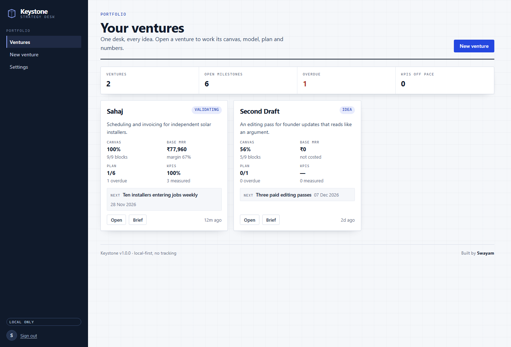

# Project 09: Business Strategy Planner ("Keystone")

**Author:** Swayam · **Category:** 2. Business, Strategy & Operations · **Status:** Completed (v1.0)

Keystone is a strategy desk for a founder's own ventures. Each venture gets a nine-block business
canvas, an impact-weighted SWOT ledger, a costed revenue model with three scenarios, a now / next /
later plan, and a KPI log that compares progress with elapsed time. Everything reads back as a
one-page strategy brief assembled **only** from what was entered, so a thin venture reads as thin
instead of confident. Claude can rewrite the prose when a key is configured; the local memo always
works without one.



## 1. Overview

A self-hosted, server-rendered web app: FastAPI + Jinja2 + SQLite, with a little
[HTMX](https://htmx.org) for in-place edits. One process serves everything on port 8009. There is no
frontend build step, no crawler, no analytics, and every core action works without JavaScript.

Keystone is deliberately **not** a pitch-deck generator or a market-data service. It never fetches a
market size, a competitor list or a currency rate. A number exists because you typed it, and every
derived figure — margin, break-even, scenario revenue, KPI pace, overdue days — is shown with the
inputs that produced it.

The design language is a working document rather than a dashboard: an ink-navy rail, blueprint-grid
paper, cobalt accents and monospaced uppercase labels. Under 900 px the rail becomes a wrapped top
bar, and the whole app follows `prefers-color-scheme` into a dark paper theme.

## 2. Problem statement

A business idea lives in too many places: a note for the customer, a spreadsheet for the money, a
task list for the plan, and a separate document for the "strategy". The usual fix is a template pack
that asks for twenty slides and rewards confident prose. It hides the two things that actually
matter:

1. **Which parts are still guesses.** A revenue line with no evidence should look different from one
   with three paying customers.
2. **Whether the plan is slipping.** A milestone list without dates, or a KPI chart with no expected
   pace, cannot tell you that this month is behind.

Keystone keeps the artefacts small and connected. The canvas, SWOT, model, plan and KPI log are
separate tables, but the brief and the portfolio read them together, so a gap in one becomes a
visible next move in another.

## 3. Features

### Ventures and portfolio

- Create, edit, archive and delete ventures. Names are unique per account, and the currency (INR,
  USD, EUR or GBP) belongs to the venture, so two ventures are never summed together.
- A portfolio page shows every live venture with canvas completeness, base MRR, plan progress and
  KPI health. Archived ventures are kept, listed separately and still exportable.
- A venture overview collects the next three moves: the empty canvas blocks, an uncosted model, an
  overdue milestone, a KPI that is behind, or an unsaved brief.

### Nine-block canvas

Problem, customer segments, value proposition, solution, channels, revenue, costs, metrics and
unfair advantage. Each block takes several notes with a title and an optional detail; completeness
counts a block once it has at least one note. Empty blocks render with a prompt that says what
belongs there.

### Impact-weighted SWOT

Strengths, weaknesses, opportunities and threats, each with an impact from 1 to 5 and optional
evidence. The ledger totals the impact in each quadrant, compares positive against negative, and
labels the balance **Leaning strong**, **Balanced** or **Leaning exposed** — a ±3 impact band. The
three highest-impact negative items are surfaced as the risks that matter now, regardless of
quadrant.

### Costed revenue model

- Revenue streams carry a pricing model (subscription, usage, one-off, retainer, marketplace or
  services), a whole-unit price, a unit label, a monthly volume and a confidence (low, medium or
  high).
- Base MRR is price × volume; weighted MRR applies the confidence weights. ARR is base × 12.
- Costs are fixed or variable and monthly. Margin, margin percent, blended price, break-even units
  and a revenue split by pricing model are all derived.
- Three scenarios scale **volume**, never price: Conservative ×0.7, Base ×1.0, Upside ×1.4, with a
  side-by-side table. Money is integer and whole-unit; mixed currencies are never summed.

### Now / next / later plan

Milestones carry a success criterion, an owner, an optional due date, a horizon (now, next, later)
and a status (planned, in progress, done, at risk). Overdue is **derived** on every read — not done
and past its date — so a plan cannot quietly go stale. Done milestones record when they were
completed; the header shows counts and progress per horizon.

### KPI plan with pace

Each KPI has a baseline, target, optional target date, direction (up or down) and cadence. Readings
are one per day, with a value and a note. Progress is clamped to 0–100 but the raw latest value is
always shown. Pace compares progress with the share of time elapsed since the KPI was created, with
a ±10-point tolerance:

| Status | Meaning |
|---|---|
| Reached | Progress has hit 100% |
| Ahead | At least 10 points ahead of the elapsed-time line |
| On track | Within ±10 points of it |
| Behind | At least 10 points behind it |
| Missed | The target date has passed without reaching the target |
| No readings | Nothing logged yet |

A two-point-or-more series gets an inline SVG sparkline. The KPI page lists what needs attention
first, and the portfolio shows the count that is behind.

### One-page strategy brief

Six sections — The opening, Where it plays, How it earns, What happens next, What would prove it,
What could break it — each written from stored fields. The memo is assembled locally, labelled
**Draft** until saved, then **Local**. With an Anthropic key, **Rewrite with Claude** asks for a
rewrite of the same facts; the result is validated (2–6 paragraphs, 240–3,600 characters, no
headings or code fences) and labelled **Claude**. Any failure keeps the local memo and says why.
The page prints cleanly.

### Account and data

- Email + password accounts with scrypt hashes, hashed session tokens, CSRF on every form, a login
  limiter and a CSP that allows only same-origin assets.
- Settings: name, timezone, password change (which ends every other session), live data counts and a
  permanent account deletion that needs the password **and** the word `DELETE`.
- `keystone-export-v1` JSON export, and an idempotent importer keyed by venture name, with
  `--dry-run`. The export contains no password hash, session, CSRF token or API key.

## 4. Technology stack

| Layer | Technology |
|---|---|
| Backend | Python 3.11+ (tested on 3.13), FastAPI 0.138, SQLAlchemy 2.0, Alembic, Uvicorn, Pydantic Settings |
| UI | Jinja2 templates, HTMX 2.0.11 (vendored, no CDN), hand-written CSS and a small `app.js`; server-rendered HTML |
| Database | SQLite (`data/keystone.db`; `data/demo.db` for the preview) |
| Money | Integer whole units per month; confidence weights 0.4 / 0.7 / 1.0; scenario factors 0.7 / 1.0 / 1.4 |
| KPIs | Baseline-to-target progress, elapsed-time pace with a ±10-point band, inline SVG sparklines |
| Brief | Deterministic local assembly; optional Claude rewrite through `httpx` with strict shape validation |
| Tests | pytest + FastAPI TestClient (332 tests) |

## 5. Architecture

```text
Browser ──forms / small HTMX──▶ FastAPI (Jinja2)
                                  ├── routes: auth · ventures (portfolio, overview, brief)
                                  │           canvas · swot · revenue · plan · kpis · settings
                                  ├── services: canvas (completeness, gaps)
                                  │             swot (weighted balance, top risks)
                                  │             finance (streams, costs, scenarios, break-even)
                                  │             milestones (horizons, derived overdue)
                                  │             kpis (progress, pace, sparkline)
                                  │             overview (one venture, summarised)
                                  │             brief (sections, memo, prompt)
                                  │             ai (optional Claude rewrite, validation)
                                  └── SQLAlchemy ──▶ SQLite        └──▶ Claude API (optional)
```

- **Derived, never stored.** Canvas completeness, the SWOT balance, margin, break-even, overdue
  milestones and KPI status are computed on every read. Only the inputs are in the database, so no
  cached total can disagree with its rows.
- **Money stays honest.** Prices, volumes and costs are integers in the venture's own currency. A
  blank model produces no financial claim; a blank cost sheet produces no margin percentage; mixed
  currencies are never added together.
- **The brief cannot invent.** `brief.sections()` reads the same snapshot the pages use and emits a
  sentence per fact, plus an explicit "No revenue streams are defined yet" when a section is empty.
  The Claude prompt carries those sections and the memo, and the validator rejects headings, fences,
  single-paragraph answers and anything outside 240–3,600 characters.
- **Ownership is in the query.** Every venture, child row, export and import lookup is filtered by the
  signed-in `user_id`; another account's id returns `404`, not a hidden page.
- **Sessions are hashed.** The browser holds a random token; the database stores only its SHA-256.
  Changing the password ends every other session by deleting its rows.
- **Time** is stored as aware UTC through a `UTCDateTime` type. Due dates are plain dates and KPI
  readings are one per day, compared against the user's timezone for "today".

Details, table definitions and route contracts: [ARCHITECTURE.md](docs/ARCHITECTURE.md).

## 6. Folder structure

```text
PROJECT_09/
├── README.md
├── .env.example
├── backend/
│   ├── alembic.ini
│   ├── pytest.ini
│   ├── requirements.txt
│   ├── requirements-dev.txt
│   ├── alembic/
│   │   └── versions/0001_initial_schema.py
│   ├── app/
│   │   ├── main.py            # app factory, middleware, error pages, /health
│   │   ├── config.py          # Pydantic settings
│   │   ├── db.py              # engine, Base, UTCDateTime
│   │   ├── models.py          # User, Session, Venture, CanvasEntry, SwotItem,
│   │   │                      # RevenueStream, CostLine, Milestone, Kpi, KpiReading
│   │   ├── forms.py           # form parsing and money formatting
│   │   ├── security.py        # scrypt, token hashes, sliding-window limiter
│   │   ├── timeutil.py        # timezone validation and local dates
│   │   ├── web.py             # context, auth dependencies, CSRF, rendering
│   │   ├── routes/            # auth, ventures, canvas, swot, revenue, plan, kpis, settings
│   │   ├── services/          # canvas, swot, finance, milestones, kpis, overview, brief, ai
│   │   ├── templates/         # 15 Jinja2 pages and partials
│   │   └── static/            # app.css, app.js, htmx.min.js, favicon
│   ├── scripts/
│   │   ├── seed_demo.py       # demo account, two ventures and a full desk
│   │   ├── preview.py         # one-command demo server on :8009
│   │   └── import_data.py     # import a Keystone JSON export
│   └── tests/                 # 332 tests across 10 files
├── data/                      # SQLite databases (git-ignored)
└── docs/
    ├── PRD.md
    ├── ARCHITECTURE.md
    ├── YOUR_DATA.md
    └── screenshots/           # 12 genuine PNGs
```

## 7. Installation

```powershell
cd "C:\Users\Swayam Naik\TOP-50-CLAUDE-PROJECTS\PROJECT_09\backend"

# Use the shared programme environment (a junction to shared-resources/.venv)
# or create a normal one:
python -m venv .venv
.\.venv\Scripts\Activate.ps1

python -m pip install -r requirements-dev.txt
```

Requirements are pinned. Python 3.11 or newer is required (3.13 is what the tests run on).

## 8. Environment configuration

Copy `PROJECT_09/.env.example` to `PROJECT_09/.env`. Every value is optional:

| Variable | Default | Purpose |
|---|---|---|
| `DATABASE_URL` | `sqlite:///PROJECT_09/data/keystone.db` | SQLAlchemy URL |
| `COOKIE_SECURE` | `false` | Set `true` when serving over HTTPS |
| `SESSION_DAYS` | `30` | Session lifetime in days |
| `ANTHROPIC_API_KEY` | empty | Enables **Rewrite with Claude**; empty keeps the local memo |
| `ANTHROPIC_MODEL` | `claude-opus-5-5` | Model id used for the rewrite |
| `AI_TIMEOUT_SECONDS` | `30` | Hard timeout for the model call |
| `RUN_MIGRATIONS` | `true` | Run Alembic on startup |
| `LOG_LEVEL` | `INFO` | Python logging level |

No key is required, and none is committed. `.env` is git-ignored.

## 9. Database setup

The app runs Alembic on startup. To do it manually:

```powershell
cd PROJECT_09\backend
.\.venv\Scripts\python.exe -m alembic upgrade head
```

Tables: `users`, `sessions`, `ventures`, `canvas_entries`, `swot_items`, `revenue_streams`,
`cost_lines`, `milestones`, `kpis`, `kpi_readings`.

For demo data, use the preview command (it creates and seeds `data/demo.db`):

```powershell
.\.venv\Scripts\python.exe scripts\preview.py
# http://127.0.0.1:8009 — demo@keystone.example / keystone-demo
```

`scripts/seed_demo.py` recreates **only** the demo account. It seeds two ventures on purpose:

- **Sahaj** — scheduling and invoicing for independent solar installers. A full desk: 14 canvas
  notes, 12 SWOT items, 7 milestones, 4 KPIs and 26 readings. Base MRR ₹77,960 (40 × ₹1,499 plus
  3 × ₹6,000), monthly cost ₹25,900, margin ₹52,060 (67%), ARR ₹935,520, confidence-weighted MRR
  ₹72,560 and a break-even of 15 units. Two KPIs are behind their pace, one is ahead, and one
  milestone is four days overdue.
- **Second Draft** — a thin idea-stage venture, so every empty state is reachable from the demo
  login.

It never touches a real account in `keystone.db`. Dates are relative to the seed run, so the pace
labels and overdue marker stay believable.

To import your own export (after creating your account in the app):

```powershell
.\.venv\Scripts\python.exe -m scripts.import_data --email you@example.com keystone-export.json --dry-run
.\.venv\Scripts\python.exe -m scripts.import_data --email you@example.com keystone-export.json
```

The importer is idempotent by venture name: a venture that already exists for that account is
skipped whole, so a second run duplicates nothing. Values outside the app's limits are clamped and
unknown enum values fall back to the model defaults. See [YOUR_DATA.md](docs/YOUR_DATA.md) for the
JSON shape and privacy notes.

## 10. API and form endpoints

This is a server-rendered app, so most endpoints accept HTML forms and return `303` redirects.
There is no public JSON API (the interactive docs are intentionally disabled). `GET /health`
returns:

```json
{"status": "ok", "version": "1.0.0"}
```

| Method | Path | Purpose |
|---|---|---|
| GET | `/` | Portfolio of live and archived ventures |
| GET/POST | `/register`, `/login` | Account creation and sign-in |
| POST | `/logout` | End session |
| GET/POST | `/ventures/new` | New venture form and creation |
| GET | `/ventures/{id}` | Venture overview and next moves |
| GET/POST | `/ventures/{id}/edit` | Edit form and update |
| POST | `/ventures/{id}/archive` | Archive or restore |
| POST | `/ventures/{id}/delete` | Delete venture (type the name to confirm) |
| GET | `/ventures/{id}/brief` | One-page brief and memo |
| POST | `/ventures/{id}/brief` | Save the local memo |
| POST | `/ventures/{id}/brief/ai` | Claude rewrite (key required) |
| POST | `/ventures/{id}/brief/reset` | Discard the saved memo |
| GET/POST | `/ventures/{id}/canvas` | Nine-block canvas and add a note |
| POST | `/canvas/{id}/edit`, `/canvas/{id}/delete` | Edit or delete a canvas note |
| GET/POST | `/ventures/{id}/swot` | SWOT ledger and add an item |
| POST | `/swot/{id}/edit`, `/swot/{id}/delete` | Edit or delete a SWOT item |
| GET | `/ventures/{id}/revenue?scenario=conservative\|base\|upside` | Revenue model and summary |
| POST | `/ventures/{id}/revenue/streams` | Add a revenue stream |
| POST | `/streams/{id}/edit`, `/streams/{id}/delete` | Edit or delete a stream |
| POST | `/ventures/{id}/revenue/costs` | Add a cost line |
| POST | `/costs/{id}/edit`, `/costs/{id}/delete` | Edit or delete a cost |
| GET/POST | `/ventures/{id}/plan` | Now / next / later plan and add a milestone |
| POST | `/milestones/{id}/edit`, `/milestones/{id}/status`, `/milestones/{id}/delete` | Edit, change status, delete |
| GET/POST | `/ventures/{id}/kpis` | KPI plan and add a KPI |
| POST | `/kpis/{id}/edit`, `/kpis/{id}/delete` | Edit or delete a KPI |
| POST | `/kpis/{id}/readings` | Log a reading (one per day) |
| POST | `/readings/{id}/delete` | Delete a reading |
| GET/POST | `/settings` | Profile, timezone and data counts |
| POST | `/settings/password` | Change password (ends other sessions) |
| GET | `/settings/export` | Download `keystone-export-v1` JSON |
| POST | `/settings/delete` | Delete account (password + `DELETE`) |

All state-changing forms require a CSRF token. Cross-account ids return `404`. Deleting a venture
requires typing its name exactly, and deleting an account requires both the password and the word
`DELETE`.

## 11. How to run locally

```powershell
cd "C:\Users\Swayam Naik\TOP-50-CLAUDE-PROJECTS\PROJECT_09\backend"
.\.venv\Scripts\python.exe scripts\preview.py
```

Open <http://127.0.0.1:8009> and sign in with the demo account. For a real, empty database:

```powershell
.\.venv\Scripts\python.exe -m uvicorn --factory app.main:create_app --host 127.0.0.1 --port 8009
```

Register a new account on first run. There is no public deployment and no external service required.

## 12. Testing

```powershell
cd PROJECT_09\backend
.\.venv\Scripts\python.exe -m pytest
```

**332 tests pass** across ten files:

| File | Tests | Covers |
|---|---:|---|
| `test_auth.py` | 41 | Registration, validation, duplicate email, login/logout, session isolation, CSRF, login rate limit, security headers, protected pages, error shell, unknown ids as 404 |
| `test_ventures.py` | 30 | Create, edit, duplicate names, stage and currency rules, archive and restore, name-confirmed delete, portfolio counts, ownership |
| `test_canvas.py` | 29 | All nine blocks, completeness and gaps, ordering, title and detail limits, edits, deletes, ownership |
| `test_swot.py` | 21 | Quadrant validation, impact clamping, weighted balance and tone band, top risks, grouping, edits, deletes |
| `test_finance.py` | 40 | Stream and cost validation, base and weighted MRR, ARR, margin, blended price, break-even, scenarios, model split, mixed currencies, pages and ownership |
| `test_plan.py` | 28 | Horizons, success criteria, due dates, derived overdue, status transitions and completed timestamps, progress counts, pages and ownership |
| `test_kpis.py` | 49 | Progress in both directions, elapsed-time pace, every status label, target-date miss, one-reading-per-day rule, sparkline geometry, attention order, pages and ownership |
| `test_brief.py` | 36 | Six sections, empty-state wording, facts from every entity, draft/saved labels, reset, AI gate, prompt contents, invalid prose, HTTP failure, HTMX partial, ownership |
| `test_settings.py` | 21 | Counts, profile and timezone validation, password change ending other sessions, export shape and scoping, no secrets, account deletion, CSRF |
| `test_importer.py` | 37 | Reader formats, clamping and safe parsing, full round trip, idempotent second run, dry run, unknown account, mixed currencies, account scoping |
| `conftest.py` | — | Isolated migrated SQLite database per test, CSRF-aware browser helper, `add_venture()` and child helpers |

The suite uses a temporary database and does not touch `data/keystone.db` or the demo data. The
Claude tests patch `httpx.post`; no real API key or network call is involved.

## 13. Screenshots

Twelve screenshots in [`docs/screenshots/`](docs/screenshots) are captured from the live preview with
Playwright at 1440×980 (desktop) and 390×844 (mobile), in light and dark colour schemes. They show
the seeded demo portfolio, so the margins, break-even, pace labels and overdue marker are real
computations.

| Screenshot | Shows |
|---|---|
| `01-login.png`, `02-register.png` | The ink-and-paper auth shell |
| `03-portfolio.png` | Every venture with canvas, MRR and KPI health |
| `04-venture-overview.png` | One venture, its next moves and snapshot |
| `05-canvas.png` | The nine blocks, filled and empty |
| `06-swot.png` | Impact-weighted ledger and top risks |
| `07-revenue.png` | Streams, costs, margin and the scenario table |
| `08-plan.png` | Now / next / later with a derived overdue item |
| `09-kpis.png` | Progress, pace, statuses and sparklines |
| `10-brief.png` | The one-page memo |
| `11-portfolio-dark.png` | The dark paper theme |
| `12-portfolio-mobile.png` | 390 px with no horizontal scroll |

## 14. Known limitations

- **No market data, no crawler, no benchmarks.** Keystone never fetches a market size, competitor,
  exchange rate or industry average. Every figure is either typed in or arithmetic over typed
  values. That is a privacy and honesty choice, not a missing integration.
- **One currency per venture.** Currencies are never converted and never summed across ventures.
  There is no exchange-rate table, so a multi-currency portfolio is compared side by side only.
- **Whole units only.** Prices and costs are integers in the venture's currency, monthly. There is no
  tax, no annual discounting, no churn model, no cohort logic and no cash-flow timing. Break-even is
  cost ÷ blended unit price, which is a planning sketch rather than a forecast.
- **Confidence weights are fixed.** Low 0.4, medium 0.7 and high 1.0 are constants, not user-editable
  probabilities. The weighted MRR is a sanity check, not an expected value.
- **Scenarios scale volume, not price.** Conservative / base / upside multiply monthly volume by
  0.7 / 1.0 / 1.4. They do not model price changes, mix shifts or new streams.
- **KPI pace is linear.** The expected line runs from the KPI's creation date to its target date.
  Seasonality, step targets and leading indicators are not modelled; a KPI with no target date falls
  back to a 50% midpoint rule, and the page says so.
- **The brief is template prose.** Each sentence is grounded, but the local memo is assembled from
  sentence fragments rather than written. It is meant to be edited, not sent as-is.
- **AI is unverified without a key.** The Claude path validates shape and length, and its tests use a
  fake transport. The programme has no API key, so only the local memo runs against a real
  deployment. Every memo is labelled **Draft**, **Local** or **Claude**.
- **Single-user scale.** SQLite and in-process rate limiters suit a personal planning desk. Multiple
  workers would need a shared limiter store.
- **Screenshots contain demo data only.** "Sahaj" and "Second Draft" are invented sample ventures,
  including every customer, price and KPI; they are not the author's real business.
- **No public deployment.** The app is designed to run locally; `COOKIE_SECURE` exists for anyone who
  puts it behind HTTPS themselves.

## 15. Future improvements

- An evidence field per revenue stream (named customers, signed letters) so confidence can be
  justified rather than chosen.
- A simple monthly snapshot of MRR and cost, so the portfolio can show a trend line instead of a
  single point.
- Scenario overrides per stream, not just a global volume factor.
- A printable PDF of the brief through the browser's print dialog, with a cover header.
- Optional CSV import for cost lines and KPI readings.
- A "decision log" per venture: what changed, when, and which number moved.
- Server-side session cleanup and configurable rate-limit storage for multi-worker setups.
